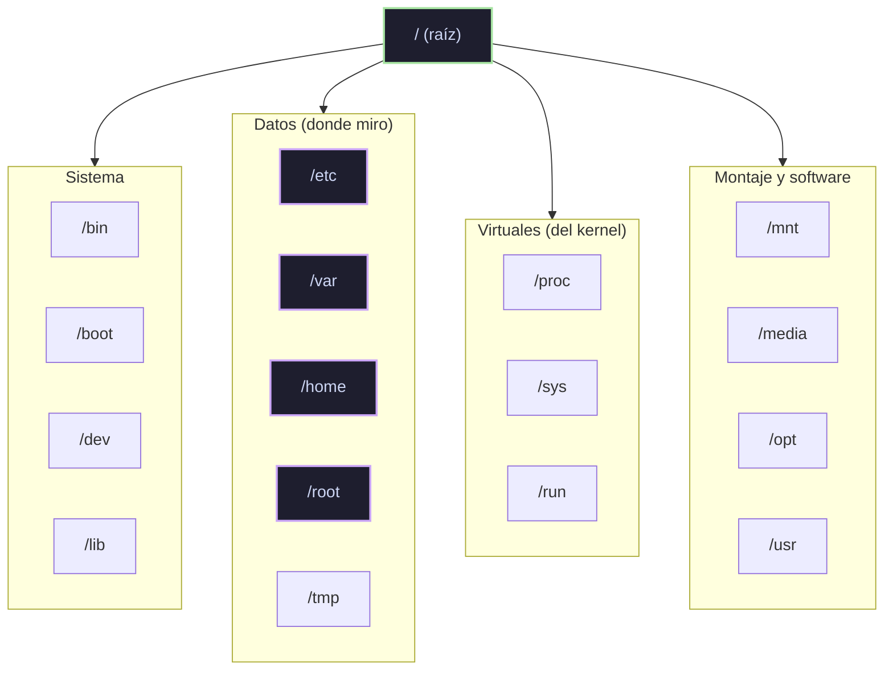

>[!NOTE]- Módulo en progreso (5/8 secciones de Workflow). Notas de lo completado.

## 1. Introducción

### Estructura de Linux

- Todo es un **árbol que nace en** **`**/**`** (raíz) — no hay unidades tipo C:\
- Estructura estándar (FHS): `/home` usuarios · `/etc` configuración · `/var` datos variables (logs, mail) · `/root` home del admin · `/bin`, `/sbin` binarios
- Ruta mental del descubrimiento: `find` por nombre → convenciones FHS → config en `/etc` → `man`

### Distribuciones

- Familias: **Debian/Ubuntu** (Kali, Parrot, Pwnbox) · **RHEL** (CentOS, Fedora) · **Arch**
- Todas comparten el kernel Linux; difieren en gestor de paquetes y filosofía

### El shell

- Shell = intérprete de comandos (bash es el estándar)
- Terminal ≠ shell ≠ consola: la terminal es la ventana, el shell es el programa que habla
- El prompt: `usuario@host:~$` — el `$` = usuario normal, `#` = **root** (¡ese símbolo es una alarma de cuidado!)

## 2. The Shell

### Prompt

- `usuario@maquina:ruta$` — leerlo antes de ejecutar algo me dice QUIÉN y DÓNDE soy

### Getting Help

- `man <comando>` — manual completo (q salir, / buscar dentro)
- `<comando> --help` — resumen rápido
- La ayuda está en el sistema: no necesito internet para aprender un comando

### System Information (lo que usé en mi sesión SSH)

|Comando|Me dio|
|---|---|
|`uname -r`|versión del kernel (4.15.0)|
|`id`|uid, gid, grupos|
|`whoami`|htb-student|
|`ps`|mis procesos (con TTY y PID)|

## 3. Workflow (6/8)

### Navegación

- `pwd`, `ls -la` (ocultos incluidos), `cd` (~ home · - anterior · .. subir)
- `ls -la` en `/home` me reveló otros usuarios: cry0l1t3, mrb3n → eso ES reconocimiento

### Archivos y directorios

- touch, mkdir, cp, mv, rm (sin papelera), `file` (el tipo real, no la extensión)

### Edición

- nano (Ctrl+O / Ctrl+X) · vim (i / Esc / :wq / :q!)
- En servidores remotos a menudo solo hay vim: saber los 4 comandos básicos = sobrevivir

### Búsqueda (find)

- `find / -name X 2>/dev/null` — el 2>/dev/null oculta "Permission denied" de carpetas ajenas
- `-type f|d`, `-size`, `-perm` (¡-4000 SUID = oro en escalada!), `-user`
- `which <comando>` — dónde está un binario

### Descriptores y redirección

- stdin=0, stdout=1, stderr=2
- `>` sobrescribe · `>>` agrega · `2>` errores · `2>&1` junta todo · `<` entrada · `|` pipe · `tee` (pantalla + archivo) · `/dev/null` (agujero negro)

### Filter Contents(completada 2026-10-25)
El pipeline de 4 verbos que me llevó toda una tarde entender:

|Verbo|Comando|Hace|
|---|---|---|
|extraer|`grep -o`|imprime SOLO el match, no la línea|
|excluir|`grep -v`|invierte: quita lo que coincide|
|regex extendida|`grep -E`|habilita `?`, `+`, `()` sin escapar|
|deduplicar|`sort -u`|ordena y quita repetidos|
|contar|`wc -l`|cuenta líneas|

**Patrones que aprendí destripando comandos:**

- `https?://` → la `s` es opcional (0 o 1 vez)
- `[^"[:space:]<>]+` → "cualquier cosa que NO sea comilla, espacio, `<` o `>`" — `[:space:]` es clase POSIX = todo whitespace
- `^...$` → anclas inicio y fin de línea (coincidencia exacta)
- `X?` → X opcional
- `\.` → punto literal (sin escape, `.` = cualquier carácter)
- `sed 's|viejo|nuevo|'` → reemplaza texto

**El patrón mental clave:** `extraer (grep -o) → transformar (sed) → deduplicar (sort -u) → contar (wc -l)`. Casi todo análisis de texto en HTB es esa cadena.

## Lo que viví en la sesión (no está en el módulo, pero importa)

- `/etc/passwd` legible por todos: `usuario:x:UID:GID:desc:home:SHELL`
- el `x` = la pass real vive en `/etc/shadow` (cifrada, solo root)
- cuentas de servicio con `/usr/sbin/nologin`: existen para servicios, nadie loguea con ellas
- El mail de un usuario vive en `/var/mail/<usuario>` (del sistema, no del home) — y el archivo solo existe si llegó correo
- `cat root` en /var/mail → ****Permission denied****: los spools de mail son privados (Unix protegiendo datos)
- Errores que me enseñaron: cat en directorio ("Is a directory"), pegar la contraseña en el comando ssh en vez del prompt, `exit` no existe en netcat

### Batallas de hoy (2026-10-25) — errores que fueron lecciones
- **El** **`**127.0.0.53**`** **fantasma:** al contar "servicios escuchando en todas las interfaces" excluí solo `127.0.0.1` — y el DNS stub de systemd-resolved (`127.0.0.53%lo:53`) se coló en mi cuenta. Lección: **filtrar por la definición** (loopback = `127.0.0.0/8` entero, `grep -v '127\.'`), no por el ejemplo que conocía.
- **`**ps**`** **vs** **`**ps aux**`** **:** busqué el usuario de ProFTPd con `ps -la` y solo veía mis procesos. Sin la `x` no ves daemons (no tienen TTY). `ps aux | grep X` = "¿quién corre X y como quién?" → respuesta: `proftpd`, su propio usuario dedicado (buena práctica de drop privileges).
- **Estres con el 34:** contar los paths únicos de inlanefreight.com me tomó 5 intentos (10 → 20 → 35 → 34). Lo que fallaba cada vez era la __definición del set__: ¿cuentan hrefs completos o paths? ¿la raíz `/` es un path? (el grader dijo que no). Lección: cuando un grader te rechaza, volcar la lista intermedia (`sort -u > /tmp/x.txt`) y auditarla línea por línea es más rápido que googlear.

## Pendiente

- Regular Expressions
- (sección 8 de Workflow)