# Skills Assessment — Introduction to Windows Command Line

## Objetivo
Enumerar y hacer reconocimiento en un host Windows, conectándonos al mismo objetivo con distintos usuarios. La IP del objetivo en esta instancia es `10.129.204.9`.

La clave del assessment es la **cadena de credenciales**: la flag obtenida con un usuario es la password del siguiente para conectarse por SSH (la flag de userN = password de userN+1). Todo el recorrido se documenta pregunta a pregunta.

Como primer paso nos conectamos por SSH:

```bash
ssh [usuario]@10.129.204.9
```

## Pregunta 1

Empezamos con el primer usuario:

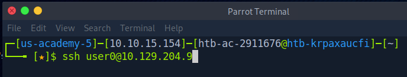

Al dar Enter observamos un banner dejado por el administrador del sistema que nos advierte que el sistema está protegido, lo que nos lleva a capturar la primera bandera y responder la primera pregunta:

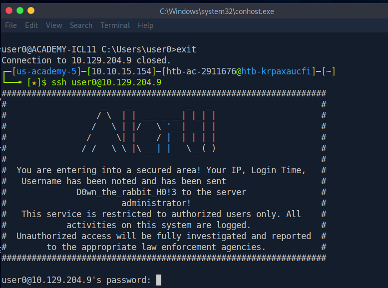

**Question 1 —** *The flag will print in the banner upon successful login on the host via SSH. (user "user0", password "Start!")*

**R:** `D0wn_the_rabbit_H0!3`

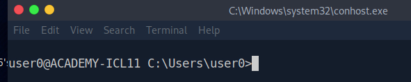

Este primer objetivo no requiere enumerar más allá del banner inicial, así que avanzamos con el siguiente usuario.

## Pregunta 2

Nuevamente accedemos por SSH (mismo objetivo, mismo banner, distinto usuario):

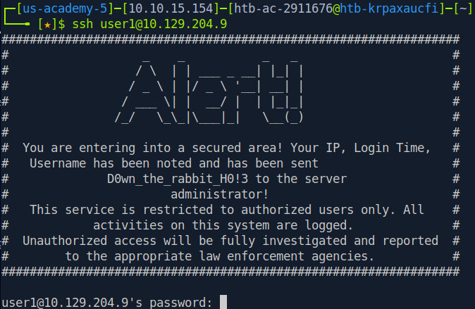
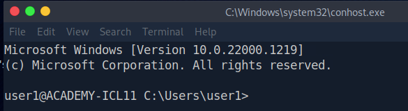

Ya adentro, probamos un par de comandos y notamos que es un sistema Windows donde caemos específicamente en `cmd.exe`: comandos como `ls` o `Get-ChildItem` no funcionan, pero `dir` sí. Buscamos la bandera donde indica la pregunta (el Desktop):

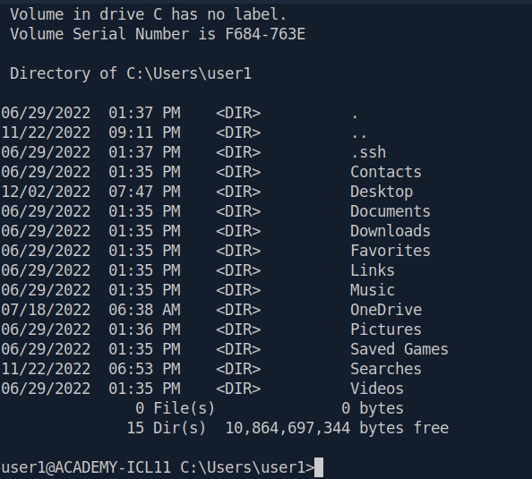

Ahí evidenciamos el `flag.txt`:

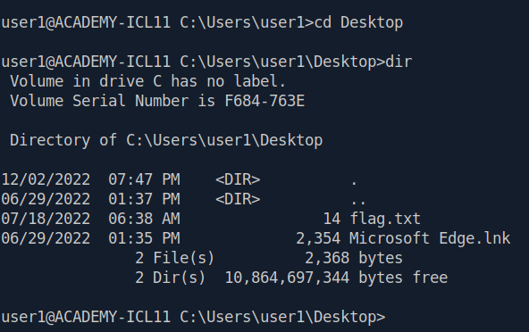

Leemos el contenido con `type`:

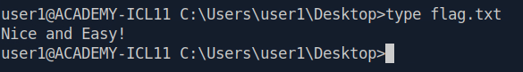

**Question 2 —** *Access the host as user1 and read the contents of the file "flag.txt" located in the users Desktop. (password: previous flag)*

**R:** `Nice and Easy!`

## Pregunta 3

La pregunta nos pide el nombre del host, así que ejecutamos `whoami`:

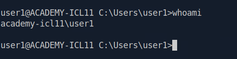

**Question 3 —** *If you search and find the name of this host, you will find the flag for user2.*

**R:** `academy-icl11`

## Pregunta 4

Nos piden ver qué archivos ocultos hay en el Desktop de `user3`. Antes, nos gustaría ver qué usuarios hay en el sistema:

```cmd
net user
```

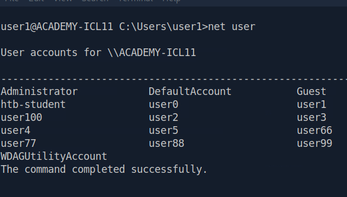

Vemos que en el sistema hay un total de 16 usuarios: 4 cuentas integradas por defecto de Windows (`Administrator`, `DefaultAccount`, `Guest` y `WDAGUtilityAccount`) y las cuentas personalizadas (`htb-student` y los usuarios numerados `user0`, `user1`, `user2`, `user3`, `user4`, `user5`, `user66`, `user77`, `user88`, `user99`, `user100`).

Para buscar los archivos ocultos en el Desktop de user3, retrocedemos un nivel (`cd ..`, de `C:\Users\user1` a `C:\Users\`) y usamos `tree` para ver el contenido más cómodo:

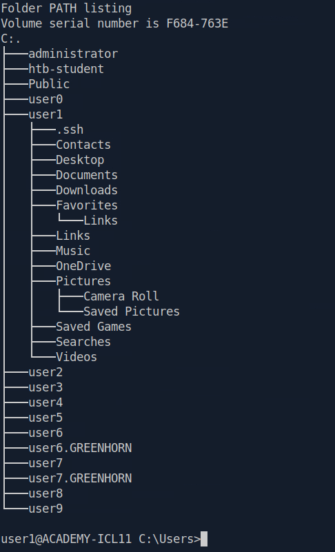

En `Users` no se visualizan todos los usuarios que vimos con `net user`, pero sí el que nos interesa. Intentamos acceder a su directorio con `cd` y obtenemos `Access is denied`:

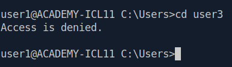

No contamos con los permisos, así que hay que buscar otra forma. Analizando las preguntas se ve un patrón (aun sin confirmar): la Q2 indicaba que la password de `user1` era "previous flag". Probamos entonces entrar a user3 con la flag que obtuvimos de user2:

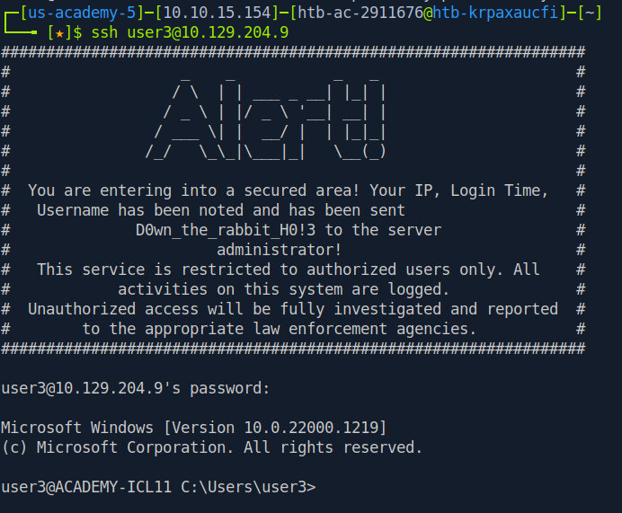

Se confirma el patrón. Ojo: en un intento anterior fallé por ingresar la password en minúscula tal como la había submitido en la pregunta — **las passwords SSH son case-sensitive**.

Ya como user3, buscamos en el Desktop con atributos:

```cmd
dir /a
```

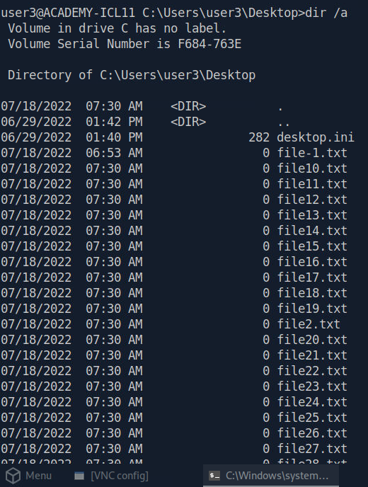

**Question 4 —** *How many hidden files exist on user3's Desktop?*

**R:** `101`

## Pregunta 5

Siguiendo el patrón, accedemos como user4:

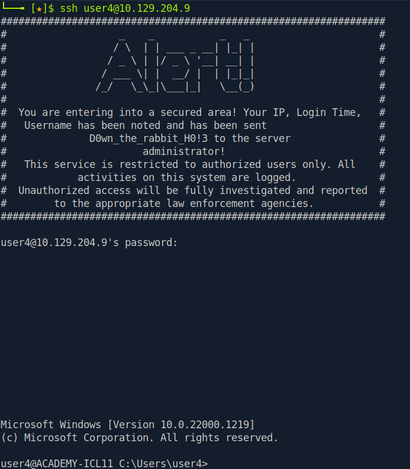

La respuesta está en Documents. Primera búsqueda:

```cmd
where flag.txt
```

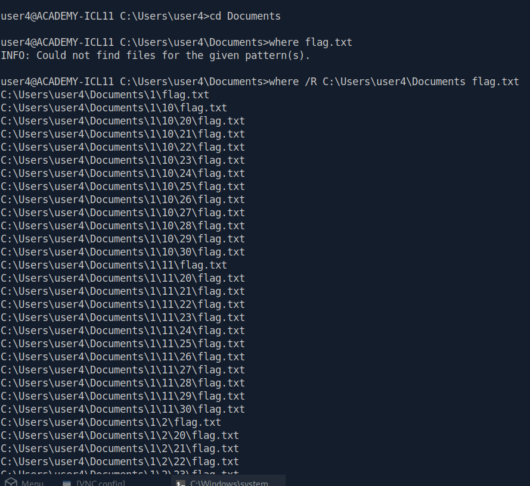

Sin resultados en el PATH, así que hacemos búsqueda recursiva — y ahora salen un montón de `flag.txt`. Difícil saber cuál es el real, así que abrimos uno a mano:

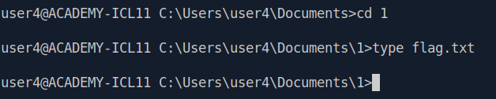

Vacío. Siguiendo la pregunta ("la bandera está en uno de ellos"), deducimos que muchos son señuelos vacíos (0 bytes), así que podemos filtrar por peso/contenido.

No estoy explícitamente limitado a CMD, así que uso todos mis recursos: paso a PowerShell desde CMD (me siento más cómodo con esa sintaxis y es más poderosa para el propósito).
*Pd: pude haberlo usado antes, pero no se me ocurrió en el momento  es importante saberse mover tanto en PS como en CMD, dado que no siempre se tiene acceso a PS.*

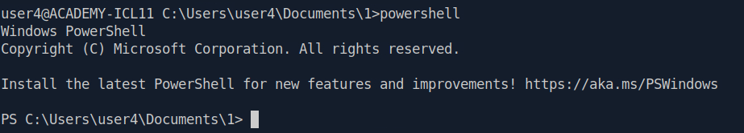

PowerShell no está deshabilitado en este sistema, lo que facilita la búsqueda de aquí en adelante. Retrocedemos una carpeta y filtramos:

```powershell
Get-ChildItem -Recurse -Filter flag.txt | Where-Object {$_.Length -gt 0}
```

¿Qué hace el comando? `Get-ChildItem` con `-Recurse` busca recursivamente en la carpeta actual y sus subcarpetas; `-Filter` filtra específicamente el archivo `flag.txt`; el pipe `|` redirige el flujo a `Where-Object`, cuyo bloque `{$_.Length -gt 0}` deja solo los archivos con contenido mayor a 0.

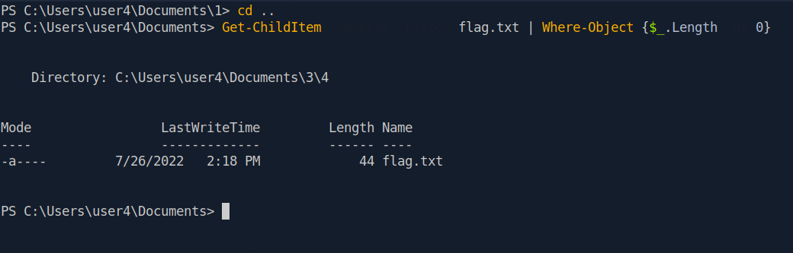

Un solo resultado. Accedemos a esa carpeta con `cd`, corroboramos con `dir` y leemos la bandera con `type`:

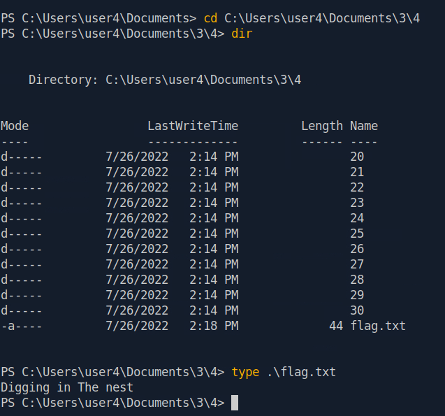

**Question 5 —** *User4 has a lot of files and folders in their Documents folder. The flag can be found within one of them.*

**R:** `Digging in The nest`

## Pregunta 6

Nos piden el número de usuarios en el sistema excluyendo `DefaultAccount` y `WDAGUtilityAccount`. Ya lo habíamos respondido indirectamente: `net user` dio un total de 16 usuarios, menos 2 excluidos.

**Question 6 —** *How many users exist on this host? (Excluding the DefaultAccount and WDAGUtility)*

**R:** `14`

## Pregunta 7

Al igual que la Q6, la respondimos indirectamente con la enumeración inicial.

**Question 7 —** *For this level, you need to find the Registered Owner of the host. The Owner name is the flag.*

**R:** `htb-student`

## Pregunta 8

Efectivamente era `user7` — el patrón se confirma. Pero hay un detalle nuevo respecto a las sesiones anteriores: el prompt ahora muestra `greenhorn\user7` y el perfil es `C:\Users\user7.GREENHORN>`. Esto indica que la autenticación fue contra el **dominio GREENHORN** (el Domain Controller) y no contra una cuenta local del host: el formato `DOMINIO\usuario` del prompt y el sufijo `.GREENHORN` en la carpeta de perfil son la evidencia de que estamos operando con una cuenta de dominio.

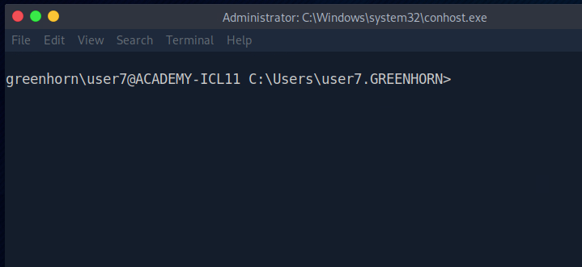

Nos conectamos vía SSH a la IP que se nos solicita:

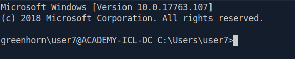

Ya adentro, como se nos solicita buscar módulos de PowerShell, accedemos a PowerShell:

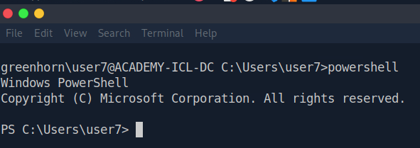

Buscamos los módulos cargados:

```powershell
Get-Module
```

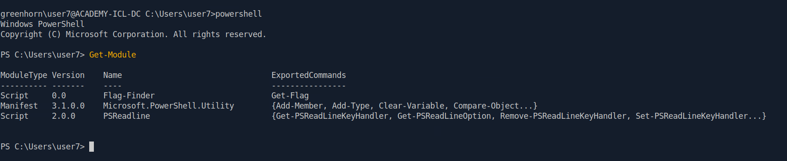

Parece que encontramos lo que buscábamos: la respuesta está dentro de uno de esos módulos. Ejecutamos el cmdlet que aparece ahí, `Get-Flag`:

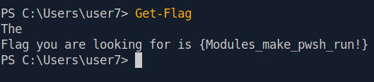

**Question 8 —** *For this level, you must successfully authenticate to the Domain Controller host at 172.16.5.155 via SSH after first authenticating to the target host. This host seems to have several PowerShell modules loaded, and this user's flag is hidden in one of them.*

**R:** `Modules_make_pwsh_run!`

## Pregunta 9

Nos piden encontrar un usuario con `GivenName` relacionado a "flag", así que escribimos:

```powershell
Get-ADUser -Filter "GivenName -eq Flag"
```

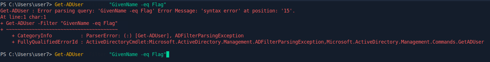

Error de sintaxis. Revisando mis apuntes, faltaban comillas simples alrededor del valor:

```powershell
Get-ADUser -Filter "GivenName -eq 'Flag'"
```

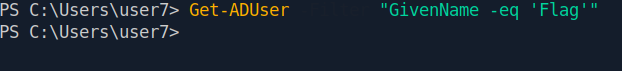

Sin resultados. Leyendo de nuevo la pregunta, noté que leí mal el enunciado: el criterio de búsqueda es **Surname** y el dato a extraer es **GivenName**. El comando correcto:

```powershell
Get-ADUser -Filter "Surname -eq 'Flag'"
```

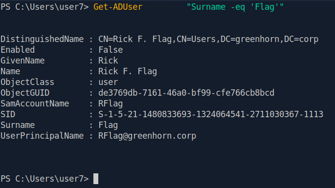

Esta vez sí hay resultado, con lo que respondemos la pregunta 9.

**Question 9 —** *This flag is the GivenName of a domain user with the Surname "Flag".*

**R:** `Rick`

## Pregunta 10

Nos piden filtrar procesos y encontrar uno que empiece por "vm". Cambiamos de usuario y, ya como user9, ejecutamos:

```powershell
tasklist | Sort-Object -Descending | Select-String "vm"
```

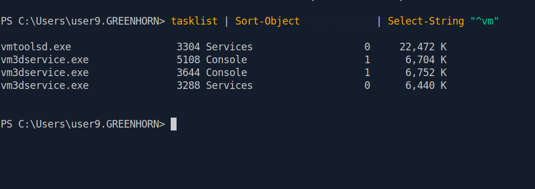

**Question 10 —** *Use the tasklist command to print running processes and then sort them in reverse order by name. The name of the process that begins with "vm" is the flag for this user.*

**R:** `vmtoolsd.exe`

## Pregunta 11

La última pregunta nos lleva a revisar los logs: una falla de logon con ID 4625:

```powershell
Get-WinEvent -FilterHashtable @{LogName='Security'; ID=4625}
```

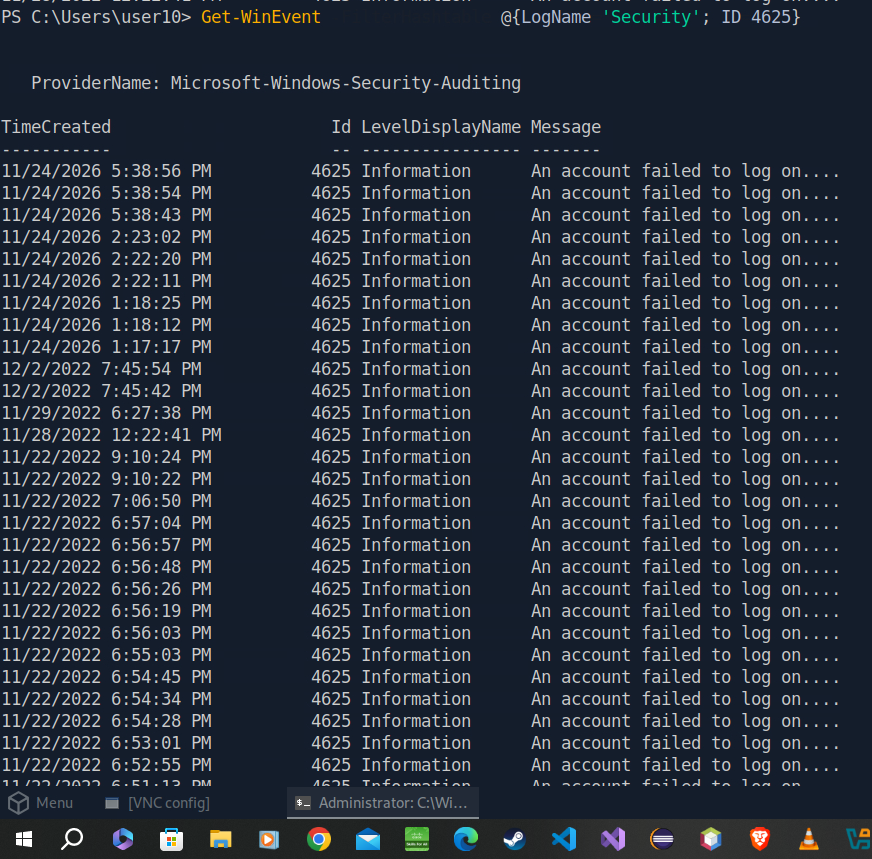

No es el resultado esperado, así que buscamos una manera distinta de filtrar.
*Pd: los fallidos de 2026 son míos, de cuando escribí mal las contraseñas — esos usuarios quedan descartados.*

Eso arrojó demasiada información y además difícil de leer, así que filtramos por la ventana del burst (22/11/2022, 6:50 PM a 7:00 PM) y expandimos el mensaje:

```powershell
Get-WinEvent -FilterHashtable @{LogName='Security'; ID=4625} | Where-Object {$_.TimeCreated -gt '11/22/2022 6:50 PM' -and $_.TimeCreated -lt '11/22/2022 7:00 PM'} | Select-Object -ExpandProperty Message
```

¿Qué hace? Filtra por tiempo (del 22/11/2022 entre las 6:50 PM y las 7:00 PM) y extiende el mensaje completo de cada evento con `-ExpandProperty`.

No pongo screenshot porque no es ninguno de esos usuarios. Releyendo, la pregunta menciona que la cuenta es **en el Domain Controller**, así que me conecto nuevamente por SSH a `172.16.5.155` dado que ya agote mis opciones de búsqueda de este lado.

Finalmente, en el DC, ejecutamos un comando con un filtro todavía más específico:

```powershell
Get-WinEvent -FilterHashtable @{LogName='Security'; ID=4625} | Group-Object {$_.Properties[5].Value} | Sort-Object Count -Descending | Select-Object Count, Name
```

¿Qué hace? `{$_.Properties[5].Value}` extrae exactamente el nombre de usuario que falló el inicio de sesión dentro de cada evento 4625; `Sort-Object Count -Descending` ordena el resultado de manera descendente; y `Select-Object Count, Name` muestra solo el número de intentos y el nombre.

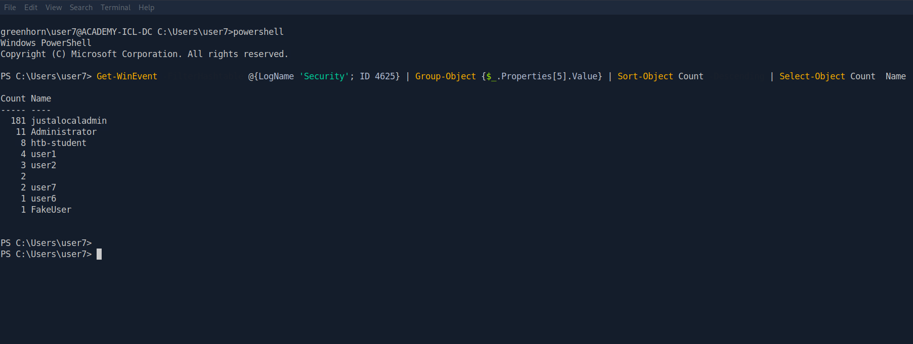

Esto da la respuesta final: `justalocaladmin` con 181 intentos fallidos — un indicador claro de ataque de fuerza bruta.

**Question 11 —** *What user account on the Domain Controller has many Event ID (4625) logon failures generated in rapid succession, which is indicative of a password brute forcing attack? The flag is the name of the user account.*

**R:** `justalocaladmin`

## Lecciones o errores

- **Validar la cadena login a login**: responder la pregunta en la plataforma no verifica el eslabón de credenciales; los saltos que di por sentado (user5, user6) eran justo donde una cadena real se rompe.
- **Case-sensitive**: el hostname se aceptó como respuesta en minúscula, pero como password exigía el case exacto (`ACADEMY-ICL11`).
- **El paso "extra" del enunciado es el desambiguador**: el sort inverso de Q10 existe para ordenar la búsqueda, no como decoración.
- **Procesos de servicio vs. de sesión**: los servicios (session 0) se ven iguales desde cualquier usuario; los filtros `STATUS`/`WINDOWTITLE` de `tasklist` no funcionan en remoto.
- **La tabla trunca**: `Select-Object -ExpandProperty Message` muestra el contenido completo de un evento.
- **Filtrar después del pipe**: si el filtro no existe en el `FilterHashtable`, `Where-Object` sobre `TimeCreated` (o cualquier propiedad) hace el trabajo.
- **Leer el enunciado completo**: decía "on the Domain Controller" y el análisis se hizo en el host equivocado; el DC tenía su propio Security log con la respuesta.
- **No autoinculparse**: los 4625 propios quedan en el log  descartarlos antes de analizar.
