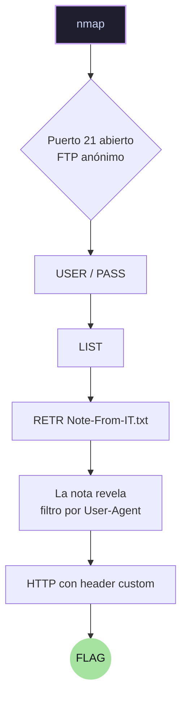

**Módulo:** Introduction to Networking (HTB Academy) — skills assessment  
**Fecha:** 2026-10-16 (sesión) / repaso 2026-10-21

## Objetivo

Comprender cómo habla el protocolo FTP sin clientes — a mano con netcat.

## Cadena de ataque



## Recon previo (nmap)

Antes de hablar con el FTP, mapeé la máquina:

```bash

nmap 10.129.233.197
# → 21, 80, 135, 139, 445, 3389, 5357 abiertos (Windows: msrpc, netbios, SMB, RDP)

nmap -p21,80 -sC -sV 10.129.233.197
# -sC: scripts por defecto · -sV: detección de versión
# → Microsoft ftpd + ftp-anon: Anonymous FTP login allowed (FTP code 230)
```
El script `ftp-anon` de nmap me dijo que el FTP aceptaba login anónimo — ni siquiera tuve que probarlo a mano para saberlo.

## Qué hice (resumen)

Requerí de usar 2 terminales para realizar este laboratorio en la que la **Terminal 1** fue el canal de control mientras que la **Terminal 2** fue el canal de datos.

**Terminal 1 canal de control (puerto 21):**

```bash
nc <ip> 21
USER anonymous[Ctrl+V][Enter][Enter]
PASS anything[Ctrl+V][Enter][Enter]
PASV → 227 Entering Passive Mode (10,129,233,197,194,14)
```

**Terminal 2  canal de datos (puerto efímero):**
```bash
nc -v <ip> 49678        ← 194*256 + 14 = 49678
```
**¿De dónde sale el puerto de Terminal 2? **

Cuando envío `PASV` por el canal de control, el servidor responde:
`227 Entering Passive Mode (10,129,233,197,194,14).`
 
Los **últimos dos números** (194 y 14) son el puerto de datos dividido en dos
bytes. El puerto real es `p1×256 + p2` = **49,678**.

En Terminal 2 solo abro ese puerto y espero — el contenido (listado, archivo)
viaja por ahí, no por el 21. Cada `PASV` nuevo = puerto nuevo.

**De vuelta a la terminal 1**:
```bash
LIST  → 125/226 → el listado aparece en T2
PASV  → nuevo puerto efímero → nueva T2
RETR Note-From-IT.txt → contenido en T2
```

 **Qué falló y cómo lo resolví**
 1. **Connection refused en el puerto de datos** → había cerrado el canal de control; el puerto pasivo solo vive mientras vive su PASV
    
2. **500 / 451 en comandos** → FTP exige `\r\n`; Enter solo manda `\n` (truco: Ctrl+V luego Enter dos veces)
    
3. **Volver a ejecutar PASV** → cada PASV invalida el puerto anterior

**Key takeaways**

- FTP = 2 canales: control (órdenes) + datos (contenido). Por eso existe el cálculo raro: el puerto de datos se anuncia dentro del canal de control (protocolo de los 70s)
    
- `p1*256 + p2` = puerto de datos
    
- netcat habla el protocolo crudo: `exit` no existe, se envía literal; Ctrl+C para salir
    
- El cliente (browser, ftp.exe) hace esto por ti — hablarlo a mano te deja VER lo que el cliente esconde (banners, headers, comentarios HTML)

 **Códigos FTP que aprendí**
 
|Código|Significado|
|:--|:--|
|220|servicio listo (banner)|
|230|login OK|
|331|usuario OK, necesita pass|
|227|modo pasivo, puerto anunciado|
|125/150|datos, transfiriendo|
|226|transferencia completa|
|500|comando no entendido|
|530|no logueado|
|451|parámetro incorrecto|

**Blue Team: ¿cómo lo detectaría?**

[x] Login FTP anónimo en logs — ¿legítimo en mi red? 
[x] Beaconing: conexiones repetidas a puertos efímeros altos 
[x] `RETR` de archivos .txt en un FTP que no debería leerse 
[x] Tráfico HTTP con User-Agent inusual ("Server Administrator" no es un UA de browser)

**Idea grande**

> Hackear = hablar el protocolo del servicio a mano. La información sensible (nota interna) estaba en un servicio "inocente" (FTP anónimo) — recon → información → explotación de mala config.
