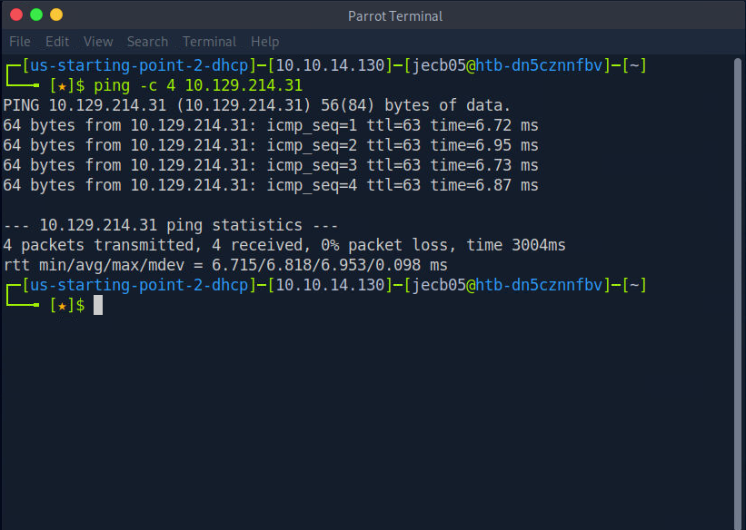
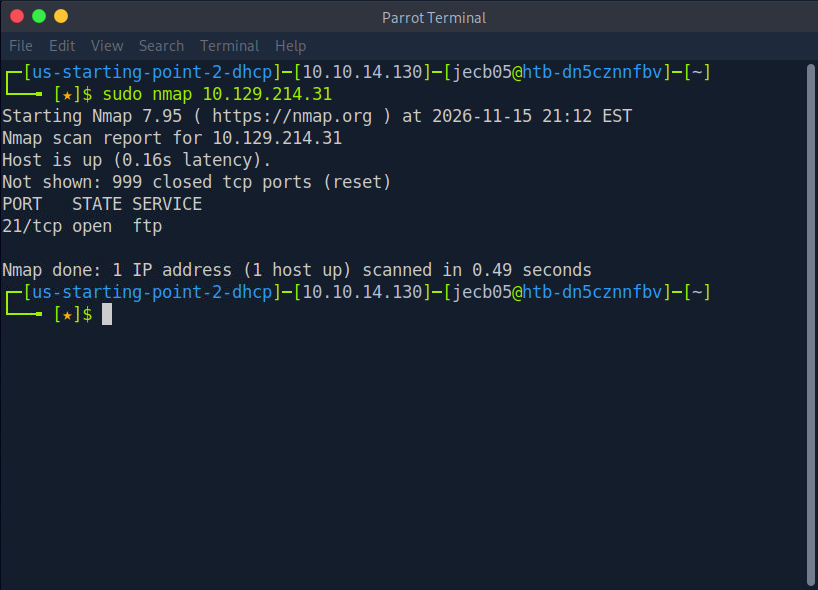
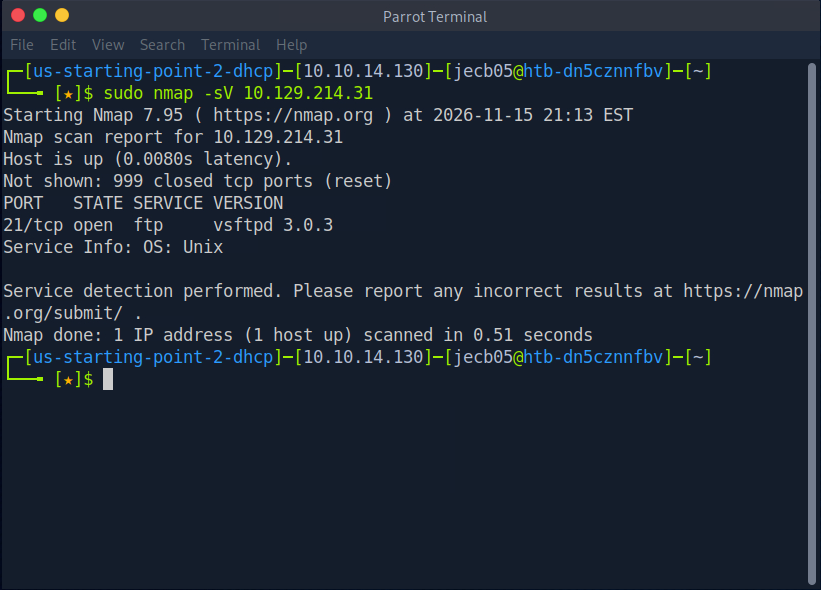
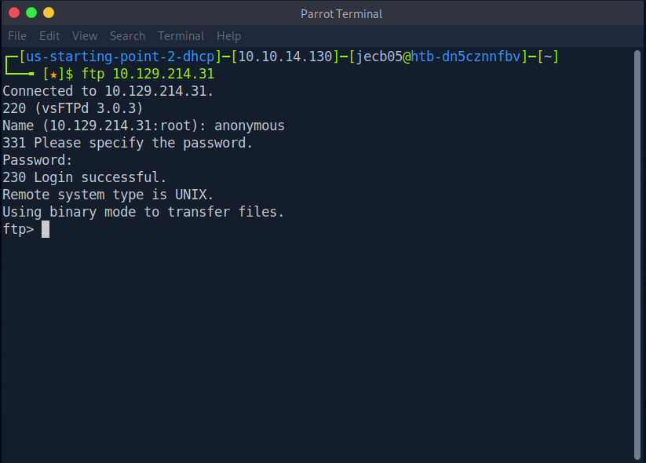
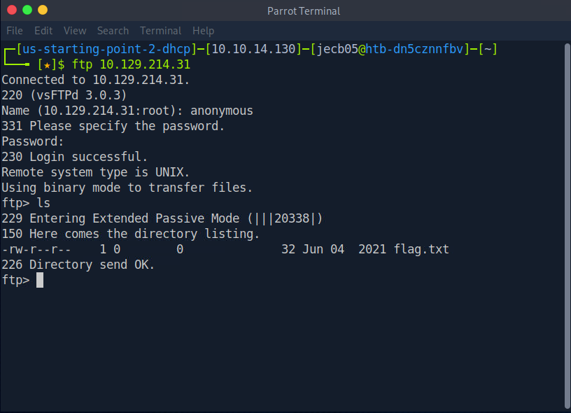
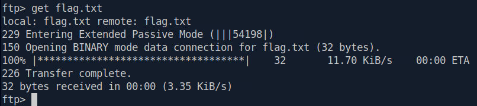
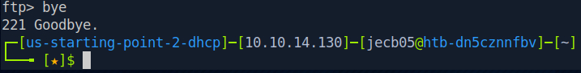
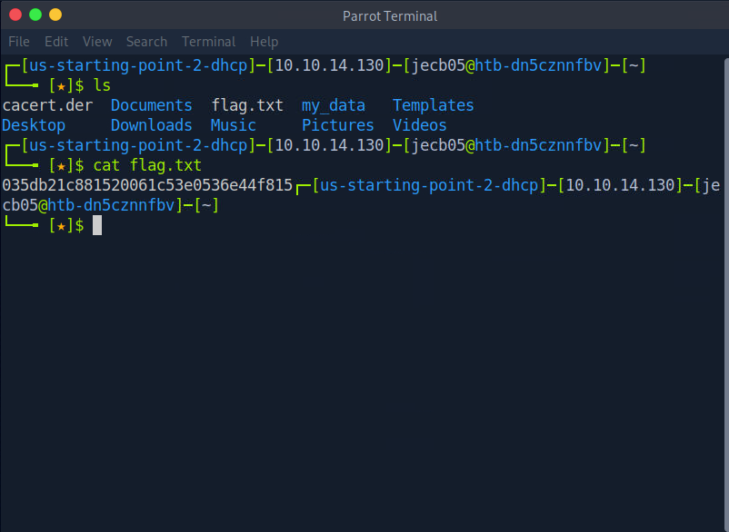

**HTB Starting Point — Tier 0 | Very Easy | Linux**

## Contexto
Fawn expone un servicio FTP (puerto 21) mal configurado: permite acceso anónimo con lectura de archivos. El objetivo es practicar el flujo mínimo de ataque: 
reconocimiento → identificación de servicio → explotación de mala configuración → captura de la flag.

## Enumeracion

### Reconocimiento inicial

Primero hacemos un `ping` a la ip del objetivo, en este caso 10.129.214.31, con el objetivo de identificar si el objetivo existe y recibe y devuelve paquetes. En este caso usamos:

```bash
ping -c 4 10.129.214.31
```
       
El argumento `-c 4` es para enviar únicamente 4 paquetes. A diferencia de Windows, en Linux `ping` no se detiene solo: envía paquetes indefinidamente hasta que hagamos `ctrl+c`.



Siguiendo con el reconocimiento inicial utilizamos nmap sin argumentos en este caso identificamos lo que ya sabiamos y es que hay un servicio de `FTP` abierto  escuchando en el puerto 21



Luego para un recon mas especifico y/o amplio usamos nmap con el argumento -sV identificamos la version de FTP que usa, en este caso el argumento `-sV` es la abreviatura de ***Service/Version Detection***, que le indica a Nmap que sondee los puertos abiertos para descubrir qué servicio exacto y qué versión están corriendo.


> **Hallazgo:** vsftpd 3.0.3 corriendo sobre Unix. `-sV` toma más tiempo pero revela la versión exacta del servicio, clave para saber si existe exploit público o si toca abusar de la configuración.

## Acceso inicial

Nos conectamos al objetivo mediante FTP corriendo el siguiente comando
```bash
ftp 10.129.214.31
```

utilizamos el usuario `anonymous`

> **Por qué funciona:** el FTP anónimo es una cuenta legacy diseñada para acceso público de solo lectura. Cuando un admin la deja habilitada sin restricciones, cualquiera puede listar y descargar archivos. La contraseña se ignora (se acepta cualquiera o vacía).

Al ser un SO basado en unix listamos los archivos como en cualquier distro basada en  unix el cual seria `ls` en lo que evidenciamos:

> **Hallazgo:** `flag.txt` expuesto en el directorio raíz del FTP.

## Captura de la flag

Ahora para obtener la bandera hacemos uso del comando `get` descargando el archivo desde el objetivo

Y salimos de el objetivo con el uso del comando `bye`

finalmente listamos los archivos de nuestra maquina donde vemos el `flag.txt` y luego visualizamos su contenido con `cat`

finalmente capturando la bandera

## Lecciones
- **FTP viaja en claro** (sin cifrado): usuario, contraseña y contenido se transmiten en texto plano. En un entorno real, un atacante con un capturador de red como Wireshark los lee sin esfuerzo. La alternativa segura es SFTP (tunneado por SSH, puerto 22) o FTPS (FTP + TLS).

- **`anonymous` habilitado = mala configuración clásica.** En assessments reales siempre probar `anonymous` / password vacía en FTP primero.
- **Flujo mínimo replicable:** `ping` → `nmap` → `nmap -sV` → interacción con el servicio → `get`. Este esqueleto aplica a casi cualquier máquina de Starting Point(Siguiendo un flujo basico de recon y luego ganar acceso).
- Comandos FTP útiles para el toolbox: `ls` (listar), `get` (descargar), `put` (subir), `bye` (salir).

## Preguntas de la máquina


1. **What does the 3-letter acronym FTP stand for?**  File Transfer Protocol
2. **Which port does the FTP service listen on usually?**  21
3. **FTP sends data in the clear. What acronym is used for a later protocol designed to provide similar functionality securely, as an extension of SSH?**  SFTP
4. **What command sends an ICMP echo request to test our connection to the target?**  ping
5. **From your scans, what version is FTP running on the target?**  vsftpd 3.0.3
6. **From your scans, what OS type is running on the target?**  Unix
7. **What command displays the 'ftp' client help menu?**  `ftp -?`
8. **What username is used over FTP to log in without an account?**  anonymous
9. **What is the response code for the FTP message 'Login successful'?**  230
10. **Besides `dir`, what common Linux command lists files on the FTP server?**  ls
11. **What command downloads the file found on the FTP server?**  get

**Flag:** root flag owned 