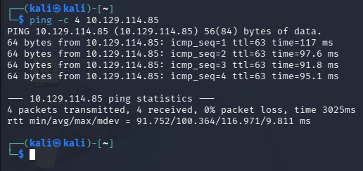
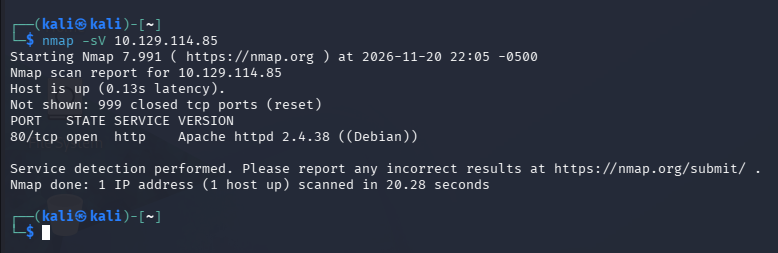
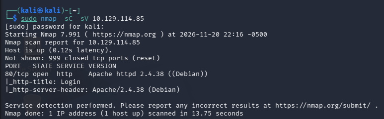
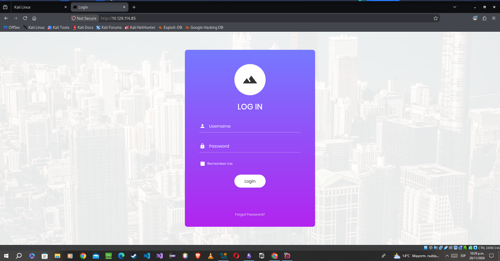
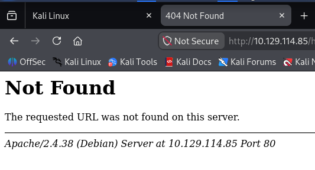
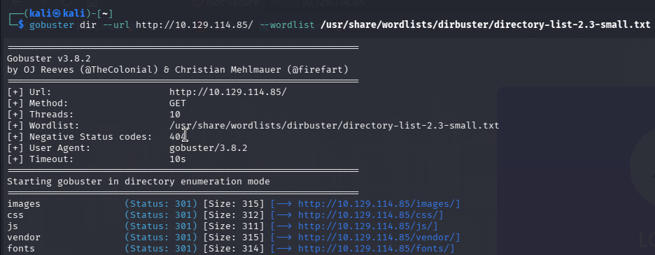
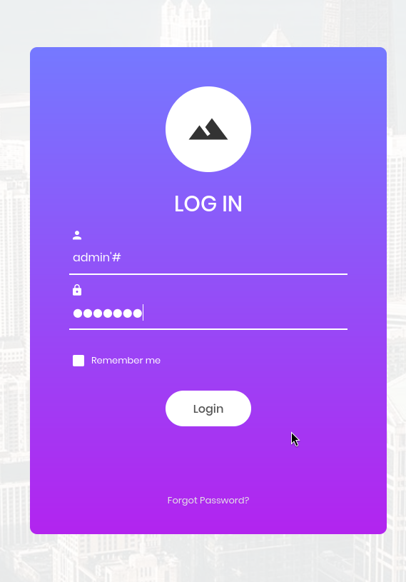
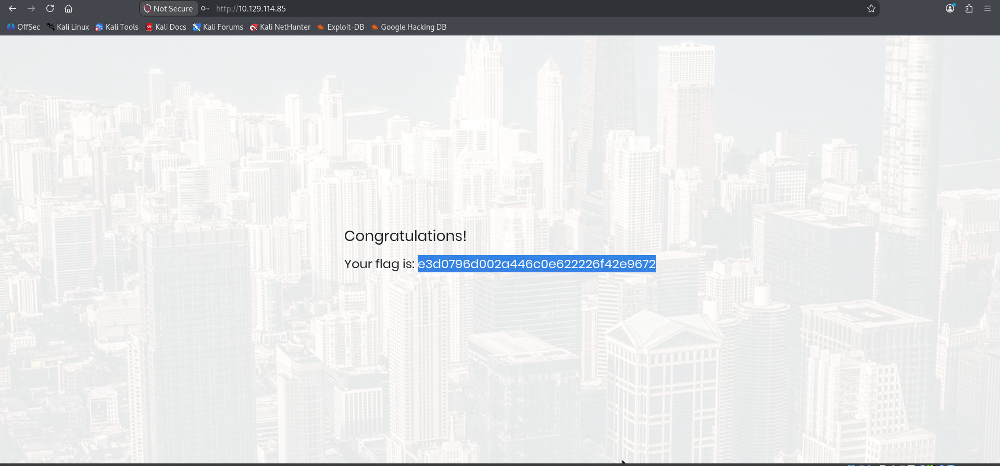

# Appointment Write-up
**HTB Starting Point — Tier 1 | Very Easy | Linux**

## Contexto
Appointment nos introduce a la **inyeccion SQL**, un concepto clave en la explotacion de aplicaciones web: nos permite inyectar codigo SQL en la base de datos del objetivo con el fin de acceder a ella o hacer bypass de su login.

## Enumeracion

Siempre hay que verificar conectividad con el objetivo, puesto que si no hay conectividad simplemente no hay mucho que se pueda hacer. Por eso como reconocimiento activo inicial simplemente hacemos un:

```bash
ping -c 4 10.129.114.85
```



Observamos que efectivamente la IP objetivo recibe y devuelve paquetes, por lo que concluimos que la conexion es exitosa.

&gt; [!Nota] No en todos los casos nos servira el ping, dado que este envia paquetes ICMP y en muchos casos los firewalls suelen estar configurados para bloquearlos. Un ping fallido no es indicio automatico de que el objetivo no exista, pero en labs como estos se hace para corroborar que la conexion funciona y podemos avanzar.

Bien, continuando con la enumeracion y el reconocimiento activo lanzamos un:

```bash
nmap -sV 10.129.114.85
```

Esto con el fin de averiguar: 1) que puertos tiene abiertos (cuando se lanza nmap solo con ese argumento o sin argumentos adicionales, mapea los 1000 puertos mas comunes) y 2) que servicios y version de servicios estan escuchando en estos puertos. Eso nos permite identificar cual es nuestra superficie de ataque (para red team) o auditar que servicios pueden estar desprotegidos, parcharlos y reducir la superficie en la que nos pueden atacar (blue team).



&gt; **Hallazgo:** Observamos que tras el escaneo de nmap hay un servicio `http` escuchando en el puerto 80, especificamente un servidor Apache version 2.4.38 hosteado en un sistema Debian.

Tras esto ejecutamos nuevamente nmap, pero esta vez agregamos el argumento `-sC`. Que hace este argumento? Ejecuta los scripts por defecto que trae nmap para hacer un levantamiento de informacion mas detallado, por lo que lanzamos:

```bash
sudo nmap -sC -sV 10.129.114.85
```

&gt; [!Nota] En este caso usamos `sudo` y damos privilegios a nmap para que este pueda ejecutar sus scripts sin problema.



&gt; **Hallazgo:** Nuevamente nos topamos con el servidor Apache escuchando en el puerto 80, pero esta vez logramos identificar que este servidor contiene un **login** (el script http-title lo revela).

Por que lanzar un nmap sobre un objetivo que es un servicio web? Al recabar informacion sobre que servicios estan escuchando en que puerto, podemos saber como atacar a un objetivo y abordar inteligentemente el ataque en vez de lanzar herramientas a lo loco. Esto con el fin de mantener el sigilo, tener mejor idea de como operar como lo haria un atacante real, e investigar que vulnerabilidad afecta a X servicio segun que version de este se encuentra instalada.

Bien, habiendo hecho este reconocimiento inicial y habiendo identificado que nuestro objetivo cuenta con un servidor Apache, pasamos al navegador donde escribimos la IP de nuestro objetivo:



Vemos efectivamente que nos lleva a una pagina web con un login.

Dado que no tenemos credenciales para acceder, continuamos con la enumeracion del sitio web para averiguar con que vulnerabilidades cuenta, como en este lab la **inyeccion SQL**. Para esto podemos ir a la URL del objetivo y cambiar la ruta: por ejemplo `/login`, `/home`, `/login/forgot`, `/contact`, entre otras. Este proceso suele ser sencillo porque los desarrolladores solemos nombrar los directorios de forma predecible (buenas practicas o semantica universal). Por que se hace esto? A veces los desarrolladores olvidamos algun recurso o directorio que puede contener informacion util, aunque este oculto — y oculto no significa protegido. Esto permite al atacante buscar mas vectores de ataque, porque generalmente no se conforma con un solo punto, al menos no durante la fase de reconocimiento.

Ejemplo:



&gt; **Hallazgo:** Aca podemos ver que, si bien la pagina devolvio un error 404 (no encontrado), nos arroja la misma informacion crucial que el reconocimiento con nmap: `Apache/2.4.38 (Debian) Server at 10.129.114.85 Port 80` — y esto sin lanzar comandos, lo cual es relativamente mas discreto al no generar paquetes de red.

Podriamos tirarnos una eternidad en esto, pero como el lab esta enfocado en la inyeccion SQL, proseguimos con **Gobuster**: una herramienta programada en Go cuyo proposito es lanzar ataques de fuerza bruta contra directorios, en base a una lista o *wordlist* de nuestra eleccion.

Dado que gobuster necesita una wordlist para funcionar (no adivina rutas), bien podriamos redactarla nosotros mismos —lo cual llevaria tiempo y demasiado trabajo— o usar una ya existente. Como la mayoria de desarrolladores nombra los directorios de forma predecible, estas listas son bastante estandarizadas. La coleccion mas conocida es **SecLists**: https://github.com/danielmiessler/SecLists

Hay 2 formas de instalarla. La primera:

```bash
# Clona el repo en la ruta actual (genera desorganizacion si es tu home)
git clone https://github.com/danielmiessler/SecLists.git
```

La otra es usar el gestor de paquetes de Kali, que la deja en una ruta estandar del sistema:

```bash
sudo apt update && sudo apt install -y seclists
# queda en /usr/share/wordlists/seclists
```

Habiendo hecho eso, usamos gobuster asi:

```bash
gobuster dir --url http://10.129.114.85/ --wordlist /usr/share/wordlists/seclists/Discovery/Web-Content/directory-list-2.3-small.txt
```



Gobuster no nos llevo a mucho: solo mostro directorios comunes (`/images`, `/css`, `/js`, `/vendor`, `/fonts`) que cualquier sitio web podria tener. Pero eso no significa que en todos los casos sea asi — explorar directorios puede llevar a informacion util en muchas ocasiones, por eso el paso no se salta.

## Acceso inicial

Antes de hacer ataques de fuerza bruta —que en muchos casos son muy ruidosos— primero probamos con credenciales por defecto o comunes en el panel de login: `admin:admin`, `administrator:password`, `root:root`, `user:user`, `guest:guest`.

**Resultado:** ninguna funciono. Esto suele pasar porque hoy en dia se usan contrasenas mas seguras, pero nunca se sabe.

Bien, ahora si entramos en materia con la **inyeccion SQL para bypass de autenticacion**. Dado que el login falla con credenciales comunes, probamos si el formulario valida correctamente las entradas o si es vulnerable a SQLi.

* **Por que funciona?** Digamos que el backend construye la consulta SQL concatenando directamente lo que escribe el usuario sin sanitizarlo, algo tipo:
```sql
SELECT * FROM users WHERE username='usuario' AND password='contrasena'
```
* **El truco:**
1. Usamos una comilla simple (`'`) para cerrar el campo del usuario antes de tiempo.
2. Usamos el simbolo numeral (`#`) para comentar el resto de la consulta SQL, haciendo que la base de datos ignore por completo la verificacion de la contrasena.



* **Payload utilizado:**
    * **Username:** `admin'#`
    * **Password:** `cualquiercosa` (ej. `jijijaja`)
* **Consulta resultante en el servidor:**
```sql
SELECT * FROM users WHERE username='admin'#' AND password='jijijaja'
```
*(Al existir el usuario `admin`, la consulta devuelve 1 fila valida y nos da acceso directo sin contrasena.)*

Lo que finalmente nos lleva a capturar la bandera:



## Lecciones
- **Orden de operaciones web:** recon → credenciales default → SQLi manual → recien ahi fuerza bruta (la mas ruidosa va al final). El writeup lo marca como opcional, pero el gobuster es paso estandar de enumeracion web.
- **El banner del servidor se filtra hasta en los 404** — una sola request al navegador te dice el servidor y version. Menos ruido que nmap (aunque nmap da mucho mas contexto).
- **La SQLi de login mas basica del mundo** es `usuario'#`: cierra la string, comenta el chequeo de password. Contra cualquier login que concatene sin sanitizar, entras como el primer usuario valido que pruebes.
- Mitigaciones que el writeup menciona y conviene conocer: input validation, *parameterized queries*, stored procedures y WAF. La cura real es la query parametrizada — nunca confiar en el input del usuario.

## Conexión con...
- Tercera máquina donde el acceso no requiere exploit ni shell: despues de FTP/SMB/Redis anonimos, aca es una **vulnerabilidad de la aplicacion web** (OWASP Top 10). El Tier 1 sube la complejidad: ya no basta con conectarse, hay que entender como habla la app con su base de datos.
- El writeup sugiere el modulo **Web Requests** de Academy para entender GET/POST y codigos 200/302/404 — te conviene para las proximas maquinas web.