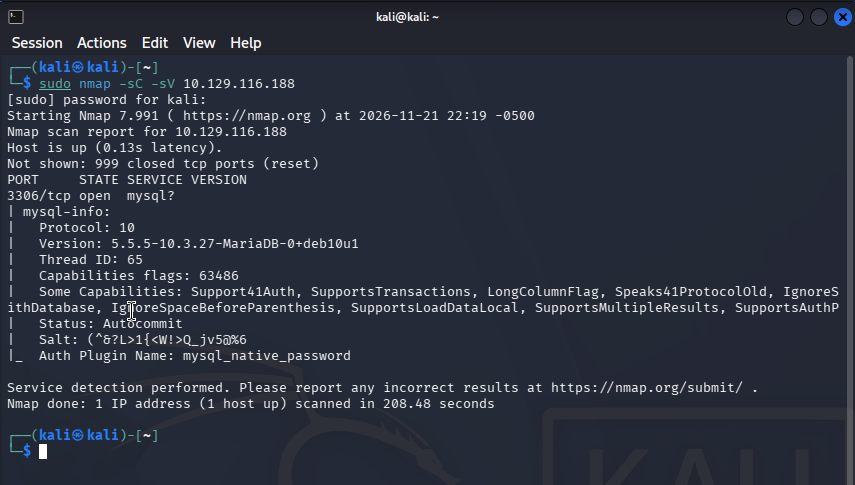
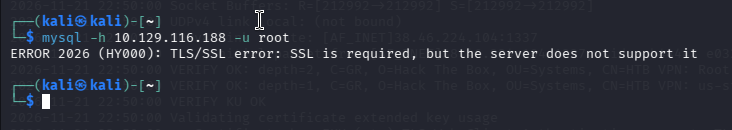
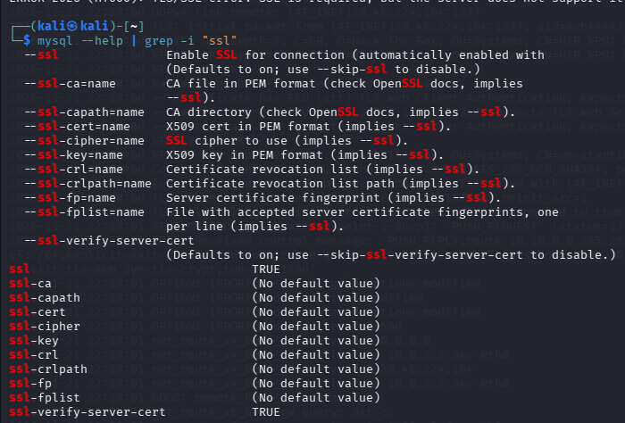
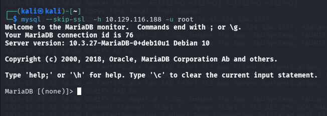
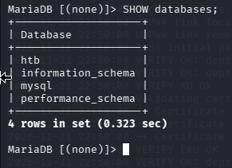
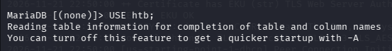
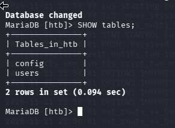
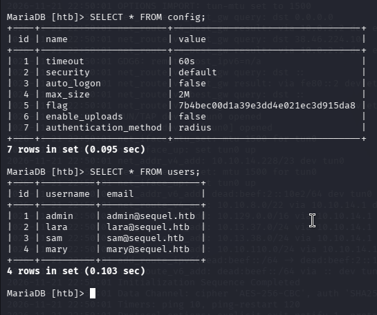

# Sequel Write-up
**HTB Starting Point — Tier 1 | Very Easy | Linux**

## Contexto
Sequel continua el tema de las bases de datos, especificamente las bases de datos **relacionales** o tambien llamadas bases de datos SQL. Es muy importante saber movernos en este tipo de entornos: de que nos sirve haber vulnerado la base de datos si no sabemos como encontrar la informacion util para nuestro proposito.

## Enumeracion

Iniciamos con un reconocimiento activo, nuevamente como en laboratorios anteriores, con nmap ejecutando:

```bash
sudo nmap -sC -sV 10.129.116.188
```



&gt; **Hallazgo:** Podemos observar que hay un servicio `MySQL` escuchando en el puerto 3306 — especificamente estamos tratando con **MariaDB**, que podriamos decir que es una bifurcacion (*fork*) de MySQL: creada por los desarrolladores originales de MySQL al separarse de Oracle, compatible pero proyecto independiente. En este caso la version es 10.3.27. Entre otra informacion como las capacidades que trae, el dato relevante es `Auth Plugin Name: mysql_native_password`: es el plugin de autenticacion clasico de MySQL (el metodo con el que el servidor hashea y verifica contrasenas). Lo que nos indica que podemos intentar autenticarnos de forma remota es el propio puerto 3306 abierto.

## Acceso inicial

Para comunicarnos con este servicio usamos un cliente gestor de este tipo de base de datos: `mysql` o `mariadb`. Teniendo el panorama general del objetivo, ejecutamos:

```bash
mysql -h 10.129.116.188 -u root
```

`-h` se usa para especificar el host al que nos conectamos y `-u` para el usuario con el que nos autenticamos. En este caso usamos `root`, dado que al ser un usuario por defecto existe la posibilidad de que nos autentiquemos con el.



&gt; **Hallazgo:** Sufro un error al intentar acceder al servicio por una diferencia de epocas: el lab es antiguo y el servicio a su vez lo es, por lo que no soporta cifrado SSL. Mi maquina, al tener una version mas moderna de MySQL, es mucho mas estricta con eso — por eso salta `ERROR 2026 (HY000): TLS/SSL error: SSL is required, but the server does not support it`.

Como lo solucionamos? Podriamos preguntarle a la IA, o simplemente usar los mismos comandos de administracion de Linux: la ayuda integrada de la herramienta.

```bash
mysql --help | grep -i "ssl"
```

Aca usamos el panel de ayuda por defecto que traen las herramientas de Linux, filtrando con `grep` para que solo arroje resultados relacionados a `SSL` (uso `-i` para que no distinga mayusculas/minusculas y la busqueda sea mas eficiente).



&gt; **Hallazgo:** En las primeras lineas aparece `--ssl` y su contraparte `--skip-ssl`, que desactiva el uso de SSL en el cliente. Probamos con ese argumento para conectarnos nuevamente:

```bash
mysql -h 10.129.116.188 -u root --skip-ssl
```



En este caso la conexion funciono correctamente (root **sin password** — la mala configuracion del servicio), por lo que pasamos a hacer recon dentro del sistema objetivo.

Primero revisamos que bases de datos existen en el servidor:

```sql
SHOW databases;
```



&gt; **Hallazgo:** Hay 4 bases de datos en total, con matices: 3 son internas del sistema (vienen por defecto: `information_schema`, `mysql`, `performance_schema`) y 1 personalizada, que es `htb`. Tener en cuenta esto es importante para no perder tiempo buscando donde no hay informacion util.

Dado que la base de datos que nos interesa es `htb`, la seleccionamos:

```sql
USE htb;
```



Ahora para listar su contenido:

```sql
SHOW tables;
```



&gt; **Hallazgo:** Tiene 2 tablas creadas: una llamada `config` y otra llamada `users`.

Finalmente, para ver el contenido de estas tablas:

```sql
SELECT * FROM config;
```



&gt; **Hallazgo:** Con esta consulta encontramos la bandera dentro de la tabla `config`. Revisamos la otra tabla tambien, lo cual nos lleva a terminar el lab.

## Lecciones
- **`--skip-ssl` te salva con servicios viejos**: clientes modernos exigen SSL por defecto; labs antiguos no lo soportan. Antes de googlear, `--help | grep` — la ayuda integrada responde mas rapido.
- **Flujo de navegacion SQL una vez dentro**: `SHOW databases;` → `USE &lt;db&gt;;` → `SHOW tables;` → `SELECT * FROM &lt;tabla&gt;;`. Aprendertelo de memoria: es el equivalente al `ls`/`cd`/`cat` de las bases de datos relacionales.
- **Reconoce las DBs default**: `information_schema`, `mysql`, `performance_schema` son del sistema; la info valiosa casi siempre esta en la DB custom.
- **root sin password en un servicio de red = game over**: cualquiera con acceso al puerto lee toda la base de datos.

## Conexión con...
- Appointment (ayer): mismo ecosistema SQL, pero ayer atacamos la app web que habla con la DB (SQLi), hoy hablamos **directo con la DB** porque el puerto 3306 esta expuesto. Dos vectores distintos al mismo tipo de objetivo.
- Redeemer (Redis): la navegacion es el mismo patron con otro dialecto — alli fue `info`/`select`/`keys *`/`get`, aca `SHOW`/`USE`/`SELECT`. Aprender la gramatica de cada motor es la habilidad transferible.